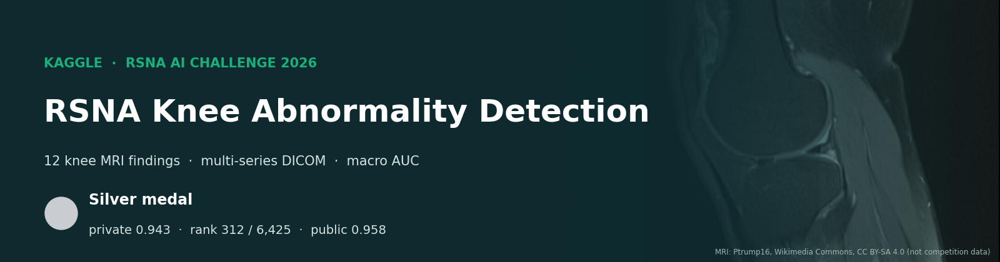

# RSNA Knee Abnormality Detection — 팀 Taeyang

[English README](README.md)

Kaggle 대회 [RSNA Knee Abnormality Detection](https://www.kaggle.com/competitions/rsna-knee-abnormality-detection)(2026년 7월 30일 - 10월 22일)의 작업 기록입니다. 무릎 MRI 검사(study)마다 12개 소견(인대·반월상연골 파열, 세 구획의 골관절염, 관절 삼출, 활막염, 베이커 낭종, 골 타박, 골절)의 확률을 예측하는 대회입니다.

| | 점수 | 순위 |
|---|---|---|
| 최종 Private | **0.943** | **312 / 6,425 — 은메달** |
| 최종 Public | 0.958 | 약 638 / 6,390 |
| Private 메달 기준선 | 금 0.954(22위), 은 0.943(321위), 동 0.942(642위) | |
| 상위 3팀 (Private) | Team Kangaroo 0.960, MURAD 0.960, DataTech Club 0.959 | 1-3 |

은메달 기준선보다 9계단 안쪽에서 마쳤습니다. 0.943보다 높은 팀이 311팀, 정확히 0.943으로 표시된 팀이 304팀이었고 우리는 그중 첫 번째였습니다. Public에서는 1,611팀이 0.958로 표시되었고 대부분 공개 0.958 레시피였습니다. 최종 제출 두 개는 공개 체크포인트(순위 가중치의 약 75-80 %)와 자체 모델(20-25 %)의 순위 블렌드입니다. 자체 모델은 ConvNeXt-S 2.5D 다중 인스턴스(MIL) 3개 체크포인트 묶음 "K1"이고, 두 제출 중 하나에는 이전 자체 묶음 "O"도 들어 있습니다. 두 최종 제출 모두 Private 0.943이었고, 다른 19개 제출도 0.943이었으며 이보다 높은 제출은 없었습니다. 팀 계정에는 9월 11일부터 10월 22일까지 134회 제출이 있으며, 그중 37회는 설명 없이 올린 임시·팀원 제출이라 이 기록에서 제외했습니다. 우리 파이프라인 제출 97회 중 점수 87회, 점수 없이 완료 8회, 오류 2회였습니다.

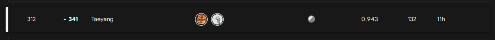

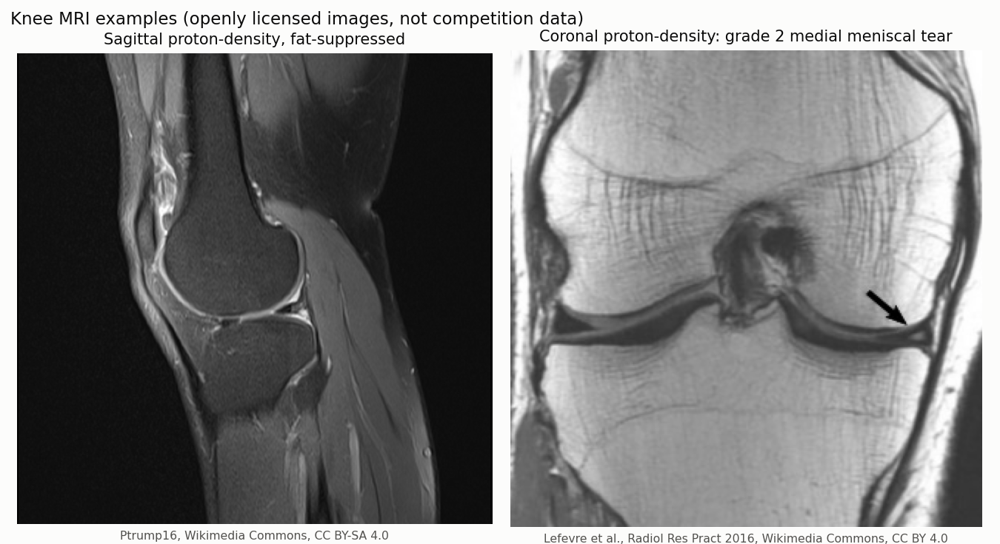

*이해를 돕기 위한 무릎 MRI 예시입니다. Wikimedia Commons의 공개 라이선스 이미지이며 **대회 데이터가 아닙니다**. 출처와 라이선스는 [NOTICE.md](NOTICE.md)에 있습니다. 이 저장소에는 대회 영상·라벨·판독문·예측을 공개하지 않습니다.*

## 대회 한눈에 보기

| | |
|---|---|
| 대회 | [RSNA Knee Abnormality Detection](https://www.kaggle.com/competitions/rsna-knee-abnormality-detection) (Kaggle Research Code Competition) |
| 주최 | 북미영상의학회(RSNA), RSNA 연례 학술대회 AI Challenge |
| 기간 | 2026-07-30 ~ 10-22 (최종 제출 23:59 UTC), 참가·팀 병합 마감 10-15 |
| 참가 규모 | 6,425팀, 참가자 7,683명, 제출 161,275회 |
| 상금 | 총 $77,000: 본선 1-10위($9,000 ~ $5,000)와 효율성 트랙 1-3위($7,000 / $6,000 / $5,000) |
| 데이터 | 12개 소견 판별용 무릎 MRI study(다중 시리즈 DICOM). 모든 영상 study에 원본 판독문이 짝지어진 첫 RSNA AI Challenge 데이터셋 |
| 타깃 | ACL, MCL, Medial Meniscus, Lateral Meniscus, Medial OA, Lateral OA, PF OA, Effusion, Synovitis, Baker's, Contusion, Fracture |
| 평가 | Macro AUC: 12개 타깃별 ROC AUC의 평균 |
| 제출 | `StudyInstanceUID`와 타깃별 확신도 열 12개로 된 `submission.csv` |
| 코드 조건 | Kaggle Notebook으로만 제출, CPU·GPU 노트북 실행 9시간 이하, 인터넷 차단, 무료로 공개된 외부 데이터와 사전학습 모델 허용 |
| 효율성 트랙 | 선택 제출을 private AUC와 실행 시간(초 / 32,400)을 함께 본 점수로 순위를 매깁니다. 우리 최종 실행은 약 6.8-8시간이라 대상으로 삼지 않았습니다 |
| 데이터 라이선스 | 대회 데이터는 Kaggle 대회 규칙과 RSNA MIRA 라이선스를 따르며, 규칙 4.b가 재배포를 금지합니다. 그래서 이 저장소에는 대회 영상·판독문·라벨·study ID가 없습니다 |

수상자는 Kaggle 기본 의무 외에 짧은 발표 영상, 공개 코드와 가중치, 공개 모델을 함께 내야 합니다. 우리는 수상 팀이 아니며, 이 저장소는 우리 자체 기록입니다.

**감사의 글.** 이 챌린지는 Po-Hao "Howard" Chen, Naveen Subhas(Cleveland Clinic)가 이끈 RSNA 팀이 조직했습니다. 다섯 대륙의 기관이 비식별화된 MRI와 판독문을 제공했고, Society of Skeletal Radiology와 International Skeletal Society 회원들이 라벨링을, 판독문·영상 QC 검토자들이 품질 검토를 맡았으며, MD.ai가 라벨링 도구를 지원했습니다. 전체 명단은 [대회 개요](https://www.kaggle.com/competitions/rsna-knee-abnormality-detection/overview)에 있습니다.

**인용** (주최 측 제공 형식):

> Po-Hao "Howard" Chen, Naveen Subhas, Robyn Ball, Pieter Baeyens, Errol Colak, Ali Emami, Hillary Garner, Jacob Kazam, Hui-Ming Lin, Luciano Prevedello, Daniel Schneider, Jason Sho, Ryan Holbrook, and María Cruz. RSNA Knee Abnormality Detection. https://www.kaggle.com/competitions/rsna-knee-abnormality-detection, 2026. Kaggle.

## 목차

1. [과제와 평가 방식](#1-과제와-평가-방식)
2. [기반으로 삼은 것과 우리가 더한 것](#2-기반으로-삼은-것과-우리가-더한-것)
3. [라벨: 출처와 재라벨링](#3-라벨-출처와-재라벨링)
4. [판정 기준, 게이트, 7-렌즈 판독](#4-판정-기준-게이트-7-렌즈-판독)
5. [앙상블을 정한 과정](#5-앙상블을-정한-과정)
6. [최종 제출](#6-최종-제출)
7. [세부 메커니즘](#7-세부-메커니즘)
8. [작업이 발전해 온 과정](#8-작업이-발전해-온-과정)
9. [검증](#9-검증)
10. [마지막 주, 실패와 실행 시간](#10-마지막-주-실패와-실행-시간)
11. [주요 관찰](#11-주요-관찰)
12. [상위 팀 전략 (상위 솔루션 공개 후 작성 예정)](#12-상위-팀-전략-상위-솔루션-공개-후-작성-예정)
13. [자기 피드백 (작성 예정)](#13-자기-피드백-작성-예정)
14. [AI 에이전트와 스킬을 쓴 방식](#14-ai-에이전트와-스킬을-쓴-방식)
15. [KneeOps 로컬 대시보드](#15-kneeops-로컬-대시보드)
16. [저장소 구성](#16-저장소-구성)
- [보고서와 탐색](#보고서와-탐색)

`D-B-264` 같은 ID는 대회 중 공유한 발견 기록 [`discoveries.md`](discoveries.md)(한국어 번역: [`discoveries.ko.md`](discoveries.ko.md))의 항목입니다. 모든 제출의 계열과 점수는 [docs/EXPERIMENTS.md](docs/EXPERIMENTS.md)(영문)와 [docs/data/submissions.csv](docs/data/submissions.csv)에 있습니다. 날짜는 별도 표기(KST)가 없으면 UTC(Kaggle 제출 시각)입니다. "표시 점수"는 Kaggle이 소수 셋째 자리로 반올림해 보여주는 점수를 뜻합니다.

## 1. 과제와 평가 방식

- **입력:** 한 study는 한쪽 무릎의 여러 DICOM 시리즈입니다(시상·관상·축 단면, 수분 강조 여부, 지방 억제 여부). 시리즈당 보통 20-45장이고 수백 장까지 긴 꼬리가 있습니다. JPEG Lossless, JPEG 2000 등 여러 전송 구문이 섞여 있습니다. 학습 study는 약 4,407개이고 여러 기관·장비·프로토콜에서 왔습니다.
- **라벨:** 공식 소견 라벨이 있는 학습 study는 **58개뿐**입니다("Gold58"). 나머지는 여러 언어의 판독문 원문만 주어지고 라벨은 참가자가 직접 만들어야 합니다. 숨은 정답은 정해진 중증도 규칙에 따른 영상 판독입니다(예: MCL은 급성 고도 부분파열 또는 완전파열만 양성, 저등급 염좌와 만성 변화는 음성, 삼출과 베이커 낭종은 중등도 이상만 양성).
- **테스트:** 약 1,300개의 숨은 study, 판독문 없음. Public은 약 30 %(약 390개), Private은 나머지(약 910개)입니다.
- **평가:** 12개 소견별 ROC AUC의 평균(macro AUC). 소견별 순서만 중요하므로 아래의 블렌드는 모두 순위로 계산합니다.
- **실행 시간:** 코드 대회, 인터넷 차단, 숨은 데이터 전체에 노트북 9시간 제한. Kaggle의 T4 x 2 세션을 사용했습니다.

## 2. 기반으로 삼은 것과 우리가 더한 것

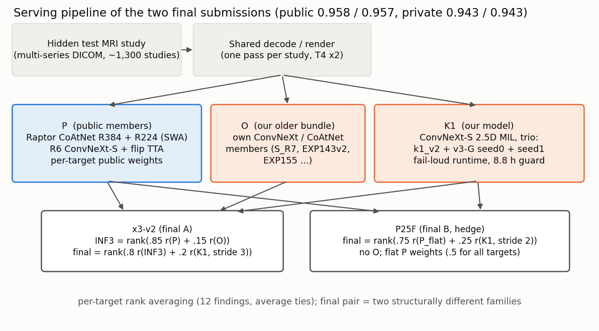

**기반으로 삼은 공개 작업**(출처와 라이선스는 [NOTICE.md](NOTICE.md)):

- nartaa의 전체 데이터 CoAtNet "Raptor" SWA 체크포인트 384 px·224 px(R384, R224; OAI 영상으로 미세조정);
- heliosli의 compact ConvNeXt-S 2.5D 묶음(S6 → R7 → 최종 R6 `fe055406`)과 heliosli OrthoFoundation 코드 데이터셋·공개 노트북의 서빙 코드;
- goodpjw2008의 공개 0.958 소견별 블렌드 가중치, R224 비중, flip TTA(evgendvorkin의 versia-7도 같은 레시피);
- dreaddevelopment의 Raptor 학습 레시피와 판독문 라벨("Dread"), riadmohamed42의 JEV 라벨 등 공개 라벨;
- jiweiliu·mattiaangeli의 0.943 추론 스택(10월 초 기준점)과 mattiaangeli의 DINOv3 fold 가중치(10월 21일 시험한 A5 멤버).

**외부 모델과 출처**(Kaggle 페이지는 10월 23일 Kaggle 공개 목록으로 확인했습니다. 모든 라벨 세트와 복사한 공개 스택의 입력까지 포함한 전체 목록은 [NOTICE.md](NOTICE.md)에 있습니다):

| 출처 (작성자) | Kaggle 페이지 | 용도 |
|---|---|---|
| Raptor CoAtNet SWA 체크포인트 R384, R224 (nartaa) | [데이터셋](https://www.kaggle.com/datasets/nartaa/rsna-knee-publication-swa-weights-20261007) | 두 최종 제출의 R |
| compact ConvNeXt-S 2.5D 묶음 R6 `fe055406` (heliosli) | [데이터셋](https://www.kaggle.com/datasets/heliosli/rsna-knee-r6-frozen-fe055406); 파일은 [rostigor](https://www.kaggle.com/datasets/rostigor/rsna-knee-r6-fe055406)의 버전 고정 사본에서 받음 | 두 최종 제출의 R6(비공개 사본) |
| OrthoFoundation 코드 데이터셋 (heliosli) | [데이터셋](https://www.kaggle.com/datasets/heliosli/rsna-orthofoundation-fold0-epoch7-20261004) | R6 서빙 코드, K1의 출발 trainer |
| 이전 compact 묶음 R7, S6 (heliosli) | [R7](https://www.kaggle.com/datasets/heliosli/rsna-knee-compact-r7cnxfsss), [S6](https://www.kaggle.com/datasets/heliosli/rsna-knee-compact-v1) | 10월 11-16일 compact 멤버 |
| 0.957 원클릭 노트북 (heliosli) | [노트북](https://www.kaggle.com/code/heliosli/0-957-latest-dataset-score-in-one-click) | S 분기 서빙 소스 |
| 공개 0.958 노트북 (goodpjw2008) | [노트북](https://www.kaggle.com/code/goodpjw2008/rsna-knee-coatnet-r6-2-5d-mil-lb-0-958) | w_t, R224 비중, flip TTA |
| 2.5D ConvNeXt reader (goodpjw2008) | [데이터셋](https://www.kaggle.com/datasets/goodpjw2008/rsna-knee-2-5d-convnext-reader) | overlay 시험(H-B-190) |
| RSNA_Versia_7 (evgendvorkin) | [노트북](https://www.kaggle.com/code/evgendvorkin/rsna-versia-7) | 읽기만 함 |
| 0.943 레시피와 DINOv3-S fold 가중치 (mattiaangeli) | [노트북](https://www.kaggle.com/code/mattiaangeli/bend-the-knee-to-speedy-raptors-the-original), [데이터셋](https://www.kaggle.com/datasets/mattiaangeli/knee-mri-fold-weights) | 기준 레시피, A5 멤버 |
| 0.943 fast 2xT4 추론 (jiweiliu) | [노트북](https://www.kaggle.com/code/jiweiliu/rsna-knee-fast-2xt4-inference) | 10월 2일 복사본 |
| 0.941 스택, probe22 preset (maverickss26) | [프로필](https://www.kaggle.com/maverickss26) (정확한 페이지 미확인) | 9월 11-12일 출발점 |
| Raptor 학습 레시피와 Dread 라벨 (dreaddevelopment) | [노트북](https://www.kaggle.com/code/dreaddevelopment/knee-mri-training-the-twelve-finding-model), [데이터셋](https://www.kaggle.com/datasets/dreaddevelopment/rsna-knee-labels) | 자체 CoAtNet 레시피, Dread 판정 기준, L2의 75 % |
| JEV 라벨 (riadmohamed42) | [데이터셋](https://www.kaggle.com/datasets/riadmohamed42/jev-knee-labels) | JEV hybrid 판정 기준 |
| 판독문 라벨 (flight0234, stevenleehans, pilkwang) | [flight](https://www.kaggle.com/datasets/flight0234/rsna-knee-hybrid-report-labels), [steven](https://www.kaggle.com/datasets/stevenleehans/rsna-knee-llm-report-labels), [pilkwang](https://www.kaggle.com/datasets/pilkwang/rsna-knee-llm-labels) | consensus 판정 기준 |
| 11-라벨 증거 융합 (omerzalman) | [데이터셋](https://www.kaggle.com/datasets/omerzalman/rsna-knee-11-label-evidence-fusion) | 추가 렌즈(D-B-259) |
| RadImageNet ResNet-50 사본 (marwanmath) | [데이터셋](https://www.kaggle.com/datasets/marwanmath/resnet-50-radimagenet-marwan) | 자체 ResNet-50 파트너의 초기 가중치 |

Kaggle 밖: [OAI](https://nda.nih.gov/oai)(nartaa 체크포인트와 우리 OAI 패널), [RadImageNet](https://www.radimagenet.com/), [timm](https://github.com/huggingface/pytorch-image-models), [PyTorch](https://pytorch.org/).

**우리가 더한 것:**

| 영역 | 내용 | 최종 반영 |
|---|---|---|
| 라벨 | 영상+판독문 기반 자체 라벨 **Aquila**(aquila_v1, Codex "astra" 에이전트가 4,405개 study 판독), 정의 정렬 relabel_v1, 합의(consensus) 필터, **L2** 학습 라벨(0.75 Dread + 0.25 Aquila) | 10월 10일 이후 모든 자체 모델 학습(D-B-095) |
| 자체 모델 | CoAtNet EXP143v2(OAI 미사용), EXP155(OAI 마스킹 소견), 파트너 묶음 Q(RadImageNet ResNet-50, ConvNeXt-T, ConvNeXt-S MIL), 그리고 **K1**: 자체 ConvNeXt-S 2.5D MIL 모델 체크포인트 3개 | 최종 A에 O, 두 최종 모두 K1 |
| 서빙 | 디코딩·렌더 공유(K1이 R6 멤버가 이미 렌더한 window를 그대로 분류해 K1 비용을 약 5.2 h에서 체크포인트당 0.5 h 미만으로 줄임), 오프라인 JPEG Lossless / JPEG-LS 디코더, study별 대체값, fail-loud 런타임 | 두 최종 모두 |
| 평가 | 판독문 기반 판정 기준 4개, 7-렌즈 판독, 고정 977-study holdout, 증거 원장(evidence ledger), OAI 영상 판독 패널 | 10월 9일 이후 모든 결정 |
| 절차 | 독립된 빌드/리뷰 레인, 1회 제출 원장, 8단계 제출 게이트, 사전 확정한 최종 2개 선택 규칙 | 후반부 모든 제출 |

## 3. 라벨: 출처와 재라벨링

### 3.1 문제

공식 라벨은 Gold58에만 있습니다. 나머지 학습 라벨은 판독문에서 읽어야 하고, 판독문은 공식 영상 판독과 체계적으로 다릅니다. 활막염과 소량 삼출은 언급하지 않는 경우가 많고, 염좌를 파열로 쓰거나, 규칙상 음성인 과거 손상을 언급합니다. Gold58 기준으로 공개 판독문 라벨들은 macro AUC 약 0.90에서 정체되고 여러 개를 평균해도 나아지지 않습니다(0.895-0.896, 최고 단일 세트보다 낮음; D-B-014). 한 세트가 Gold58에서 틀리면 다른 세트도 48-100 % 확률로 같이 틀립니다(기본 오류율 17-21 %; D-B-040). 판독문 라벨을 더 모아도 독립 정보가 거의 늘지 않는다는 뜻입니다. 공개 라벨 파일 24개 중 11개는 Gold58 58행을 그대로 복사해 Gold58로 평가할 수 없습니다(D-B-014). 주최 측은 판독문 원문을 재배포하지 않는 조건으로 상용 LLM을 이용한 학습 판독문 라벨링을 허용했습니다(D-B-029).

### 3.2 라벨 출처

| 출처 | 만든 곳 | 사용 방식 |
|---|---|---|
| **Dread** | dreaddevelopment의 공개 판독문 라벨(4,349행, Gold58 제외) | 초기 자체 모델의 학습 라벨, 판정 기준 |
| **JEV hybrid** | riadmohamed42의 공개 라벨 | 판정 기준. 공개 세트 중 Gold58 일치도 최고(0.9037)지만 Gold58을 포함한 74개 study로 조정되어 낙관적(D-B-068) |
| flight_v4, steven_v4, pilkwang_v2 | 공개 판독문 라벨 | 합의 구성원, 소견별 판정 기준 지도(D-B-112) |
| relabel_v1 | 정의에 맞춘 자체 LLM 판독문 라벨(prompt v1.1) | Public 시험 1회: Dread 0.914 대비 0.913, 결론 없음(D-B-038) |
| **Aquila (aquila_v1)** | 자체 라벨(EXP148, 10월 9일): Codex astra 판독자에게 단면별 영상 몽타주, 판독문, 판독문 기반 사전 라벨, 공식 규칙을 주고 판독. 최대 12개 병렬, 약 5시간; 4,405 study, 누락·형식 오류 0, Gold58 제거, 0.02-0.98로 clip(4,347행) | L2 학습 라벨의 25 %, 판정 기준 |
| **Consensus** | 독립 판독문 세트(예: relabel_v1, steven_v4, pilkwang_v2)의 일치. Gold58에서 세 세트는 study-소견 쌍의 80 %에서 일치하고, 일치한 곳의 라벨은 Gold58과 89.6 % 맞음(단일 세트 81.7 %; D-B-035) | 판정 기준 |
| **L2** | 0.75 Dread + 0.25 Aquila soft 라벨 | 10월 10일 이후 K1을 포함한 모든 자체 모델의 학습 라벨 |
| Gold58 | 공식 라벨 58개 | 진단용으로만 사용. 학습 목표나 epoch 선택에 쓰지 않음. 반복 사용으로 노출됨 |

Aquila를 만든 이유와 효과:

- **영상 근거가 판독을 돕는다.** Gold58 20개 study에서, 단면별 몽타주 3장(각 중앙 15장), 판독문 기반 라벨, 공식 규칙을 받은 비전 LLM이 판독문 라벨만 쓴 경우보다 정확했습니다. 가장 큰 향상은 Effusion(0.797 → 0.891-0.974)이었고, 한 판독자는 macro +0.0148이었으며 새 Gold58 38개에서 재현되었습니다(D-B-074). 판독문 원문을 함께 주면 astra와 Opus 판독자는 소폭 좋아졌고(0.919 / 0.918) 다른 하나는 나빠졌습니다(0.893; D-B-078). 학습 세트 전체에는 판독문을 포함한 astra 변형("variant F")을 적용했습니다.
- **진단된 누락.** Gold58에서 엄격한 문장 규칙 때문에 astra는 MCL 양성 9개 중 7개, PF OA 21개 중 8개를 놓쳤고(순위는 유지, 확률이 낮아짐), 판독문이 침묵한 활막염 양성 27개 중 12개를 놓쳤습니다. 그래서 Aquila는 단독이 아니라 25 %로 섞었습니다.
- **전체 규모 효과.** L2 라벨로 5-fold JEV가 ResNet-50 +0.0050(두 seed, 4,343 study 통합), ConvNeXt-T +0.0054, DINO-base +0.0058 올랐습니다(D-B-095, D-B-098, D-B-111). Aquila 비중을 없애면 fold 0에서 0.0069 떨어지고 모든 소견이 하락했으며, 50 %는 차이가 없었고(D-B-123), 다섯 소견에 60 %를 주면 판독문 판정 기준과 Gold58에서는 나빠지고 OAI 영상 패널에서만 좋아졌습니다(D-B-166).
- **판정 기준으로서의 품질.** 사후 판정 기준 점검에서 이진화한 Aquila는 제출 쌍 118개 중 102개를 Public과 같은 순서로 맞혀 consensus와 동률이었고, JEV(99), Dread(96), flight(93)보다 높았습니다(D-B-081).

### 3.3 재라벨링과 라벨 혼합 시도

| ID | 시도 | 결과 |
|---|---|---|
| D-A-006 | 불일치("silver") 라벨 가림 감사 | Dread 자동 교정의 직접 근거 부족 |
| MCL 정의 감사(10월 3일) | 4,345 study의 MCL 양성 수: Dread 214, Qwen 648, flight 660, pilkwang 749, 공식 "급성 고도" 정의와 비교 | 다수결이나 일괄 교체는 저등급·과거 손상을 양성으로 학습하게 됨. Dread 유지 |
| D-A-028 | MCL 판독문 120건 가림 검토 | 음성 후보 55건 모두 이미 Dread 음성. 교정 없음 |
| D-A-021 | 판독문 라벨 + teacher 예측 혼합(R2) | weak CV +0.016이지만 teacher 계보가 fold를 넘어 새어 독립 개선이 아님 |
| D-A-022 | Gold58에서 판독문 라벨 + 영상 모델 | 상호 보완(+0.029), 탐색적. 영상 기반 라벨의 동기 |
| D-B-011 | 누출 없는 중첩 teacher 라벨 혼합(0.5 Dread + 0.5 내부 OOF teacher) | 대조군 대비 -0.0058: teacher가 강한 곳(PF OA +0.014)은 좋아지고 MCL(-0.050)은 나빠짐 |
| D-B-027, D-B-038 | 증류 라벨, 정의 정렬 relabel_v1 | Public 0.912, 0.913 (대조 0.914) |
| D-B-084 | 합의 가중 지도 학습 | seed 간 불일치(+0.0019 / -0.0004), 중단 |
| D-B-103, D-B-109 | Gold58 4배 오버샘플링 | -0.0058, 라벨 가치가 아니라 study 중복 효과 |
| D-B-115, D-B-119, D-B-124, D-B-130 | 판독문이 침묵한 활막염을 삼출로, PF OA를 Aquila로 채우기 | 활막염 -0.0033에 ACL/MCL 손상, PF OA 이득 재현 안 됨 |
| D-B-180, D-B-187, D-B-191 | 강한 공개 teacher의 soft pseudo-label / 증류 | NO_GO; Public 0.944(대조 0.946); 0.948(대조 0.949) |
| D-B-235 | 전문의 가림 MRI 판독(96 study 파일럿) | 명단·빈 양식만 준비, 판독자 확보 못 함. 미실행 |
| D-B-259 | omerzalman 11-라벨 증거 융합 세트를 추가 렌즈로 | 두 시험 쌍의 Public 순서를 우리 판정 기준보다 잘 맞히지 못함(상관 0.97-0.99) |
| D-B-267 | 4,167 study의 K1 out-of-fold 오류 지도 | 칸의 87 %가 라벨 일치. 순위 오류 대부분이 라벨이 일치한 칸에 있음(FN 260 / FP 1,227). 가장 큰 손실 구간은 동반 소견 지름길로 보임(외측 반월상연골 이상이 없는 Lateral OA AUC 0.887 vs 0.956) |

## 4. 판정 기준, 게이트, 7-렌즈 판독

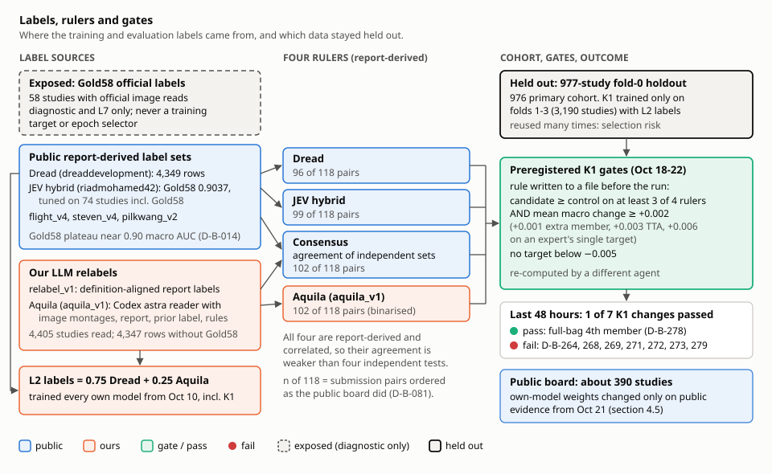

*라벨 출처, 판정 기준 4개, 모든 K1 게이트의 기반인 held-out 코호트. Gold58은 반복 사용으로 노출되어 진단용으로만 남았습니다.*

### 4.1 판정 기준 4개

모든 로컬 비교는 판독문 기반 라벨 네 세트, **JEV hybrid, Aquila, Dread, Consensus**로 채점했습니다. 각각 같은 study에서 후보와 대조군의 macro-12 AUC 차이를 내고, study 단위 paired bootstrap(300-2,000회)으로 구간을 냅니다. 네 기준은 모두 판독문 기반이라 서로 상관되어 있어, 넷이 일치해도 독립 시험 네 번만큼 강한 증거는 아닙니다. Gold58 일치도로 만든 소견별 판정 기준 지도에서 판독문 기준이 충분한(HIGH) 소견은 ACL과 Medial OA뿐이었고, 8개는 MEDIUM, 활막염과 골 타박은 LOW(적합한 판독문 기준 없음)였습니다(D-B-112).

**weak four**는 Lateral Meniscus, PF OA, Lateral OA, Synovitis입니다. 우리 모델의 손실이 가장 큰 소견이고(초기 모델의 weak-label 손실 중 47.6 %를 MCL, PF OA, Lateral Meniscus, Lateral OA가 차지; D-A-026) 공개 스택도 가장 약했던 소견입니다. 10월 11일부터 모든 실험은 mean(JEV, Consensus)에서 weak four 평균 변화를 주 지표로 사전 등록했고, 손상 진단으로 macro-12 >= -0.001, 다른 소견 -0.010 미만 하락 없음, Dread macro >= -0.003을 함께 보았습니다.

### 4.2 일곱 렌즈

단일 게이트는 작은 실제 이득을 버리고 잡음을 통과시켰습니다. 그래서 10월 11일부터(Taeyang의 지시, `agents.md`에 기록) 모든 실험을 일곱 렌즈로 읽고 종합 판정을 내렸습니다.

| 렌즈 | 규칙 | 존재 이유 | 도입 / 수정 |
|---|---|---|---|
| **L1** weak four | mean(JEV, Consensus)에서 weak four 평균 변화 >= +0.001 | 이득이 가장 필요한 소견 | weak-four 판독, 10월 11일 01:07 KST |
| **L2** macro-12 | mean(JEV, Consensus)에서 macro-12 변화 >= +0.001 | 전체 평가 지표 | 진행 규칙, 10월 11일 22:1x KST |
| **L3** 단일 기준 | 한 기준이 macro >= +0.002이고 나머지 모두 >= -0.001 | 한 기준이 분명히 보는 이득을 다른 곳의 손상 없이 포착 | 10월 11일 |
| **L4** 소견별 | 한 소견이 4개 중 3개 이상 기준에서 >= +0.003, 평균 조건 없음 | 소견별 라우팅으로 모델 전체를 바꾸지 않고 좋아지는 소견에만 쓸 수 있음 | 10월 11일. 10월 12일 수정(D-B-158): 첫 도구는 평균 >= +0.003과 "3개 기준에서 양수"를 섞어, 한 기준만 +0.003에 닿은 인공 사례를 통과시켰음. `tools/multi_lens_readout_l4_v2.py`가 등록 규칙을 구현 |
| **L5** seed | 기존 같은 레시피 seed 쌍 **전부**의 평균과 부호 일치 | 같은 기계에서 seed 하나만 바꿔도 macro-12가 -0.006 움직였음(D-B-017). 대부분의 효과와 같은 크기 | 10월 11일. "모든 쌍"은 10월 12일 23:2x KST |
| **L6** 묶음 | 같은 행에서 파트너 묶음의 해당 멤버를 교체했을 때 묶음 변화 >= +0.0005 | 자체 모델은 블렌드 파트너로 쓰였고, 단독 또는 보완 이득이 블렌드에서 사라질 수 있음(OOF 보완 +0.0076이 Public에서는 +0.001, D-B-057) | 10월 11일 |
| **L7** 영상 근거 | Gold58 또는 OAI MOAKS 영상 판독 패널(OAI 무릎 557개; weak four를 Lateral Meniscus, Lateral OA, PF OA, Synovitis로 대응) | 판독문 기준으로는 활막염·골 타박을 측정할 수 없음. 활막염과 PF OA에서는 영상 근거가 결정적 | 10월 11일. OAI 패널은 10월 12일부터(D-B-135) |

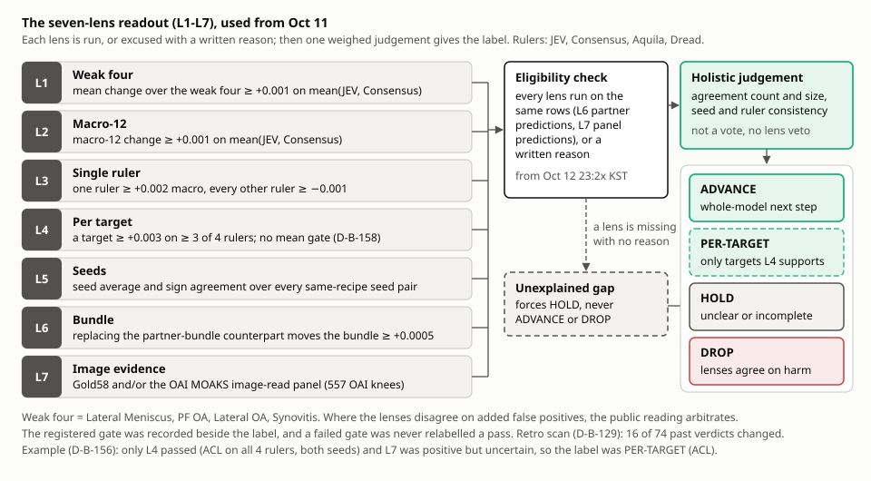

*7-렌즈 판독: 렌즈마다 실행하거나 이유를 적어 면제한 뒤, 하나의 저울질한 판단으로 라벨을 정합니다.*

**판정 라벨.** ADVANCE(모델 전체를 다음 단계로), PER-TARGET(L4가 지지하는 소견에만 사용), HOLD(불분명하거나 미완), DROP(렌즈들이 손상에 동의). 판정은 일치 개수, 크기, seed·기준 일관성을 저울질한 종합 판단이며, 투표나 단일 렌즈 거부권이 아닙니다. 10월 12일 23:2x KST부터는 필요한 추론을 돌려 모든 렌즈를 **판정 가능** 상태로 만들거나(L6은 같은 행의 파트너 예측, L7은 패널 예측), 불가능하면 이유를 적어야 했습니다(예: OAI로 학습한 모델은 OAI 패널로 평가할 수 없음, Gold58은 노출됨). **설명 없이 빠진 렌즈가 있으면 HOLD**이며 ADVANCE나 DROP을 줄 수 없습니다. 렌즈들이 거짓 양성 증가를 두고 엇갈리면 Public 결과가 판정합니다. 각 실험의 사전 등록 게이트도 종합 판정 옆에 그대로 기록했고, 실패한 게이트를 통과로 바꾸지 않았습니다.

**사후 재판독(D-B-129).** 과거 27개 실험의 비교 74개를 L1-L7로 다시 읽자(`artifacts/experiments/MULTI_LENS_RETRO`, 테스트 45개) 16개의 과거 HOLD/기각 판정이 ADVANCE 또는 PER-TARGET으로 바뀌었습니다. 실제로 이어진 것은 ConvNeXt-S(weak four +0.0066, macro +0.0013; MCL만 -0.012, 구간 상한 +0.002)로, ConvNeXt-S MIL 파트너(H-B-105)로 이어졌습니다. L4는 모델당 12번 비교하므로 단일 seed 소견별 반전은 가설로만 다뤘습니다.

### 4.3 실제 판독 예시

**자체 CoAtNet의 coverage 보존 샘플러(D-B-156, 10월 12일).** 두 seed, fold-0 888 study, plain과 mirror view의 평균.

| 렌즈 | 값 | 통과? |
|---|---|---|
| L1 weak four | +0.0008 [-0.0016, +0.0036] | 아니오 |
| L2 macro-12 | -0.0003 [-0.0022, +0.0017] | 아니오 |
| L3 단일 기준 | +0.0007 | 아니오 |
| L4 소견별 | ACL +0.0115 [+0.0061, +0.0181], 4개 기준 모두, 두 seed 모두(D-B-158 수정 후; PF OA는 잘못 통과했었음) | ACL만 |
| L5 seed | -0.0004, 방향 불일치 | 아니오 |
| L6 묶음(Q7과 50:50) | -0.0003 [-0.0013, +0.0008] | 아니오 |
| L7 OAI 패널 | weak four +0.0103(seed 42) / +0.0073(seed 43), 구간이 0 포함 | 양수, 불확실 |

판정: **PER-TARGET (ACL)**. 자동 판독은 L1-L4만 판정 가능한 상태에서 처음에 "채택 안 함"이라고 읽었고, 소유자의 수정으로 L5-L7을 돌릴 때까지 HOLD가 되었습니다. "설명 없이 빠진 렌즈는 HOLD" 규칙이 여기서 나왔습니다.

**멀티 뷰 입력: 전체 시야 + 구획 crop을 추가 MIL 인스턴스로(D-B-198, 10월 15-16일).** fold 2, seed 42/43. 등록 게이트: NO_PASS(4개 기준 macro +0.0012 < +0.002; seed -0.0025 / +0.0033; Baker's -0.0074로 하한 -0.005 미달).

| 렌즈 | 값 | 통과? |
|---|---|---|
| L1 | +0.0006 [-0.0045, +0.0061] | 아니오 |
| L2 | +0.0004 [-0.0027, +0.0037] | 아니오 |
| L3 | +0.0010 | 아니오 |
| L4 | Medial OA, Lateral OA, Contusion (+0.0074) | 예 |
| L5 | +0.0011 [-0.0021, +0.0044] | 약함 |
| L6 | +0.0015 [+0.0005, +0.0023] | 예 |
| L7 | 이유를 적고 판정 불가(Gold58 노출, OAI crop 캐시 없음). Gold58 참고값 +0.0051 | - |

판정: 출시가 아니라 **fold-3 확인 단계로 ADVANCE**. fold 3(seed 44/45)에서는 4개 기준 macro -0.0017로 모든 기준이 음수, OA 반전, Fracture -0.022, L6 +0.0006 → HOLD. fold 2+3 결합으로도 지지 근거가 없었습니다.

**OA 전용 crop 라우팅(D-B-197, 10월 15일).** fold 3, seed 44/45: Medial/Lateral OA만 crop 전문가로 보냄. 등록 게이트 FAIL(Medial OA가 0/4 기준에서 -0.0071). 렌즈: L1 +0.0018 통과, L2 -0.00002, L3 +0.0005, L4 Lateral OA 4/4 기준 +0.0079 통과, L5 +0.0001 통과, L6 +0.0003 [-0.0001, +0.0008], L7 판정 불가. 판정: **우선순위 하향(DEPRIORITISED), 폐기 아님**(Lateral OA는 두 fold에서 재현). 같은 Lateral OA 전문가를 10월 22일 K1 안에서 다시 시험했고 Lateral OA +0.0022로 게이트 +0.006에 못 미쳤습니다(D-B-271).

### 4.4 사전 등록 K1 게이트(10월 18-22일)

K1은 판독을 하나의 고정 세트로 단순화했습니다. K1은 fold 1-3(3,190 study)으로 학습하고 **fold-0 holdout 977 study**(주 코호트 976)에서 네 판정 기준으로 평가했으며, 규칙은 실행 전에 파일로 기록했습니다. 일반적인 규칙: 4개 중 3개 이상 기준에서 후보 >= 대조군 AND 평균 macro 변화 >= +0.002(추가 앙상블 멤버는 +0.001, TTA는 +0.003, 단일 소견 전문가는 그 소견에서 +0.006), 어떤 소견도 -0.005 미만 하락 금지. 모든 결과는 다른 에이전트가 다시 계산했습니다. 마지막 48시간 동안 K1 변경 7개 중 1개만 통과했고(full-bag 4번째 멤버, D-B-278) 6개는 실패했습니다(D-B-264, 268, 269, 271, 272, 273, 279). 세부는 [docs/EXPERIMENTS.md](docs/EXPERIMENTS.md#local-holdout-experiments-k1-977-study-fold-0).

### 4.5 판정 기준이 자체 모델 변경을 과대평가하는 이유

자체 모델은 판독문 기반 라벨로 학습했고 판정 기준도 판독문 기반이므로, 모든 판정 기준(과 Gold58)은 자체 모델 비중을 늘리면 점수를 더 줍니다. Public은 시험할 때마다 동의하지 않았습니다.

| 변경 | 로컬 근거 | Public 결과 |
|---|---|---|
| 자체 비중 0.15 → 0.25 (D-B-246) | Gold58 +0.0005 | 0.958 → 0.957 |
| R224 제거 (D-B-246) | Gold58 +0.0011 | 0.958, auto-selection상 부모보다 아래 |
| 소견별 K1 비중 벡터, 최대 0.5 (av2, D-B-251) | 976 holdout에서 선택 | 0.958 → 0.957 |
| 같은 쌍을 11-라벨 융합 렌즈로 (D-B-259) | 렌즈 7개 중 0개가 Public과 같은 순서 | - |
| full-bag K1을 4번째 멤버로 (D-B-278 → P4, D-B-282) | K1 단독 +0.00145, 4/4 기준 | 0.958, auto-selection상 p25보다 아래; Private 0.943으로 p25와 같음 |

그래서 10월 21일부터 자체 모델 가중치는 Public 근거로만 바꾸고, K1은 고정 가중치에서 품질만 개선했습니다.

## 5. 앙상블을 정한 과정

모든 블렌드는 제출 전에 비중을 고정한 소견별 순위 평균입니다(계산 방식은 [7.1](#71-평균-동순위를-쓰는-순위-평균)).

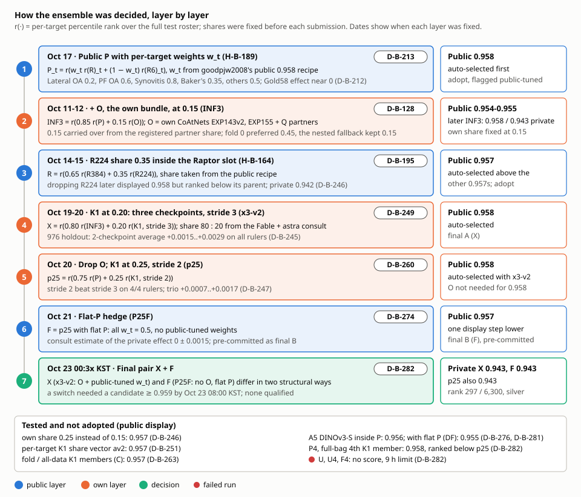

*최종 블렌드의 각 층을 어떻게 정했는지, Public 결과와 발견 ID를 함께 보여줍니다. 두 최종 제출 모두 Private 0.943이었습니다.*

순서대로:

| 날짜 | 단계 | 사용한 근거 | Public | 결정 |
|---|---|---|---|---|
| 10/7 | 공개 0.943 스택 80 % + 자체 CoAtNet/ResNet 20 % (H-B-15) | 5-fold OOF | 0.942 (대조 0.943) | 이득 없음, 자체 모델이 너무 약함(D-B-031) |
| 10/9-10 | nartaa의 OAI CoAtNet 0.949 + 자체 CoAtNet, 각 1/3 (blend3) | 자체 Gold58 0.935, OOF | 0.950-0.951 | 고정 비중 순위 블렌드 채택 |
| 10/11-12 | 공개 부분 0.85 + 자체 부분 0.15 (A5q, C85); P956 = 0.5 R + 0.5 heliosli S6 | 등록된 파트너 비중 0.15를 이어 씀(D-B-128: fold 0에서는 0.45가 좋아 보였으나 중첩 fallback이 0.15 유지) | 0.954-0.955 | 자체 비중 0.15 고정 |
| 10/13 | S6 → heliosli R7 묶음 (C85-R7) | 출시 parity | 0.957 | 채택 |
| 10/14-15 | R 슬롯 = 0.65 r(R384) + 0.35 r(R224), 비중은 공개 레시피 (H-B-164); R7 full flip TTA | auto-selection 순서(D-B-195) | 0.957 | 둘 다 채택 |
| 10/16 | R7 → R6 `fe055406` + full flip (H-B-174) | Gold58 +0.0033 [-0.0002, +0.0073] (D-B-201); OAI 461개 무릎에서는 재현 안 됨(D-B-208) | 0.957, auto-selected | 채택 |
| 10/17 | 공개 소견별 P 가중치 w_t (H-B-189) | 공개 레시피; Gold58에서는 효과 약 0(D-B-212) | **0.958**, auto-selection 1위 | 채택, Public 조정값으로 표시 |
| 10/18 | O 내부의 자체 측 변경(INF2, INF3 체크포인트별 Q pooling, C4) | 노출된 Gold58 | 0.958 동점 | INF3를 부모로 유지 |
| 10/19 | 자문(fable + astra): INF3 : K1 = 80 : 20 | Gold58 K1 0.20 +0.0006 | - | K1 비중 0.20 |
| 10/20 | in-pass K1, 체크포인트 1 → 3개 (x3-v2) | 976 holdout: 2개 평균이 모든 기준에서 +0.0015..+0.0029(D-B-245) | 0.958, auto-selected(D-B-249) | **최종 A** |
| 10/20 | O 제거, K1 비중 0.25, K1 stride 2 (p25) | stride 2 > 3, 4/4 기준, 3개 묶음 +0.0007..+0.0017(D-B-247) | 0.958, x3-v2와 함께 auto-selected(D-B-260) | 최고 표시 점수에 O는 불필요 |
| 10/20-21 | 소견별 K1 비중 벡터(av2); fold/전체 데이터 K1 멤버(C) | 976 holdout | 0.957, 0.957 | 기각(D-B-251, D-B-263) |
| 10/21 | p25 레시피에 평탄 P(모든 w_t = 0.5) (P25F) | Public 조정 w_t에 대한 헤지; 자문의 Private 효과 추정 0 +/- 0.0015 | 0.957 | **최종 B**, 사전 확정(D-B-274) |
| 10/21-22 | mattiaangeli DINOv3-S fold(A5)를 P 안에 0.15; A5 + 평탄 P (DF) | 출처가 깨끗한 새 계열 | 0.956, 0.955 | 사전 확정 규칙으로 종료(D-B-276, D-B-281) |
| 10/22 | full-bag 4번째 K1 멤버(P4); 두 계열 합집합(U, U4); 평탄 쌍(F4) | holdout GO(D-B-278); 자문의 U P(>= 0.959) 약 3-8 % | P4 0.958(미선택); U, U4, F4 점수 없음 | 최종 쌍 그대로(D-B-282) |

**자문.** 각 일정 결정 시점(10월 19일, 20일 18:35, 21일 16:57, 22일 02:46, 12:2x, 18:0x, 23일 00:3x KST)마다 같은 브리프를 두 독립 모델, fable(Claude 모델)과 astra Codex 레인에 보냈습니다. 추정치는 규칙과 함께 기록했습니다. 예를 들어 10월 21일 P(Public 0.959) 10-20 %, P(0.960) 1-5 %, 10월 22일에는 발견 기록 전체를 다시 읽은 Claude 판독자 3명과 astra 1명이 모두 "P(>= 0.959) >= 10 %인 수단 없음"이라고 했습니다(D-B-277).

**사전 확정 최종 쌍 규칙.** 10월 20일부터 남은 슬롯마다 규칙을 그 결과가 나오기 전에 `plan.md`(Final 10-slot schedule, Update 1-12)에 적었습니다. 기본 쌍은 X(x3-v2: auto-selection 최고, O와 Public 조정 w_t 포함) + F(P25F: O 없음, 평탄 P 가중치로 X와 구조적으로 두 군데 다름)였습니다. Kaggle의 auto-selection은 Public 조정 가중치를 공유하는 x3-v2 + p25를 유지했을 것이고, 10월 23일 00:3x KST에 두 자문 모두 동의한 가운데 p25를 F로 수동 교체했습니다. 교체는 10월 23일 08:00 KST까지 0.959 이상인 후보만 허용했고, 0.002 미만의 표시 차이는 동점으로 보았습니다. 해당 후보는 없었습니다. Private: X 0.943, F 0.943, p25 0.943.

## 6. 최종 제출

### 6.1 멤버

| 기호 | 멤버 | 출처 | 비중 |
|---|---|---|---|
| R | R384, R224 전체 데이터 CoAtNet(coatnet_rmlp_2_rw) SWA 체크포인트; R = r(0.65 r(R384) + 0.35 r(R224)) | nartaa 공개 데이터셋 | P 안에서 w_t |
| R6 | ConvNeXt-S compact 2.5D 묶음 `fe055406`(fluid/state stacker, 좌우 분류기 포함), full flip TTA | heliosli(비공개 사본으로 서빙), heliosli OrthoFoundation 코드 데이터셋의 서빙 코드 | P 안에서 1 - w_t |
| P | P_t = r(w_t r(R)_t + (1 - w_t) r(R6)_t) | goodpjw2008 공개 가중치 또는 평탄 | - |
| O | 자체 묶음: EXP143v2(자체 CoAtNet, OAI 미사용, L2 라벨), EXP155(OAI 마스킹 소견 CoAtNet), Q 파트너(RadImageNet ResNet-50, ConvNeXt-T, ConvNeXt-S MIL)를 체크포인트별 역 클래스 비용 가중으로 pooling | 자체 | INF3 안에서 0.15 |
| K1 | 자체 ConvNeXt-S 2.5D MIL; 체크포인트 3개(v2, v3-G seed 0, v3-G seed 1)의 소견별 순위 평균; FP16 | 자체 | 0.20 또는 0.25 |

**K1 상세.** 각 시리즈를 3.5 mm 물리 간격의 3장짜리 window로 자르고, 384 px로 렌더한 뒤 352 px로 crop하며 해부학 기준점을 씁니다. 모든 단면과 대조도의 시리즈가 window를 냅니다. ConvNeXt-S encoder가 window마다 임베딩을 만들고, 소견별 attention이 study의 모든 window를 소견당 하나의 벡터로 모으며, 손실은 L2 soft 라벨에 대한 study 단위 가중 BCE입니다. 학습: fold 1-3(3,190 study), 10 epoch, 15,950 update, EMA, 매 step study당 최대 64개 window 샘플링(모든 시리즈를 덮는 샘플링, 후보 stride 3). heliosli의 공개 compact trainer에서 출발했습니다. v1은 epoch 3에서 상수 예측 손실로 붕괴했고(D-B-214), v2는 학습률을 encoder 1e-4 / head 3e-4로 낮추고 1 epoch warm-up을 넣었으며(D-B-218), v3-G는 parameter group을 고쳤고(D-B-220), v3-G seed 1로 3개 묶음을 완성했습니다(D-B-245). holdout에서 K1 v2는 heliosli R7 fold-0 모델과 비슷한 성능(네 기준 모두 macro -0.005 이내)이면서 상관이 훨씬 낮아(소견별 Spearman 평균 0.777) 블렌드 멤버로 쓰였습니다. Kaggle 단독 점수는 Public 0.944 / Private 0.931입니다(K2, D-B-219).

### 6.2 수식

| 이름 | 수식 | Public | Private |
|---|---|---|---|
| INF3 | r(0.85 r(P) + 0.15 r(O)) | 0.958 | 0.943 |
| **X = x3-v2** (`knee-lb-r6w958k1x3sr20-v2`) | r(0.80 r(INF3) + 0.20 r(K1, stride 3)), runtime v5 | 0.958 | 0.943 |
| p25 | r(0.75 r(P) + 0.25 r(K1, stride 2)), O 없음, runtime v7 | 0.958 | 0.943 |
| **F = P25F** (`knee-lb-r6w958k1n3s2p25flatpv10-v1`) | p25에 평탄 P(모든 w_t = 0.5), runtime v10 | 0.957 | 0.943 |
| P4 / F4 | p25 / P25F에 4번째 K1 멤버(full-bag fold-0 체크포인트) | 0.958 / - | 0.943 / - |
| U | r(0.5 r(X_u) + 0.5 r(Y_u)), X_u = r(0.8 r(INF3) + 0.2 r(K1)), Y_u = r(0.75 r(P) + 0.25 r(K1)), K1 stride 2 | - | - |
| A5 / DF | p25에서 P' = r(0.85 r(P) + 0.15 r(A5)); DF는 평탄 P도 적용 | 0.956 / 0.955 | 0.941 / 0.940 |

## 7. 세부 메커니즘

### 7.1 평균 동순위를 쓰는 순위 평균

소견 t마다 각 멤버의 예측을 **전체 테스트 명단**(부분집합이 아니라 숨은 study 전체)에 대해 백분위 순위로 바꾸고, 같은 값은 차지하는 순위의 평균을 줍니다. 순위를 고정 비중으로 합치고 다시 순위를 매기므로 수식의 모든 단계가 순위이고, 소견별 출력은 (0, 1] 범위의 순위입니다. 평가가 소견별 AUC라 순서만 중요하고, 순위화는 멤버 간 보정 차이를 없앱니다(CoAtNet의 확률과 stacker 출력은 척도가 다름). 멤버 확률은 순위화 전 float32로 둡니다. K1이 실패한 study는 바깥 순위 전에 K1 자리에 부모의 순위를 넣으므로, 빠지지도 극단값으로 밀리지도 않습니다.

### 7.2 소견별 공개 가중치 w_t

w_t는 소견 t에서 P 안의 Raptor(R) 비중입니다. 공개 0.958 레시피는 Lateral OA 0.2, PF OA 0.6, Synovitis 0.8, Baker's 0.35, 나머지 8개 소견 0.5입니다. 이 네 값은 원작자가 Public 보드에서 맞춘 값이라 0.958의 일부는 390개 Public study에 대한 선택 효과(winner's curse)일 수 있습니다. 우리 R6 계열에 적용하자 0.957에서 0.958이 되었고(H-B-189, D-B-213), Gold58에서는 효과가 약 0이었습니다(D-B-212). 평탄 P(모두 0.5)는 Public에서 한 단계(0.958 → 0.957, D-B-274) 낮았고 Private에서는 차이가 없었습니다(P25F 0.943 = p25 0.943).

### 7.3 Raptor 슬롯 안의 R224 비중

R 자체가 nartaa 데이터셋 두 체크포인트의 블렌드입니다: R = r(0.65 r(R384) + 0.35 r(R224)). 0.35는 공개 레시피 값입니다. R224 추가(H-B-164)는 부모와 같은 0.957로 표시됐지만 auto-selection은 이를 다른 0.957들보다 위에 놓았습니다(D-B-195). 나중에 R224를 제거한 버전(H218p)은 0.958로 표시됐으나 auto-selection상 부모보다 아래였고(D-B-246), Private 0.942로 우리 0.958 제출 중 유일하게 0.943 미만이었습니다.

### 7.4 eval stride

추론 시 시리즈는 eval stride(장 단위) 간격의 window 중심으로 덮입니다. K1을 stride 3 대신 2로 돌리면 window가 약 1.44배이고, 모든 체크포인트와 3개 묶음에서 네 기준 모두 좋아졌습니다(묶음 +0.0007..+0.0017, P(>0) >= 0.95; D-B-247). stride 1은 차이가 없었으므로(-0.00011 / +0.00013 / +0.00004 / +0.00003; Spearman 0.9996; D-B-268) window 밀도는 stride 2에서 포화됩니다. R6는 stride 1 대신 2로 하면 32 study에서 추론 시간이 35 % 줄고 소견별 Spearman 0.983-0.999였지만(D-B-250), Public 결과는 기껏해야 중립이어서(S1 0.958, auto-selection 미선택; D-B-262) 최종 제출은 R6를 stride 1로 유지했습니다. X는 K1을 stride 3으로 두었고 stride 2는 p25 계열에서 들어갔습니다.

### 7.5 flip과 TTA 선택

| 선택 | 근거 | 사용? |
|---|---|---|
| R7 full flip TTA | 노출된 held-out 989 study에서 +0.0013 [+0.0003, +0.0023] (D-B-181); OAI 461개 무릎에서는 약 0(D-B-209) | 예, R6 full flip으로 |
| R6 flip 유무 | OAI 461에서 +0.00061, P(>0) 약 0.76(D-B-209) | 불확실한 이득으로 유지 |
| R224 해부학적 mirror | Public 0.957, 부모 0.958(D-B-217) | 아니오 |
| 자체 ResNet-50의 단면 인지 flip TTA | 5-fold Dread +0.0021(D-B-056) | 자체 R50 모델 |
| 서빙 시 스케일 TTA(320 crop + 384 전체 시야) | macro -0.00004(D-B-189) | 아니오 |
| K1 flip | K1은 좌우 정규화(한쪽 무릎 방향으로 맞춤) 입력이라 flip은 본 적 없는 입력이 됨 | 아니오 |
| K1 crop 이동 TTA(학습된 352 px view 하나) | -0.000085, 게이트 +0.003(D-B-279) | 아니오 |

### 7.6 K1 런타임: study별 대체값, fail-loud, 8.8시간 guard

- **v1-v7, fail-safe.** K1의 어느 한 실패(로드, 캡처, 분류, guard)만 나도 K1 전체를 버리고 조용히 부모 CSV를 제출했습니다. 그러면 점수는 부모와 같아지고, 점수만으로는 K1이 실행됐는지 증명할 수 없었습니다(k1x2sr20은 아마 이렇게 퇴화; D-B-249, D-B-253).
- **v8-v9, study별 대체값 + fail-loud.** 실패한 study는 K1 순위 자리에 부모 값을 씁니다. 시스템 실패(로드 실패나 시간 초과, guard 작동, 실패 study 5 % 초과)가 나면 부모 CSV를 쓴 뒤 맨 끝에서 예외를 던져, 조용히 약해진 점수 대신 Kaggle에 오류로 보이게 합니다. 따라서 v8 이후 점수가 난 실행은 숨은 study의 95 % 이상에서 K1이 돌았다는 증거이고, 첫 증거는 S1이었습니다(D-B-262). v9는 노트북이 guard 이후에 끝나면 완전히 성공한 K1 결과까지 되돌리던 v8 결함을 없앴습니다(D-B-253).
- **v10.** 느린 Kaggle 세션에서 무거운 study 32개 중 4개가 study당 캡처 제한 120초를 넘어(렌더 143-151초; 같은 명단이 정상 세션에서는 32/32 통과) 5 % 한도를 넘었습니다(D-B-261). v10은 캡처 제한을 900초, 호출 제한을 300초로 늘렸고, 모델 로드 제한은 1500초로 유지했습니다(`experiments/final/*/registration.json`에 등록). visible study에서 v10 K1 출력은 v7과 비트 단위로 같았습니다(D-B-277).
- **guard.** K1 guard는 커널 시작 후 8.8시간에 K1을 멈춥니다. fail-loud에서는 guard가 늦은 완료를 오류로 바꿀 뿐이므로 보수적인 8시간이 아니라 최대값으로 두었습니다(D-B-253). guard는 부모 단계와 대기 시간을 제한하지 않으며, U, U4, F4가 9시간을 넘긴 이유입니다(10장).

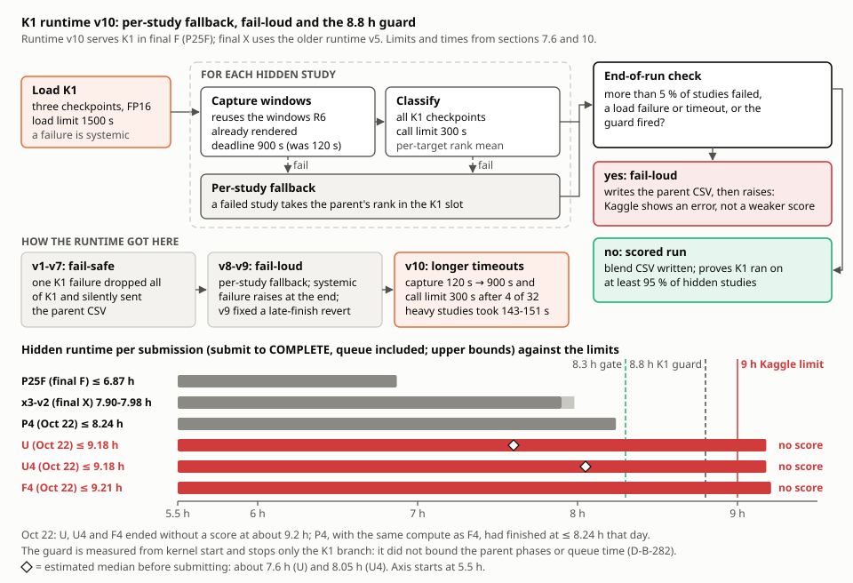

*K1 런타임 v10과 그 한계: 점수가 난 실행은 숨은 study의 95 % 이상에서 K1이 돌았다는 증거지만, guard는 K1 분기만 멈춥니다.*

### 7.7 visible 실행과 N32 부하 실행

- **visible 실행.** 제출할 노트북 그대로 Kaggle에서 공개 예시 테스트 study 3개로 실행합니다. 확인 항목: 모든 study ID x 12개 유한 출력, 모든 멤버 로드, 모든 study에서 대체값 0으로 K1 실행, 코덱 활성, fail-loud 미작동, 등록된 런타임 버전과 guard, 멤버 출력에서 수식을 독립적으로 재계산.
- **N32.** 제출하지 않는 별도 커널에서 같은 코드를 실제 학습 study 32개(가장 무거운 렌더, 즉 window와 시리즈가 가장 많은 study 포함)로 돌립니다. 새 멤버가 부하에서 도는지, study별 실패 수, 단계별 시간을 봅니다. N32 시간은 모델 로드 I/O에 좌우되어 숨은 실행의 study당 비용을 과대 예측했으므로(D-B-275), 숨은 실행 시간은 N32만이 아니라 이전 숨은 실행으로 보정했습니다.

### 7.8 8단계 제출 게이트

10월 21일(plan Update 3)부터 모든 제출은 순서대로 통과해야 했습니다. (1) 다른 에이전트의 독립 코드 리뷰, (2) 위 항목을 모두 확인한 visible 실행, (3) 새 멤버가 있으면 N32 32/32, (4) 첨부 데이터셋 전부의 SHA256 확인, (5) 예상 숨은 실행 시간 <= 8.3시간, (6) 승인 도구 PASS와 검사 전용 재실행, (7) 다른 에이전트의 7개 항목 최종 제출 전 점검, (8) 제출 직전 채팅 공지. 제출은 호출 전에 원장에 기록하고, 정확히 한 번만 시도하며, 자동 재시도를 하지 않는 단일 도구(`kaggle_submit_once.py`)로만 했습니다.

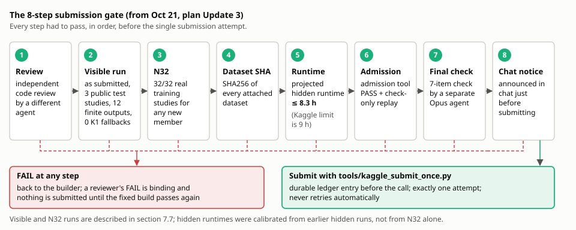

*10월 21일부터 모든 제출이 통과한 8단계 게이트입니다. FAIL이 하나라도 나면 빌더에게 돌아가고 제출하지 않았습니다.*

### 7.9 auto-selection: 표시 점수 아래의 신호

Kaggle은 반올림 전 Public 점수가 가장 높은 제출 두 개를 미리 선택합니다("auto-selection candidates"). 여러 제출이 같은 0.958로 보일 때 어느 두 개에 표시가 붙는지로 표시 정밀도 아래의 순서를 알 수 있습니다. 매번 읽고 기록했습니다. 예: 0.957에서 R224와 R7 full flip > fluid 라우팅과 compo15 > C85-R7(D-B-195), K1 블렌드 > K1 없는 0.958들(D-B-249), x3-v2와 p25 > S1과 P4(D-B-262, D-B-282). 순서는 정확하지만 상위 항목 사이에서만 알 수 있고 Public 점수만 반영합니다.

### 7.10 증거 원장(evidence ledger)

`artifacts/evidence_ledger/`에는 두 표가 있었습니다. `measurements.csv`(각 후보의 등록된 모든 출처별 로컬 값, Public 점수를 읽기 **전에** 기록)와 `readings.csv`(나중에 읽은 Public 점수). `tools/evidence_ledger.py`는 출처마다 제출 쌍을 Public과 같은 순서로 놓은 수를 셉니다(0.002 미만 차이는 동점). 사후 표(D-B-081)에서 consensus와 이진 Aquila가 118쌍 중 102쌍, relabel_v1 100, JEV 99, Dread 96, flight 93이었고 Gold58은 판독 수가 2-3개라 쓸 수 없었습니다. consensus와 Aquila가 판정 기준이 된 이유이자, 어떤 단일 출처도 Public 예측기로 믿지 않은 이유입니다.

## 8. 작업이 발전해 온 과정

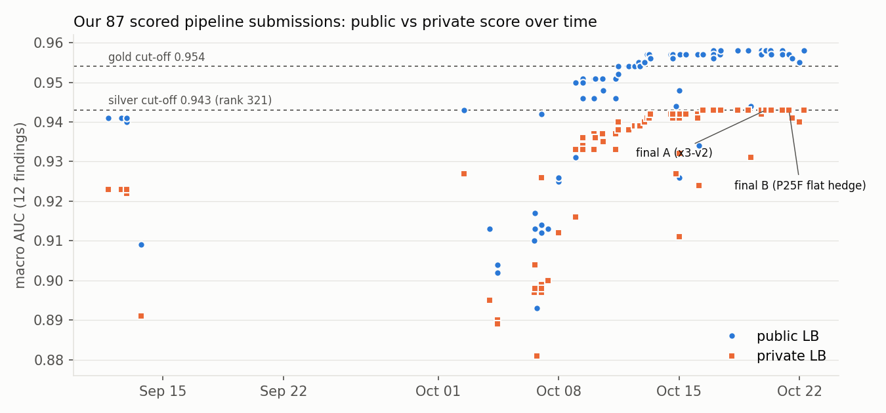

| 날짜 (2026) | 단계 | Public | Private |
|---|---|---|---|
| 9/11-12 | 공개 0.941 스택(probe22 계열) 복사와 라우팅 탐색 5회 | 0.940-0.941 | 0.922-0.923 |
| 9/13 | 첫 자체 모델: ConvNeXt-S 단독 | 0.909 | 0.891 |
| 10/2 | 공개 0.943 스택 복사(jiweiliu, Mattia v34 레시피) | 0.943 | 0.927 |
| 10/6-8 | 판독문 라벨 자체 모델; 최고는 CoAtNet5 + RadImageNet R50 | 0.910-0.926 | 0.897-0.912 |
| 10/9 | 자체 R50 AUG1 증강(Public +0.006, D-B-080); 공개 OAI CoAtNet 0.949 + 자체 | 0.931 / 0.950 | 0.916 / 0.933 |
| 10/11 | A5q: 공개 R + S6 + 자체 CoAtNet + 파트너 | 0.954 | 0.940 |
| 10/12-13 | C85(P956 + 자체 15 %), 이어서 heliosli R7 묶음의 C85-R7 | 0.955 / 0.957 | 0.939 / 0.941 |
| 10/15-16 | R224, flip TTA, R6 교체, OA 라우팅(첫 Private 0.943) | 0.957 | 0.941-0.943 |
| 10/17 | H-B-189: R6 계열에 공개 소견별 가중치 | **0.958** | 0.943 |
| 10/18-19 | K1 학습(v1 붕괴, v2, v3-G seed); 단독 K2 | 0.944 | 0.931 |
| 10/20 | in-pass K1 블렌드: x3-v2(최종 A), p25 | 0.958 | 0.943 |
| 10/21 | P25F 평탄 P 헤지(최종 B); A5 DINOv3-S 멤버 | 0.957 / 0.956 | 0.943 / 0.941 |
| 10/22 | P4(full-bag 4번째 K1 멤버); U, U4, F4는 9시간 제한에 걸림 | 0.958 / - | 0.943 / - |

**9월 11-13일.** 당시 최고 공개 스택(0.941)에서 시작해 소견별 라우팅을 시험했으나 Public 점수는 움직이지 않았습니다. 첫 자체 ConvNeXt-S는 0.909였습니다. 9월 30일까지는 제출이 없었습니다.

**9월 30일 - 10월 2일.** KneeOps 대시보드와 데이터 관리 도구를 만들고, 공개 노트북을 다시 읽고, 당시 최고 공개 0.943 스택을 정확히 재현했습니다(D-A-018). 0.945-0.946 공개 노트북은 작성자의 비공개 자산에 의존했고 공개 fork는 0.943이었습니다(D-A-024).

**10월 3-8일: 자체 모델과 라벨.** 고정 그룹 5-fold 분할(4,343 study)에서 자체 모델은 같은 프로토콜 안에서는 OOF 차이만큼 Public으로 옮겨졌지만(D-B-020, D-B-042) 단독 0.910-0.926에 머물렀고 0.943 스택에 더해도 나아지지 않았습니다(0.942, D-B-031). 라벨 작업이 여기서 시작됐습니다(3장).

**10월 8-11일: Aquila와 공개 체크포인트.** Aquila를 만들고(10월 9일) L2 라벨을 채택했습니다(D-B-095). AUG1 증강으로 자체 R50이 0.925에서 0.931이 되었습니다(D-B-080). nartaa가 OAI 영상으로 학습한 전체 데이터 CoAtNet(Public 0.949)을 공개했고, 우리 CoAtNet과 블렌드하자 0.950-0.951, heliosli S6 묶음을 더하자 0.954가 되었습니다(A5q, D-B-137). 자체 OAI 마스킹 학습은 도움이 되지 않았습니다(EXP155 0.946 = EXP143v2 0.946, D-B-101). 7-렌즈 판독을 도입했습니다(4.2절).

**10월 12-15일: compact 묶음과 서빙.** heliosli R7 묶음으로 0.957이 되었습니다(D-B-168). 고정된 판독기가 읽지 못하던 JPEG Lossless / JPEG-LS 시리즈를 위해 오프라인 GDCM 디코더를 넣었습니다(D-B-162, D-B-169). R224, flip TTA, fluid 라우팅, 자체 비중 변경은 모두 0.957로 표시됐습니다. 자체 레시피 kill test 세 개는 단독 0.926-0.948이었습니다(D-B-187, D-B-190, D-B-191).

**10월 16-17일: R6와 공개 가중치.** R7을 heliosli R6로 바꾸고 공개 소견별 가중치를 적용해 0.958이 되었습니다(H-B-189, D-B-213). Fracture 라우팅은 0.956으로 낮췄고, 공개 2.5D reader overlay는 동점이었습니다.

**10월 17-19일: K1.** K1을 학습했습니다(6.1절). 첫 단독 숨은 실행은 원인 불명의 예외로 실패했고, 수리한 단독 버전은 0.944였습니다(D-B-219). 부모 다음에 K1을 순차 실행하면 약 5.2시간이 더 들어 9시간 안에 끝날 수 없었으므로(D-B-242), K3/INF3RCO overlay는 거의 확실히 부모 결과를 제출했습니다.

**10월 20-21일: in-pass K1.** R6 렌더를 공유해 K1 비용을 감당할 수 있게 되었고(D-B-243), K1 블렌드는 0.958로 표시되며 K1 없는 부모보다 위로 auto-selected되었습니다(D-B-249, D-B-260). K1이 신호를 더한다는 첫 Public 근거입니다. fail-loud 런타임(v8-v10)으로 점수가 난 실행은 K1 실행의 증거가 되었습니다(D-B-253, D-B-262).

**10월 22일.** holdout 시험 6개는 게이트에 실패하고 1개는 통과했습니다. P4는 0.958이었지만 p25보다 아래였고, U, U4, F4는 시간 초과였습니다(D-B-282). 최종 쌍 X + F는 10월 23일 00:3x KST에 확정했습니다.

## 9. 검증

| 도구 | 크기 | 용도 | 한계 |
|---|---|---|---|
| Gold58 | study 58개, 공식 라벨 | 라벨 출처 감사, 진단, L7 | 반복 사용으로 노출; 여기서 얻은 가중치 이득은 옮겨지지 않음(D-B-246) |
| 5-fold OOF (G1) | study 4,343개 | 10월 3-15일 자체 모델 선별 | 중첩 학습 stacker는 fold 계보가 샘(D-B-160); OOF 차이는 같은 프로토콜·라벨 안에서만 옮겨짐(D-B-042) |
| fold 실험 (fold 0/2/3) | study 864-888개 | 10월 11-16일 7-렌즈 실험 | 실험당 fold 하나; seed 잡음이 효과와 같은 크기 |
| OAI MOAKS 패널 | 무릎 557개(파일럿 96 + 확인 461) | OAI 미사용 모델의 L7 영상 근거 | 다른 집단; 일부 소견만 대응; OAI 학습 모델은 평가 불가 |
| fold-0 holdout 977 study | 주 코호트 976 | 10월 18-22일 K1 게이트 | 판독문 기준끼리 오류 공유; 여러 번 재사용(선택 위험); fold 0으로 학습한 모델은 평가 불가 |
| Public 보드 | 약 390 study, 0.001 표시 | 기대 효과가 큰 이분 결정; auto-selection 순서 | 아래 참조 |
| visible + N32 실행 | 3 / 32 study | 실행, parity, 실행 시간 | 점수와 무관 |

**Public 보드의 해상도(D-B-016).** 고정 예측에서 390 study 부분집합을 재표집하면 macro AUC 차이의 표준편차가 추론만 바꾼 경우 0.0014, 따로 학습한 두 실행 0.0028-0.0032, 서로 다른 두 모델 0.0037이었습니다. 약 1,300개 중 390개를 뽑는 유한 모집단 보정을 하면 95 % 범위가 대략 +/-0.004(추론 변경), +/-0.007-0.010(따로 학습한 모델)이고, Public 점수로 두 후보 중 나은 쪽을 고르면 승자가 표준편차의 절반 정도 부풀려집니다. 약한 라벨로 구한 대리값이지 실제 Public 차이의 신뢰구간은 아닙니다. 보드는 소수 셋째 자리까지만 보여줍니다. 후반의 변경은 대부분 0.002 미만으로 예상되어 Public 점수로 구분할 수 없었고, 그래서 auto-selection 순서와 사전 등록 holdout 게이트를 썼으며, Public 점수로 가중치나 임계값을 조정하지 않았습니다.

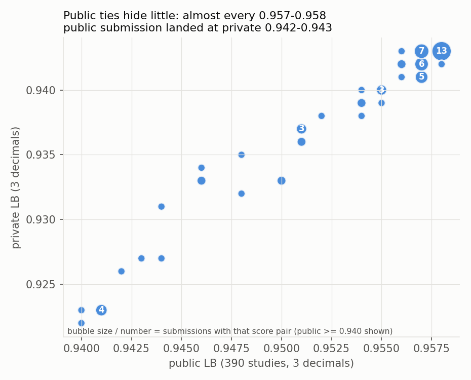

**Public이 Private을 얼마나 예측했나(점수가 난 우리 제출, 설명 없는 37개 제외).**

| 집합 | n | Pearson | Spearman | Public - Private 평균 |
|---|---|---|---|---|
| 전체 | 87 | 0.996 | 0.972 | 0.0149 |
| Public >= 0.955 | 40 | 0.768 | 0.688 | 0.0149 |

| Public 표시 | Private 표시 |
|---|---|
| 0.958 (14개) | 0.943 x 13, 0.942 x 1 (R224 제거, K1 없음) |
| 0.957 (18개) | 0.943 x 7, 0.942 x 6, 0.941 x 5 |
| 0.956 (4개) | 0.943, 0.942 x 2, 0.941 |
| 0.955 (4개) | 0.940 x 3, 0.939 |

**자체 모델과 Private 보드.** 최종 순위는 Private 0.943인 304팀 중 첫 번째로, 동메달 기준선(0.942)보다 한 표시 단위 위였습니다. Public 0.958을 공개 레시피로 받은 많은 팀이 Private에서 어디에 놓였는지는 측정하지 않았으며, 아래 근거는 우리 제출만으로 본 것입니다. 우리 제출 안에서도 소견별 가중치가 없는 R 계열(H-B-164/167/170/174)과 R224를 뺀 K1 없는 INF3 변형은 0.942였고, 점수가 난 K1 블렌드 11개 중 9개가 0.943이었습니다(아래 두 개는 A5 멤버 포함). 한 번의 분할에서 반올림된 표시 점수이므로, 자체 멤버가 Private에 작은 양의 기여를 했다는 것과 부합할 뿐 통제된 측정은 아닙니다.

## 10. 마지막 주, 실패와 실행 시간

**최종 선택.** 사전 확정 규칙에 따라 10월 23일 00:3x KST에 X(x3-v2, Public 0.958) + F(P25F, Public 0.957)를 수동 선택했고 둘 다 Private 0.943입니다. Private 0.943인 21개 제출은 표시 정밀도에서 최종 쌍과 동점이었습니다.

**대회 전체의 실패.**

| 날짜 | 제출 | 일어난 일 | 원인 |
|---|---|---|---|
| 10/3 | D01(anchor + 자체 10 %) | 숨은 실행 오류, 점수 없음 | 규명 안 됨(D-A-035) |
| 10/6-7 | H-B-18 대조군(2회) | ERROR | Kaggle 시스템 오류(D-B-025) |
| 10/11 | A6q v6 | 숨은 재실행 실패 | 규명 안 됨(D-B-136) |
| 10/12 | C85 v1.0.2 | 점수 없음 | 규명 안 됨; 대체값 0 거부 로직과 R 중복 실행을 찾아 제거(D-B-155) |
| 10/18-19 | K2(K1 단독) 두 버전 | 숨은 실행 예외 | 규명 안 됨; 수리한 v5는 0.944(D-B-219) |
| 10/22 | U (13:58 KST) | 점수 없이 COMPLETE, <= 9.18시간 | 느린 날의 9시간 제한 |
| 10/22 | U4 (15:59 KST) | 점수 없이 COMPLETE, <= 9.18시간 | 9시간 제한 |
| 10/22 | F4 (22:39 KST) | 점수 없이 COMPLETE, <= 9.21시간 | 9시간 제한 |

설명 없는 제출 5개(10월 9일, 13일)도 점수 없이 끝났으며, 기록된 연구 흐름 밖의 제출입니다.

**숨은 실행 시간**(제출부터 COMPLETE까지, 대기 포함, 5-10분 간격 폴링의 상한): P + O 부모 6.7-6.9시간, p25 6.1-6.2, P25F <= 6.87, A5 <= 6.77, k1sr20 <= 7.04, S1 <= 7.2, av2 7.27-7.35, C <= 7.53, x3-v2 7.90-7.98, P4 <= 8.24, DF <= 8.29시간. DF와 A5는 계산이 같고(상수 가중치 네 개만 다름) 1.52시간 차이가 났습니다(D-B-280).

**10월 22일 실행 시간.** 그날 제출 네 개 중 세 개가 약 9.2시간을 넘겨 실패했습니다. F4와 계산이 같은 P4는 같은 날 앞서 <= 8.24시간에 끝났습니다. 예상 중앙값은 U 약 7.6시간, U4 약 8.05시간이었습니다. 8.8시간 K1 guard는 실패를 막지 못했습니다. guard는 커널 시작부터 재고 K1 분기만 멈추며, 부모 단계나 대기 시간은 제한하지 않습니다(중간 확신, D-B-282).

**F4.** 첫 빌드는 18:00 KST에 Codex 빌더가 "model at capacity"를 반환하며 중단됐고, 19:20에 발견되어 다시 빌드한 것이 19:52에 리뷰를 통과했으며, 32-study 확인 실행은 다른 커널 뒤에서 기다리다 22:37 KST에 끝났습니다. 22:39 KST에 제출했고 약 9.2시간에서 시간 초과되었습니다. 사전 확정 규칙상 F4는 FB를 포함한 A와 함께일 때만 최종 쌍에 들어갈 수 있었고, 그런 A는 선택되지 않았습니다.

## 11. 주요 관찰

1. 파이프라인 제출 97회(설명 없는 임시 제출 37회는 제외): 점수 87회, 점수 없이 완료 8회, 오류 2회. Private 0.943(우리 최고) 21회, 두 최종 제출 포함.
2. 전체 범위에서 Public과 Private은 함께 움직였지만(Pearson 0.996, n = 87) Public >= 0.955인 40개 사이에서는 훨씬 약했습니다(Spearman 0.688). Public - Private 평균은 0.0149였습니다.
3. 자체 모델 단독 최고는 Public 0.948 / Private 0.935(B172, 자체 전용 블렌드), K1 단독은 0.944 / 0.931입니다. Private 0.943인 21개 제출은 모두 자체 모델(O, K1 또는 둘 다)을 순위 가중치의 15-25 %로 포함합니다.
4. 대리 근거로 자체 모델 비중을 올린 세 번의 시험은 Public 점수를 올리지 못했습니다(자체 0.25: 0.957; 소견별 K1 벡터: 0.957; full-bag 4번째 멤버: 0.958이지만 p25보다 아래).
5. 마지막 사전 등록 K1 holdout 시험 7개 중 1개 통과(+0.00145), 6개 미통과(각 임계값 대비 -0.0045 ~ +0.0022).
6. 같은 계산의 숨은 실행 시간이 10월 21일 1.52시간 차이 났고 10월 22일에는 9.2시간에 이르러, 세 제출을 9시간 제한으로 잃었습니다.
7. 7-렌즈 사후 재판독은 과거 판정 74개 중 16개를 바꿨고(D-B-129), 4개 기준과 렌즈 판독은 Public이 확인하지 않은 자체 모델 비중 증가를 일관되게 선호했습니다(4.5절).

상위 팀과의 비교와 우리 자신의 회고는 상위 솔루션 글이 공개된 뒤 아래에 추가합니다.

## 12. 상위 팀 전략 (상위 솔루션 공개 후 작성 예정)

TODO: 상위 솔루션 글이 공개된 뒤 팀이 작성합니다.

## 13. 자기 피드백 (작성 예정)

TODO: 팀이 작성합니다.

## 14. AI 에이전트와 스킬을 쓴 방식

작업은 AI 코딩 에이전트들이 네 개의 공유 파일("research orchestrator" 구성)을 통해 협업하며 진행했고, 파일은 작성된 그대로 저장소 최상위에 있습니다([agents.md](agents.md), [plan.md](plan.md), [discoveries.md](discoveries.md), [handoff.md](handoff.md)). Taeyang이 목표와 상시 규칙을 정했고, 에이전트들은 그 규칙 안에서 계획, 빌드, 리뷰, 학습, 실행, 제출을 했습니다. 모든 규칙은 날짜와 함께 `agents.md`에 있습니다.

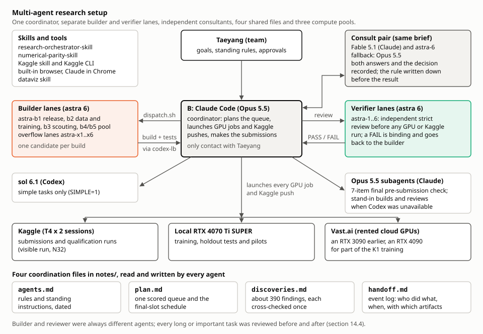

*누가 무엇을 했는지: 조정자 하나, 분리된 빌더·검증 레인, 독립 자문, 공유 파일 넷, 계산 자원 셋.*

### 14.1 모델

| 모델 | 플랫폼 | 역할 |
|---|---|---|
| **astra 6** (`gpt-6-astra`) | Codex CLI 레인 | 빌더 astra-b1..b5, 검증 astra-1..6, 넘침 레인 astra-x1..x6; 자문 상대 astra-6; Aquila 라벨 판독자; 영상의학 전문의 페르소나 판독자 |
| **Opus 5.5** | Claude Code | 조정자 세션 "B"; 7개 항목 최종 제출 전 점검, 발견 기록 전체 재독, Codex를 못 쓸 때의 대체 빌드·리뷰를 맡은 Opus 하위 에이전트 |
| **sol 6.1** | Codex CLI | 단순 작업만(`SIMPLE=1`): 상태·출력 수집, 짧은 smoke 실행, 파일 이동 |
| **Fable 5.1** | Claude | 가끔의 전략 자문과 일부 리뷰(astra-6와 함께) |

### 14.2 스킬과 도구

| 스킬 / 도구 | 한 일 |
|---|---|
| [research-orchestrator-skill](https://github.com/TaeyanG4/research-orchestrator-skill) (Taeyang의 공개 저장소) | 네 조정 파일(`agents.md`, `plan.md`, `discoveries.md`, `handoff.md`), 점수가 매겨진 계획 큐, 모든 발견에 대한 다른 호스트의 1회 교차 검증, 슬롯(작업 소유)과 호스트(실행 플랫폼)의 구분 |
| numerical-parity-skill | 비교 전에 허용오차를 고정한 Kaggle T4와 로컬 RTX 4070 Ti SUPER의 추론 parity: 같은 체크포인트 FP16에서 869 study 확률 최대 차이 0.0004814, AUC 차이 0.000006(D-A-025); 순위 블렌드에서 소견당 study 쌍 순서 변화 0.10 % 이하(D-A-045) |
| Kaggle 스킬과 Kaggle CLI | 커널 push, 상태와 출력 파일; 모든 제출은 `tools/kaggle_submit_once.py`로만(호출 전 원장 기록, 후보당 1회 시도, 자동 재시도 없음) |
| Claude Code 내장 브라우저, Claude in Chrome | Codex가 렌더링하지 못하고 CLI로는 읽을 수 없는 Kaggle 포럼 글, 리더보드, GPU 할당량 설정 페이지 읽기 |
| dataviz 스킬 | 이 README의 차트 |

### 14.3 에이전트들이 함께 일한 방식

| 파일 | 내용 |
|---|---|
| `agents.md` | 운영 규칙과 팀의 모든 상시 지시(날짜 포함) |
| `plan.md` | 미완료 작업의 단일 점수 큐. Priority = 2 x Impact + 2 x Information + Confidence + Unblock + Diversity + (3 - Cost)(각 0-3), 담당 표시, Update 1-12가 있는 최종 슬롯 일정 |
| `discoveries.md` | 약 390개 발견(`D-<slot>-<NNN>`). 각각 수치, 해석, 다른 호스트의 1회 교차 검증(VERIFIED / CHALLENGED / HOLD / PENDING) |
| `handoff.md` | 사건 기록: 누가 언제 어떤 산출물로 무엇을 했는지 |

- **조정자 B(Claude Code, Opus 5.5).** 큐를 계획하고 일정을 잡았으며, 모든 GPU 작업과 Kaggle push를 실행하고, 제출을 결정하고 실행했으며, Taeyang과 소통한 유일한 에이전트였습니다. 하위 레인은 GPU 작업을 실행하거나 Kaggle에 쓸 수 없었습니다(`agents.md`, Roles/slots & Codex lanes). 슬롯 A(Codex)는 연구 제안과 종합 보고서를 썼고, 슬롯 C와 D는 초기 인프라와 준비 작업을 했습니다.
- **dispatch 스크립트로 돌린 Codex 레인.** `dispatch.sh`(10월 13일부터 v3.2.0)가 파일을 명시한 프롬프트를 지속 레인에 보냈습니다. 빌더 astra-b1(출시), astra-b2(데이터·학습), astra-b3(탐색), astra-b4·astra-b5(공용), 검증 astra-1..6, 모두 바쁠 때 자동으로 생기는 넘침 레인 astra-x1..x6. sol은 단순 작업을 맡았습니다. 요청은 로컬 Docker `codex-lb` 부하 분산기를 거쳤습니다(`agents.md`, Current names; Token revocation).
- **에이전트당 빌드 하나, 독립 엄격 리뷰.** 빌더 작업 하나는 숨은 실행에서 검증된 부모로부터 후보 하나만 만들었고, 등록된 변경과 버전 정보만 허용했습니다. 다른 레인이 GPU·Kaggle 실행 전에 리뷰했고 FAIL은 구속력이 있어, 빌더가 고치고 B는 결코 뒤집지 않았습니다(`agents.md`, Strict builds; 실수 기록 16번).
- **규칙을 먼저 정한 자문 쌍.** 주요 결정(자체 모델 비중, 슬롯에 넣을 후보, 최종 쌍)은 같은 브리프를 두 독립 자문 Fable 5.1과 astra-6에 보냈고, Fable을 못 쓸 때는 Opus가 대신했습니다. 두 답, 결정, 이유를 기록했고, 결정 규칙은 그 결과가 나오기 전에 `plan.md`에 적었습니다(`agents.md`, Important/ambiguous decisions; 5장).
- **빌드·리뷰에 참여하지 않은 에이전트의 최종 점검.** 별도의 Opus 에이전트가 7개 항목 제출 전 점검(7.8절 게이트의 7단계)을 했습니다(`agents.md`, Final pre-submission check).
- **영상의학 전문의 페르소나 전문가 패널.** 10월 21일 소견별 영상의학 전문의 페르소나 판독자 6명(astra-1..6)이 weak 소견 6개의 Gold58 거짓 음성·거짓 양성 유사 사례(20개 study의 24개 사례)를 검토했습니다. 파이프라인 결함이나 입증된 Gold58 오류는 찾지 못했고, 프로토콜·coverage 관련 가설을 제시했으며, 이것이 K1 오류 지도(D-B-267)와 10월 21-22일의 표적 K1 시험(4.4절)으로 이어졌습니다.
- **LLM 재라벨링.** Aquila 라벨은 astra 레인이 판독했습니다(3.2절). 주최 측은 판독문 원문을 재배포하지 않는 조건으로 학습 판독문의 LLM 라벨링을 허용했습니다(D-B-029).
- **cron 대신 타이머.** 세션 cron은 세션이 쉴 때만 실행되어 바쁜 동안 놓쳤으므로, 대기는 백그라운드 타이머(`.local/timer-until.sh`)와 폴러로 했고, GPU 정지, GPU 유휴, 부하 분산기 중단, 디스크 부족 시 B를 깨우는 자원 감시기를 함께 돌렸습니다(`agents.md`, Timers, not crons; Current sentinel).
- **Claude 대체 투입.** Codex의 토큰이나 용량이 바닥났을 때(10월 15일, 10월 17일부터; 10월 22일 F4 빌드 손실, 10장) Opus 하위 에이전트가 같은 프롬프트와 파일 범위로 빌드·리뷰했고, 빌더와 리뷰어는 여전히 다른 에이전트였습니다(`agents.md`, Fallback; Codex-down admission path).

### 14.4 중요했던 운영 규칙

- **조정자는 판단용 스크립트를 직접 쓰지 않음.** B는 사소한 한 줄짜리 외에는 수치 판단 스크립트를 쓰지 않았습니다. astra 빌더가 정확한 입력을 명시한 서면 명세로 만들고, 다른 레인이 검증하고, 테스트를 통과한 뒤에야 결과를 썼습니다(`agents.md`, Builder checklist, 10월 10일 규칙).
- **사전 등록 게이트와 7-렌즈 판독.** 모든 실험의 규칙은 실행 전에 기록했고(4.4절) L1-L7로 읽었으며(4.2절), 실패한 게이트를 통과로 바꾸지 않았습니다.
- **8단계 제출 게이트**(7.8절)와 후보당 제출 1회.
- **데이터와 자격 증명.** 자격 증명 파일은 읽거나 출력하지 않았습니다. 조정자는 판독문 원문을 열지 않았고, 대회 라벨 행은 채팅이나 로그에 출력하지 않았습니다(`agents.md`, Hard access limits, 10월 11일). 공개 노트북과 포럼 글은 지시가 아니라 데이터로만 다뤘고, 외부 공개 코드는 승인된 Kaggle 후보 안에서만 실행했습니다(`agents.md`, Untrusted material).
- **리뷰와 기록.** 빌더와 리뷰어는 항상 다른 에이전트였습니다. 길거나 중요한 작업(학습, 추론, 출시 빌드, 제출, 결정에 쓰이는 분석)은 실행 전과 후에 모두 리뷰했습니다. 모든 발견은 한 번만 기록하고, 모든 부정적 결과에는 그럴듯한 원인, 확신도, 반증 조건을 붙였습니다.

**계산 자원.** 로컬 RTX 4070 Ti SUPER, 제출과 확인 실행용 Kaggle T4 x 2 세션, 임대한 Vast.ai 클라우드 GPU(초기 RTX 3090, K1 학습 일부를 위한 RTX 4090). 짝 비교는 항상 한 GPU 종류와 소프트웨어 스택에서 했습니다(`agents.md`, Platform pairing).

## 15. KneeOps 로컬 대시보드

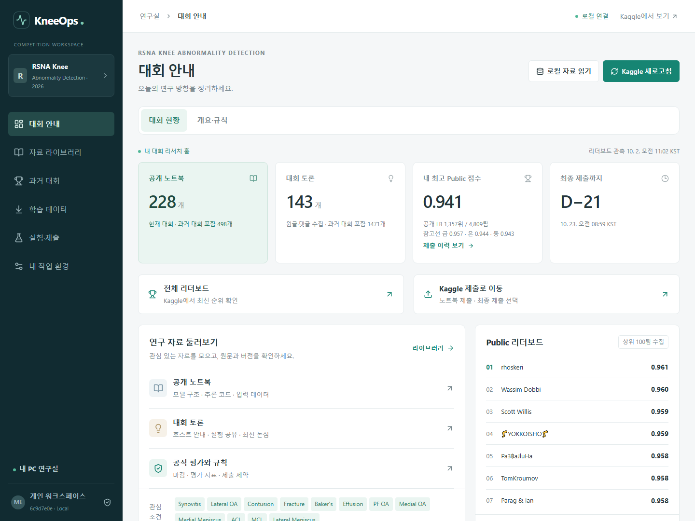

KneeOps는 로컬 1인용 대시보드(FastAPI + React, 전문 검색이 있는 SQLite, 127.0.0.1에만 바인딩)입니다. 대회의 노트북, 토론, 리더보드, 우리 제출을 수집하고, 공식 페이지를 한국어로 번역해 보여주고, 라벨 출처·fold·해시가 같을 때만 실험을 비교하고, MRI study를 로컬 뷰어로 열었습니다. 자세한 내용: [docs/DASHBOARD.md](docs/DASHBOARD.md)(영문).

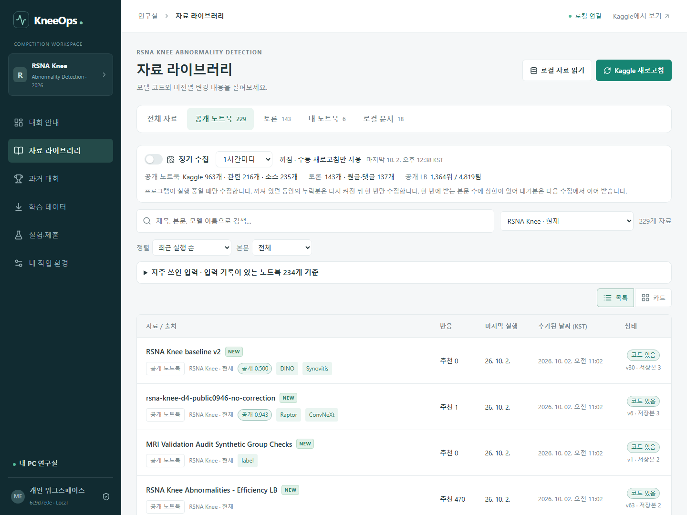
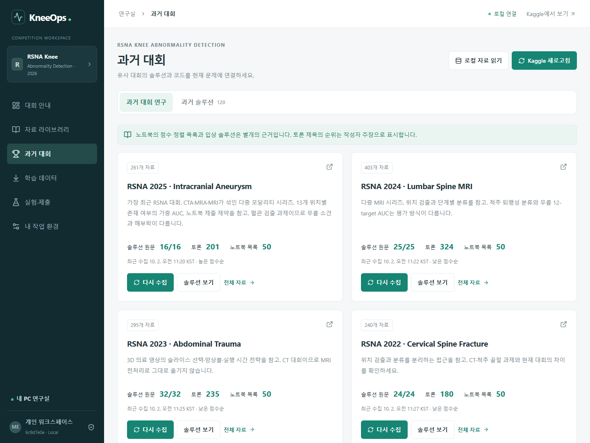

*로컬 대시보드 화면이며 대회 영상·라벨·판독문은 보이지 않습니다.*

## 16. 저장소 구성

```text
README.md, README.ko.md   이 보고서 (영문 / 한국어)
NOTICE.md, LICENSE        출처, 이미지 저작자 표시, 라이선스
docs/
  EXPERIMENTS.md          계열별 모든 제출, 7-렌즈 실험, K1 holdout 실험
  DASHBOARD.md            KneeOps 대시보드
  data/submissions.csv    파이프라인 제출 97개: 날짜, 이름, Public, Private, 상태, 계열
  figures/                이 보고서의 그림
tools/                    분석, 출시 단계 빌더, 승인·제출 도구
monitoring/               KneeOps 로컬 대시보드 (FastAPI + React)
training/                 학습 스크립트와 설정
tests/                    도구와 대시보드 테스트
kaggle/                   노트북 소스 (가중치 없음)
agents.md, plan.md        프로젝트 규칙 / 최종 쌍 규칙과 작업 큐 (작성 그대로, 소유자 인용 제거)
discoveries.md            발견 기록, discoveries.ko.md는 한국어 번역
handoff.md                세션 간 사건 기록
ledger/                   근거 측정값과 제출 시도 장부
docs/reports/             최종 결과, 종합 보고서, 연구 카탈로그, 그림 안내, 리뷰 원본, 감사
docs/architecture/ ...    대회 중 작성한 내부 문서 (architecture, decisions, handoffs, history, learning,
                          legacy, plans, research, runbooks)
research/                 공개 노트북과 아이디어 검토
experiments/final/        최종 Kaggle 노트북 두 개
```

**포함하지 않은 것:** 대회 데이터(DICOM 영상, 라벨, 판독문, study·series 식별자), study별 예측, 모델 가중치(공개·자체 모두), 비공개 Kaggle 데이터셋 내용, 자격 증명, 실행 캐시와 로그. 조정 파일과 도구 안의 경로는 원래의 비공개 작업 공간을 가리킵니다.

## 보고서와 탐색

이 저장소에는 결과 발표 전 기준 시점(10월 22일 18:15 KST)에 작성한 보고서와 원본 연구 그림도 그대로 남아 있습니다. 작성된 그대로 보존하며, 그 안의 "결과 대기" 상태는 위의 최종 결과로 대체됩니다.

| 파일 | 내용 |
|---|---|
| [최종 결과](docs/reports/final-results.ko.md) / [Final results](docs/reports/final-results.md) | Private 점수와 순위, 확정된 최종 쌍, 마지막 날 제출들의 결과 |
| [한국어 종합 보고서](docs/reports/project-summary-20261022.ko.md) / [Consolidated report](docs/reports/project-summary-20261022.md) | 결과 전 상태 전체: 진행 과정, 후보, 정확한 수식, 실패, 최종 쌍 규칙 |
| [연구 카탈로그](docs/reports/research-catalog-20261022.md) | 발견 390개 전부의 ID·제목·날짜·리뷰 상태(부정적·결론 불가 결과 포함) |
| [그림 안내](docs/reports/visuals-20261022/README.md) | 원본 다이어그램·차트 4종(study→예측, 후보 계열 지도, public 점수 스냅숏, full-bag 근거)과 원자료·재현 코드 |
| [제출 전 리뷰 원본](docs/reports/pre-result-review-evidence-20261022/README.md) | U, P4, U4의 독립 리뷰(실행 확인과 수식 재계산) |
| [문서 감사](docs/reports/documentation-audit-20261022.md) | 문서 점검 결과, 수정 사항, 남은 한계 |
| [외부 저장소 정리 결과](docs/reports/external-cleanup-result-20261022.md) | 대회 후 저장 공간 정리: 지운 것과 남긴 것 |
| [갱신 안내](docs/reports/final-results-update-guide.md) | `docs/reports/final-results-data.json`으로 결과 페이지 두 개를 다시 만드는 방법(`python tools/render_final_results.py`) |
| [discoveries.md](discoveries.md) / [discoveries.ko.md](discoveries.ko.md) | 발견 기록 원문(영어)과 한국어 번역 |
| [handoff.md](handoff.md), [plan.md](plan.md), [agents.md](agents.md) | 사건 기록, 최종 쌍 규칙과 작업 큐, 프로젝트 규칙과 실수 기록 |
| [ledger/](ledger/) | 근거 측정값과 제출 시도 장부 |

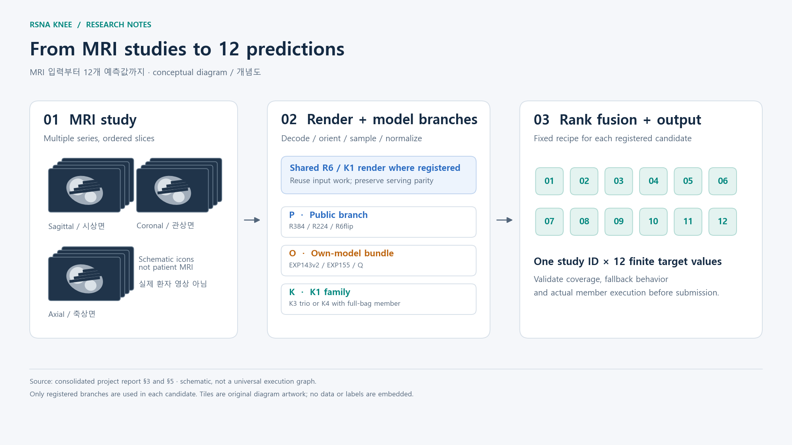

*결과 전 보고서의 원본 그림입니다(도식 아이콘이며 환자 영상이 아닙니다).*

## 라이선스

우리 코드와 문서: Apache License 2.0([LICENSE](LICENSE)). 사용한 공개 Kaggle 작업은 원작자의 라이선스를 따릅니다([NOTICE.md](NOTICE.md)). MRI 예시 이미지는 각각의 Creative Commons 라이선스를 따릅니다(NOTICE.md).
