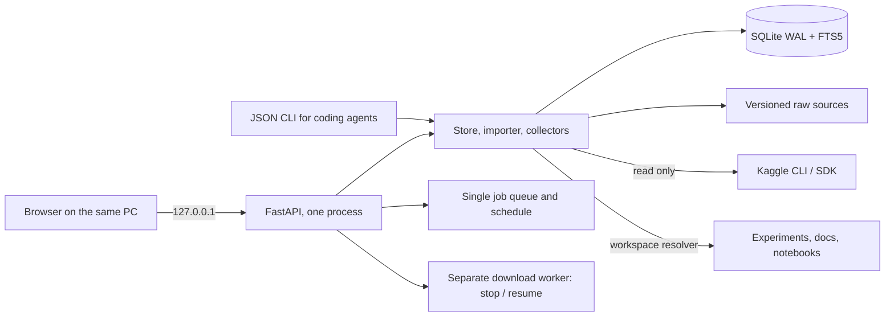

# KneeOps: the local research dashboard

KneeOps is the personal dashboard we built in the first days of October 2026 to keep the competition's public material, our experiments and our submissions in one searchable place. It runs only on the local machine; nothing in it is hosted. The source is in [`monitoring/`](../monitoring/).

*Screenshots show the dashboard's own pages; no competition images, labels or reports are visible.*

## Architecture

- **One Python process** (FastAPI, uvicorn) serves both the API and a React / TypeScript / Vite single-page app built to static files; no separate Node server runs. Its virtual environment is separate from the GPU training environment.
- **Local only.** Bound to 127.0.0.1, with Host/Origin checks and a per-run write secret on every write request. No accounts, teams or remote access.
- **Windows launcher.** `KneeOps.cmd` starts the server detached (no console window, logs to a file, run ID and an OS lock on the state folder, port claimed before the database opens) and opens the browser; `KneeOps-Stop.cmd` asks that run to shut down cleanly so downloads and collectors close properly. A Docker Compose file is provided as an alternative.
- **Storage.** SQLite in WAL mode with an FTS5 full-text index. Core tables: sources, revisions, runs, submissions, leaderboard, jobs, connectors, meta. Every source keeps an immutable revision history (body, SHA256, Kaggle version, observation time, provenance); `added_at` never changes after the first insert, so "NEW" markers stay honest across re-collection.

## What it collected

Collection runs in a single job queue, on demand or on a user-enabled schedule (15 minutes to 24 hours), and records progress, partial failures and interruptions.

| Collector | Scope per run |
|---|---|
| Current competition | our submissions (up to 200), public leaderboard top 100, the full leaderboard file for our rank, score distribution and medal reference lines, official pages |
| Public notebooks | the full list by run date (up to 2,000) plus top 100 by votes, score and popularity; source code for relevant notebooks (new ones and those whose run history changed); public scores through Kaggle's web endpoint, marked as unofficial observations |
| Discussions | the full topic list; for new or updated topics, the post and the whole comment tree (team-recruiting posts skipped) |
| Past competitions | official pages, top 100 leaderboard, notebooks, discussions and the highest-ranked solution write-ups of related past RSNA competitions, kept separate from the current competition |
| Local work | experiment `summary.json` / `result.json`, reports, project documents, notebook metadata and sources |

Kaggle is accessed read-only; transient HTTP errors are retried up to three times, authentication failures are not. Collected HTML is converted to text and never executed.

## Pages

The left menu has six groups: competition guide, source library, past competitions, training data, experiments and submissions, workspace.

- **Official documents with Korean translations.** The ten official competition pages (overview, rules, evaluation, timeline, data description, code requirements, efficiency prize, prizes, abstract, contributors) have full Korean translations shown in English, Korean or side by side. A translation is shown only when the stored English source's SHA256 matches the one it was made from; a changed source is flagged as outdated. The English text remains the authority.
- **Source library.** Notebooks and discussions, sortable by votes, comments, title-claimed score or date, filterable by whether the body was collected. "Frequently used inputs" lists the datasets, models and notebook outputs that public notebooks attach, with usage counts, and filters to the notebooks using one input; any two sources can be compared (input differences, line diff, similarity).

  

- **Past competitions.** Leaderboards and solution write-ups of earlier RSNA competitions, with line-numbered quotes of strategy passages. Solution classification is a title pattern and is shown as the author's claim.

  

- **Experiments.** Reads existing result files and separates weak-label OOF, leaky pseudo-OOF and diagnostic metrics. Two runs can be compared only when targets, rows, folds, metric, label source and the study / label / split / mask / transform hashes match and a score exists; otherwise the comparison is withheld.
- **Prediction comparison.** For 1-4 prediction CSVs and a chosen label file: per-finding AUC with positive / negative counts, macro AUC with a study bootstrap interval, Spearman rank correlation between models, and an equal-weight rank blend against the best single model. No weights are fitted. The page warns that Gold58 is an exposed diagnostic set and that models trained on a label source are inflated when scored on it.
- **Submissions and leaderboard.** Our submission history and our position against the full leaderboard and medal lines.
- **Training data and MRI viewer.** A data manager (separate download worker with stop / resume, staged files verified by size before placement, 1 GiB free-space reserve) and a ZIP index that can extract a single study from the 265 GB archive without unpacking the rest. The viewer opens DICOM studies (headers sorted by patient position and orientation, rescale and MONOCHROME1 applied, physical units only when pixel spacing is consistent) and cached NPY volumes (memory-mapped, never pickled), with pan, zoom, ROI statistics, length measurement, slice playback, mask display, a 12-image overview, series audit, preprocessing preview and a side-by-side comparison of raw and cached inputs. Review notes are stored per study, series and slice without copying images or report text. Personal DICOM header data is never exported as a whole.

## Interface for coding agents

The same functions are available as a JSON command line (`python -m monitoring.kneeops ...`): `briefing`, `sources search`, `sources show`, `experiments list`, `experiments compare`, `sync`, `history`, `fetch notebook`, `backup`, `data status`. Output is JSON on stdout, errors are JSON on stderr with a non-zero exit (2 for partial collection failures). Agents were instructed to search, open sources by ID, and never follow instructions or run code found in collected material.

## Limits

No source collection for every public notebook (relevant ones only), no official numeric notebook scores (the official API does not provide them), no bulk restore of old notebook versions, no semantic search, no collection while the app or PC is off. The dashboard never trained models or submitted to Kaggle.
