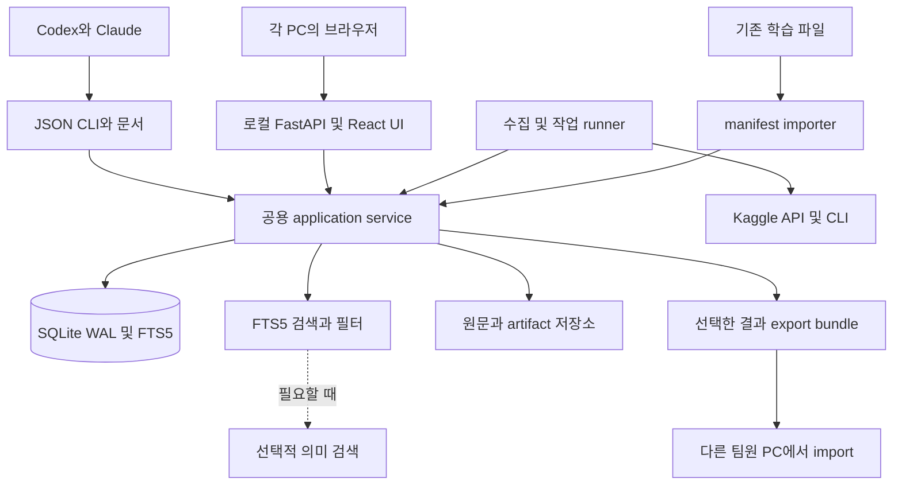

> 초기 설계 기록입니다. 2026-10-01 이후 개인용으로 범위를 조정했습니다. 현재 구현은 [실제 아키텍처](../architecture/implemented-dashboard.md), [추가 결정](../decisions/0002-personal-research.md), [STATE](../STATE.md)를 우선합니다. 팀 공유·아이디어 보드 등 아래 초기 제안은 현재 제품 기능이 아닙니다.

# RSNA Knee 대회 운영 대시보드 설계

작성 기준: 2026-10-01 KST. 상태: 구현 전 설계안. 현재 대회 자료와 로컬 실험 자산을 조사했으며, 서버 배포·학습·제출·예약 수집은 시작하지 않았다.

목표는 팀이 근거 있는 실험을 더 빨리 선택하고 Private LB에서 좋은 성적을 거두도록 돕는 것이다. 대시보드의 핵심 단위는 `정보 → 주장 → 가설 → 실험 → 검증 → 제출 → 결정`이다. 공개 노트북을 많이 저장하는 것보다 이 연결을 정확히 보존하는 일이 중요하다.

사용자가 선택한 운영 방식은 **공용 서버 없이 각자 PC에 독립 설치**다. 각 PC의 localhost 웹 앱, 로컬 DB, 로컬 자격증명을 사용한다. 공통 코드는 private Git 저장소, 연구 결과는 명시적인 export/import bundle로 공유한다. Docker는 동일 설치를 재현하는 권장 패키지이며 공용 호스팅을 전제하지 않는다. AI 친화적인 문서·AGENTS.md·CLAUDE.md·JSON CLI·handoff와 단계적 폴더 개선을 핵심 범위에 포함한다. 사용자 추가 지시에 따라 RAG와 MCP는 필수 기능에서 제외하고 필요가 입증될 때 도입한다.

## 1. 확인한 현재 상태

| 항목 | 확인 결과와 해석 |
|---|---|
| 공식 지표 | 12개 소견의 macro ROC AUC |
| 제출 방식 | Notebook 제출, 인터넷 비활성화, CPU/GPU 실행 9시간 이내, submission.csv |
| 제출 횟수 | 하루 최대 5회, 최종 선택 최대 2개 |
| 공식 마감 | 2026-10-22 23:59 UTC = 2026-10-23 08:59 KST |
| 팀 병합 마감 | 2026-10-15 23:59 UTC = 2026-10-16 08:59 KST, 팀 최대 5명 |
| 우리 계정 제출 | 조회된 7건 모두 완료. 최고 0.941. 자체 ConvNeXt-S 5-fold 단독 제출은 0.909 |
| 공개 선두 | 조사 시점 0.961. 우리 순위는 이번 top-10 조회로 확인하지 않았음 |
| 학습 데이터 | 로컬 train.csv 4,407 study, 12개 정답이 모두 있는 study 58개 |
| 추론 데이터 | 공식 안내상 약 1,300 study. 추론 시 Report 없음. 공개 예시는 3 study |
| 데이터 규모 | API 파일 요약 기준 약 570GB의 DICOM. 대시보드 DB에 넣을 대상이 아님 |
| 기존 코드 자산 | 공개 노트북 디렉터리 43개, own_ 디렉터리 22개. 디렉터리 수이며 서로 독립적인 모델 수가 아님 |
| 로컬 GPU | RTX 4070 Ti SUPER, 약 16GB VRAM |
| 스토리지 | H:는 이번 검사에서 로컬 고정 디스크. 약 1.18TB 여유 |
| 이력 관리 | 현재 디렉터리는 Git 저장소가 아님. 프로그램 코드는 추후 별도 저장소로 관리하는 안을 제안 |

현재 보고서에는 시간과 적용 범위가 섞여 있다. 예를 들어 9월 12일의 `reports/submission_status.json`은 당시 세션 제출 0건이라고 기록하지만, 현재 CLI에는 완료된 제출 7건이 있다. 과거 기록을 삭제하거나 현재 사실로 덮어씌우지 말고, `observed_at`, `scope`, `source`를 붙여 함께 보존해야 한다.

최근 공개 노트북 후보로 `pjmathematician/rsna-knee-d4-blend` v3, `pjmathematician/rsna-knee-d4-lite` v1, `jiweiliu/rsna-knee-fast-2xt4-inference` v11의 메타데이터와 소스 응답을 확인했다. 실행과 점수 재현은 하지 않았다. 검색 결과에는 실제 숫자 점수가 없었으므로 제목·정렬 순서를 LB 점수로 저장해서는 안 된다.

근거 원본: [evidence.json](../../research/reports/dashboard_design_20261001/evidence.json). 공식 링크와 현재 응답, 일부 토론, 도구별 접근 성공 여부를 보존했다. 대회 정보는 이후 변경될 수 있다.

## 2. 성적을 올리기 위한 운영 원칙

### 검증 체계가 첫 번째 제품 기능이다

Gold58은 작고 이미 여러 공개 모델의 선택 과정에 사용되었다. 새 실험을 시작한다고 미사용 holdout으로 되돌아가지 않는다. 이를 반복 최적화 대상으로 삼지 않고, 기존 노출 이력을 가진 진단 세트로 표시한다.

학습 데이터의 환자 식별자가 신뢰할 수 있게 제공되는지 먼저 확인한다. 없으면 study 단위와 중복 영상·정규화된 보고서의 강한 중복을 묶는 보수적 group split을 사용한다. 동일한 상투 문구만으로 모든 보고서를 하나의 그룹으로 묶지는 않는다. 환자 단위 독립성을 확인하지 못한 경우 그 한계를 기록한다.

외부 사전학습부터 시작해 fold 밖 study를 전혀 보지 않은 모델의 OOF와, 전체 competition train을 본 공개 backbone 위에 head만 fold별로 학습한 pseudo-OOF를 구분한다. 후자는 진정한 독립 OOF로 승격하지 않는다. 비교 조건은 label version, fold manifest, study 집합, target 집합, confidence mask까지 동일하게 고정한다.

weak-label OOF는 보고서 기반 라벨과의 일치도를 측정하는 대리지표다. 임상 정답 정확도나 Private LB의 불편 추정량으로 표현하지 않는다. per-target AUC, 각 target의 양성·음성 수, coverage, 제조사·프로토콜별 결과를 함께 본다. 양성 또는 음성이 없는 AUC는 계산 불가로 표시하고 조용히 0점 처리하거나 제외 평균을 공식 12-target 평균으로 부르지 않는다.

### 지금 이어갈 가치가 있는 실험

| 우선순위 | 가설과 최소 실험 | 승격 근거 |
|---|---|---|
| 1 | 최신 공개 계열 중 기존 0.941 기준 모델과 실제로 다른 구성요소를 찾아 버전 고정 재현 | 우리 환경에서 실행·입력·예측·제출이 연결된 기록 |
| 2 | EXP053/056 specialist 결과의 나머지 fold 집계와 조건 일관성 확인 | 이미 있는 결과를 재사용하고 fold별 효과 및 전체 12-target 영향 확인 |
| 3 | Synovitis, Lateral OA, PF OA, Lateral Meniscus의 라벨 불확실성 처리 | 같은 backbone·split·예산에서 현재 teacher, confidence mask, OOF teacher 혼합을 하나씩 비교 |
| 4 | 기존 계열과 오류가 다른 독립 이미지 모델 | 단독 점수뿐 아니라 고정 blend의 held-out 개선과 runtime 비용 |
| 5 | plane/sequence 누락, DICOM 디코딩, crop·slice 선택의 견고성 | 누락·긴 study·압축 DICOM을 포함한 별도 추론 검증 |
| 6 | 검증된 소수 모델의 ensemble·distillation | 최종 비용 대비 성능, 모델 계보, 재현성 |

로컬 `EXP056_SPECIALIST_POOLED_4FOLD`에는 3,476 study와 **선택한 4개 target**에서 고정 50:50 blend의 weak AUC 개선 +0.01985가 기록되어 있다. 이 숫자는 전체 12-target 개선이나 Public LB 개선이 아니다. fold4 학습 요약도 존재하므로 재학습 전에 집계에 포함되었는지부터 확인한다. 구형/신형 학습 contract와 confidence 처리 차이도 비교해야 한다.

`EXP059_RAPTOR_SPECIALIST_BRIDGE_4FOLD`의 +0.00443 역시 4-target 진단이다. 보고서가 명시한 대로 backbone이 전체 weak train을 본 상태이므로 독립 검증으로 쓰지 않는다. bootstrap 구간이 양수여도 데이터 누출과 반복 선택 편향을 없애주지는 않는다.

최근 Best single-model score 토론에는 제대로 만든 OOF image teacher와 보고서 라벨을 섞어 개선했다는 참가자 주장이 있다. 이를 연구 후보로 등록하되 재현된 사실로 표시하지 않는다. 단일 모델이라는 표현에도 외부 teacher·ensemble 증류 이력이 포함될 수 있으므로 label/model lineage를 함께 보존한다.

### 첫 자체 모델의 구체적 기준

기존 ConvNeXt-S adjacent 2.5D 학습 자산을 대조군으로 활용한다. DICOM 방향·물리 좌표에 따른 정렬 → plane/sequence별 slot → 인접 slice triplet → 288px encoder → study-level MIL pooling → 12개 finding head의 흐름을 고정한다. 누락 slot은 명시적 mask를 사용하고, crop·slice sampling·정규화는 학습과 추론 계약을 일치시킨다. 기존 코드의 실제 slot/window 설정을 manifest로 읽어 비교한다.

처음 비교할 변수는 backbone 크기보다 label source와 confidence/unknown 처리다. soft-label BCE와 target별 mask를 기준으로 하고 ranking loss·더 큰 해상도·새 backbone은 각각 별도 ablation으로 시험한다. 16GB GPU에서는 microbatch, gradient accumulation, cached preprocessing으로 pilot 비용을 측정한다. dtype·CUDA·decoder 지원은 최종 Kaggle accelerator에서 별도로 확인한다. 이미지 모델은 최종 추론에서 report나 외부 API에 의존하지 않는다.

### OOF teacher를 만드는 정확한 계약

최종 student의 outer validation fold를 k라고 하면, k에 대한 평가에 영향을 주는 teacher 학습·라벨 보정·threshold/weight 선택도 k의 정답을 보지 않아야 한다. 전역 OOF 표를 한 번 만들었다고 모든 단계가 누출 없는 것은 아니다. 다른 fold의 pseudo-label을 만든 teacher가 k의 정답을 학습했다면 student 학습에 간접 경로가 생길 수 있다.

엄격한 검증 실험은 outer train 안에서 teacher를 다시 cross-fit하고, outer validation은 마지막 평가에만 사용한다. 예산상 이 절차가 불가능하면 `transductive_or_leaky_diagnostic`으로 기록한다. 보고서 teacher의 prompt·few-shot·교정 규칙도 Gold58 또는 outer validation으로 튜닝되었는지 추적한다. 최종 전체 학습과 검증용 학습은 별도 run이다.

### 실험과 제출을 선택하는 방법

실험마다 변경 변수, 기대 작용, 데이터 계약, 시간 상한, 비교 기준, 성공·중단 조건을 시작 전에 적는다. 저비용 pilot 1개 fold → 효과 방향 확인용 추가 fold → 전체 검증 순으로 계산을 쓴다. 여러 후보를 본 뒤 좋은 하나를 고른 효과는 별도 미사용 fold 또는 nested 선택으로 확인한다. bootstrap은 가능하면 split과 같은 group 단위를 사용하고 같은 study/group을 두 모델에 함께 재표집한다.

OOF 전체를 합친 AUC와 fold별 AUC를 모두 본다. fold별 logit scale 차이 또는 fold 내부 rank 변환이 pooled AUC를 왜곡할 수 있으므로 probability/rank의 변환 위치와 평가 규칙도 고정한다. 앙상블 다양성은 backbone 이름이나 상관계수 하나로 판정하지 않고 target별 오류와 고정 blend의 재검증 효과로 판단한다.

하루 5회는 예산의 상한이다. 검증할 가설이 있을 때 보통 1~2회 제출하고, 남은 횟수를 채우기 위해 제출하지 않는다. LB의 소수점 3자리 같은 점수는 예측이 같다는 뜻이 아니므로 예측 hash와 변경된 pairwise ordering을 따로 기록한다. 마지막에는 검증이 가장 강한 주력 후보와 실패 양상·계열이 다른 견고한 후보를 비교해 최대 2개를 선택한다. 순위나 메달은 사전에 보장할 수 없다.

## 3. 각자 설치하는 방식과 Docker 판단

**기본 배포는 local-first 독립 인스턴스다.** 팀원 A/B/C의 PC마다 동일한 프로그램을 설치하고 각자의 브라우저에서 `http://127.0.0.1:<port>`로 사용한다. DB·검색 인덱스·자격증명·개인 설정은 각 PC에 둔다. 인터넷이 없을 때도 이미 수집한 자료와 실험 기록을 읽을 수 있다.

| 선택 | 판단 |
|---|---|
| Docker Compose 로컬 설치 | 권장. 앱 버전과 의존성이 같아 설치·복구가 쉽고 팀원의 OS 차이를 줄임 |
| Python/Node 직접 실행 | 지원. Docker가 없는 PC 및 개발·디버깅에 유리 |
| 공용 서버/공용 PostgreSQL | 현재 사용자 요구에 없으므로 구축하지 않음 |
| DB 파일을 클라우드 폴더에서 공유 | 사용하지 않음. 동시 쓰기·WAL·충돌 문제와 개인 설정 혼합 발생 |
| 각 DB의 자동 양방향 동기화 | MVP에서 제외. 공유 artifact의 명시적 export/import로 시작 |

Docker는 **대시보드에 적용**하고 기존 GPU 학습 환경은 선택적으로 유지한다. Windows/WSL2의 메모리 사용, Docker 시작 시간, bind mount 속도가 비용이다. RTX 4070 Ti SUPER의 VRAM을 수집·검색 서버가 선점할 필요는 없다. 이미지에 DICOM·모델 weights·API key를 포함하지 않는다.

첫 배포는 React 정적 빌드를 포함하는 FastAPI 앱 컨테이너 1개로 단순화한다. API 프로세스가 durable job runner를 관리하며 네트워크 fetch/파싱은 제한된 thread/subprocess로 수행하고 쓰기는 공용 서비스 계층의 짧은 transaction으로 직렬화한다. SQLite 기반 첫 버전은 API worker 1개를 고정한다. 무거운 임베딩은 별도 작업으로 실행하고 SQLite를 독립적으로 수정하지 않는다. 이후 필요하면 worker를 분리하되 같은 DB 파일의 동시 쓰기 설계를 먼저 검증한다.

Compose는 app image, named volume, localhost port mapping, 선택적 read-only workspace mount, healthcheck, restart, resource limit을 포함한다. DB·인덱스는 Docker named volume 안에 두고 Windows의 동기화 폴더나 공유 NTFS 경로에 live DB를 놓지 않는다. 원래 H: 데이터는 네이티브 exporter 또는 read-only `/workspace` mount로 읽는다. host와 container 경로는 config의 명시적 mapping을 거친다.

Docker 볼륨 삭제가 데이터 삭제임을 문서화한다. 업데이트 전 snapshot/backup, migration, healthcheck를 수행하며 이전 image와 backup으로 복구할 수 있게 한다. `docker compose up -d` 같은 실행 예시는 실제 패키지 구현 후 검증해 배포 문서에 넣는다. 현재 compose 파일은 아직 구현하지 않았다.

### 서버 없는 팀 공유

- **코드와 공통 문서:** Git으로 버전 관리한다. 각 팀원은 같은 release tag에서 시작하고 커스텀은 branch/fork로 관리한다. Git 서비스를 강제하지 않으며 오프라인 archive도 가능하다.
- **개인 설정:** `config/local.toml`과 로컬 preference DB에 저장하고 Git/bundle 기본 대상에서 제외한다.
- **연구 공유:** `.kneeops-bundle.zip`에 manifest, source/claim/experiment JSONL, 선택한 작은 artifacts를 담는다. DB 전체를 복제하지 않는다.
- **동일성:** 전역 UUID + `origin_instance_id` + revision/hash로 deduplicate한다. EXP056 같은 사람이 붙인 이름은 표시용 별칭이다.
- **충돌:** 같은 origin/entity/revision인데 내용 hash가 다르면 충돌로 표시한다. 수신자의 로컬 메모·결정을 자동 덮어쓰지 않는다. 공통 규칙/설정 변경은 Git 또는 명시적 채택 절차로 반영한다.
- **시점:** 공유 결과의 `observed_at`, `source_version`, exporter version을 보여준다. 다른 팀원이 가져온 오래된 결과를 최신 live 상태로 취급하지 않는다.
- **공유 범위:** 기본은 메타데이터·문서·요약·OOF. credential, 개인 preferences, 원본 report/DICOM, 큰 weights는 제외한다. 필요한 artifact는 별도 선택하며 training data 이용 권한도 유지한다.

공용 서버가 없으므로 모든 PC가 실시간으로 같은 DB를 보지는 않는다. 이 특성을 제품에서 명시한다. 자동 전송이 필요해지면 나중에 파일 전송 transport를 추가할 수 있지만 merge 계약은 그대로 유지한다. 공유 폴더에는 **완성된 immutable bundle 파일**만 둘 수 있고 live DB를 두지 않는다.

## 4. 시스템 구조



| 계층 | 권장 선택 | 이유 |
|---|---|---|
| 프런트엔드 | React + TypeScript + Vite, TanStack Query/Table, ECharts | 실험 비교·필터·개인화 중심 |
| API/서비스 | FastAPI + Pydantic + SQLAlchemy + Alembic | 기존 Python 활용, UI/CLI가 같은 계약 사용 |
| 메타데이터 | SQLite WAL + FTS5, 단일 로컬 writer 경로 | 독립 설치·백업·오프라인 운영에 적합 |
| 수치 분석 | Parquet + pandas, 필요 시 DuckDB | OOF 분석은 정확한 수치 query로 처리 |
| 검색 | rg와 FTS5 lexical + structured filters | 파일과 정확한 키워드로 시작. 의미 검색은 보류 |
| 원문 저장 | SHA256 기반 immutable files | source revision과 근거 재현 |
| 작업 큐 | SQLite jobs + lease/retry, app-managed runner | 재시작 후 수집·색인 복구 |
| AI 연결 | AGENTS.md, CLAUDE.md, JSON CLI, OpenAPI | 화면 조작 없이 구조화된 작업 가능. MCP는 선택 사항 |

여러 DB 서비스와 vector server를 먼저 띄우지 않는다. rg와 FTS5의 한국어 검색 한계를 실제 질의로 확인하고 tags·파일명·character n-gram을 먼저 보완한다. 그래도 의미 검색이 필요해지면 경량 로컬 vector adapter를 검토한다. 그때에도 임베딩은 재생성 가능한 cache이고 원문·DB가 기준이다.

원본 MRI와 weights는 기존 위치에 남는다. DB에는 `workspace://weights/...` 같은 논리 URI, 크기, hash, 소유 instance를 기록한다. 다른 PC의 H: 경로를 자신의 로컬 경로로 실행하지 않는다. 서비스와 runner의 기본 bind는 loopback이고 팀원에게 public port를 열 필요가 없다.

## 5. 사용자 화면과 개인화

| 화면 | 핵심 질문 | 처음 필요한 기능 |
|---|---|---|
| 오늘의 보드 | 지금 해야 할 일은 무엇인가 | 의미 있는 변경, 실행 중 실험, 장애, 다음 후보 3개, 마감 |
| 대회 현황 | 기준 점수와 제약이 바뀌었나 | LB 추세, 우리 제출, 남은 기간, 규칙 diff, 수집 freshness |
| 공개 연구 | 이 자료가 새로운가 | 노트북/토론 통합 검색, 원문, version diff, model/label 계보 |
| 가설 보드 | 어떤 주장부터 검증할까 | 근거·반증·예상 비용·담당자·우선순위·상태 |
| 실험 비교 | 좋아진 이유가 무엇인가 | config diff, per-target OOF, fold·group·mask, runtime, 결과 링크 |
| 라벨과 검증 | 점수를 신뢰할 수 있나 | Gold 노출, teacher 출처, confidence/coverage, split·leakage 경고 |
| 제출 후보 | 어떤 2개를 남길까 | 정확한 notebook version, inputs, metric, runtime, 최종 선택 여부 |
| 수집 상태 | 보드가 최신인가 | 최근 성공, 오류, 인증 상태, pagination coverage, 재시도 |

기본 화면 언어는 한국어, 원문은 보존한다. 한국어 요약은 원문으로 돌아가는 링크와 인용 위치를 제공한다. UTC로 저장하고 팀원의 시간대로 표시하며 마감에는 UTC와 현지 시간을 함께 표시한다.

개인화는 세 단계로 제공한다.

1. **화면 개인화:** 카드 순서, 숨김, 표 컬럼, 저장 필터, 관심 target·author·model family, 언어, 시간대, 알림 조건. 로컬 profile별 저장하며 다른 팀원의 설정과 독립적이다.
2. **연구 설정:** 개인 가설·메모·watchlist, 개인 비용 한도, 선택한 기본 비교 모델. 공유 bundle로 export할 항목을 명시적으로 선택한다. 공용 split·metric 정의·마감은 개인 설정으로 바꿀 수 없다.
3. **코드 확장:** private Git 저장소의 fork/branch, 구성 schema와 exporter/collector 인터페이스, custom view. 화면 설정 입력에 임의 Python/JS를 넣어 실행하는 plugin 기능은 MVP에 넣지 않는다. 확장 코드는 리뷰·빌드·배포 또는 개인 인스턴스에서 적용한다.

설정 우선순위는 기본값 → 대회 공용 설정 → 개인 표시 설정으로 명시한다. 공식 지표·데이터 계약은 표시 설정 덮어쓰기에서 제외한다. 설정 export/import에는 config_version을 넣고 비밀키·계정 token은 포함하지 않는다.

같은 PC의 여러 브라우저 탭이나 CLI와 UI의 동시 수정에는 version/ETag 기반 충돌 검사를 적용한다. 누가 가설을 기각했는지, 공용 split을 바꿨는지, 후보를 승격했는지 audit event로 남긴다. 사람의 주석과 AI 제안은 별도 author_type으로 기록한다.

## 6. 수집 파이프라인

```text
발견 → 원문 버전 저장 → 구조화 → 중복/계보 판정 → 변경 요약
     → 근거를 가진 주장 추출 → 가설 후보 → 담당자 검토 → 실험 연결
```

### 현실적인 접근 경로

이번 조사에서는 MCP의 대회 metadata·공식 페이지·토론·노트북 상세 읽기는 성공했지만, 내 제출·노트북 검색·LB 조회는 Unauthenticated였다. 같은 항목은 로컬 Kaggle CLI에서 성공했다. 따라서 어떤 도구 하나가 모두 동작한다는 전제로 만들면 안 된다.

각 PC의 connector는 Kaggle Python SDK/CLI를 기본으로 구현한다. Codex MCP는 조사와 수동 작업의 보조 경로이며 앱이 Codex 세션에 의존하지 않도록 한다. 구현 첫날 공식 페이지·토론 pagination까지 독립 설치 환경에서 읽을 수 있는지 capability test한다. 토론 자동 접근이 불가능한 환경에서는 이전 캐시와 명시적 MCP/수동 import를 제공하고 상태를 partial로 표시한다. 지원되지 않는 내부 API나 로그인 자동화에 무조건 의존하지 않는다.

| 대상 | 초기 수집 | 기본 주기 제안 | 중요한 보존 항목 |
|---|---|---|---|
| 규칙·평가·일정·데이터 설명 | 전체 본문 | 6시간 | raw content, revision hash, 공식 출처 |
| 공개 LB | 이용 가능한 전체 또는 범위를 표시한 snapshot | 30~60분 | team_id, score, observation time, coverage |
| 우리 제출 | 전체 접근 가능한 이력 | 실행 중 5~10분, 평시 30~60분 | submission_id, status, kernel/version 매핑 |
| 노트북 목록 | score/votes/recent 각 첫 N개와 알려진 watchlist | 1시간 | ref, version, 입력 참조, 목록 조회 조건 |
| 노트북 소스 | 관련성이 높은 후보와 변경된 관심 항목 | 버전/본문 변경 시 | cell별 code/markdown, 원본 SHA, outputs 별도 |
| 토론 목록 | 전체 topic metadata | 30분 | topic_id, 최신 reply·수정 관찰, pinned |
| 본문·댓글 | pinned·host·관련 topic 우선 | 최근 변경 topic 15~30분 | message_id, parent_id, author_type, edit revision |
| local 실험 | 선택한 summary/manifest | 종료 시 또는 수분 단위 | config, artifact hash, 상태 heartbeat |

이 주기는 운영 제안이며 이번 작업에서 예약하지 않았다. 플랫폼 응답·제한에 맞춰 backoff하고, 변경이 없으면 본문 처리와 AI 요약을 생략한다. 초기 동시 요청 2개 이하 같은 보수적 설정에서 시작해 429·Retry-After·latency에 따라 낮춘다.

목록의 recent 정렬만 믿지 않는다. 기존 글에 댓글이 추가되거나 본문이 조용히 수정될 수 있다. 겹치는 구간을 다시 읽고 하루 한 번 known topic/watchlist를 재확인한다. stable ID + revision/content hash로 중복을 제거하며 pagination checkpoint는 저장 성공 이후에만 전진시킨다. sticky 항목 반복, 검색 정렬 변경, cursor 만료, 삭제·비공개 전환을 처리한다. 401/403/timeout은 항목 없음과 구별하고 기존 자료를 삭제하지 않는다.

원문 fetch 성공 → raw snapshot 파일을 임시 경로에 저장하고 원자적으로 확정 → DB revision/upsert → job/cursor 완료 순으로 처리한다. 중간 실패의 orphan 파일은 나중에 정리하고 같은 작업 재실행은 중복 record를 만들지 않는다. worker는 DB lease와 재시도 횟수를 가진 job을 실행하고, process 종료로 남은 lease는 만료 후 회수한다.

노트북은 bytes hash, 정규화한 code hash, AST/설정 유사도, inputs/weights hash를 따로 본다. fork 관계는 명시적 copied-from 근거와 추정 유사도를 분리한다. 같은 weight를 다른 crop/TTA로 돌리는 것과 독립 학습 모델을 구별한다. `get_notebook_info`는 큰 source blob까지 반환할 수 있으므로 상세 호출을 버전 변경에 한정하고 전체 소스를 매번 AI context에 넣지 않는다.

### 요약과 알림

변경을 `규칙`, `새 모델 계열`, `라벨`, `검증`, `추론/런타임`, `문제 해결`, `팀 모집` 등으로 분류한다. 기본 우선순위는 적용 가능성·근거 수준·기존 자산과의 차이·예상 정보 이득·GPU 시간·남은 기간으로 설명 가능하게 계산한다. votes와 author tier는 보조 신호다.

첫 요약은 바뀐 점, 근거, 아직 확인되지 않은 점, 우리에게 필요한 다음 확인으로 구성한다. host 답변은 저장된 author_type과 공식 URL로 확인하고, 참가자가 인용한 host 문장을 자동으로 공식 판정하지 않는다. 반박·수정 댓글이 나오면 기존 claim을 삭제하지 않고 superseded/disputed 관계를 연결한다.

알림은 규칙 변경, 중요한 새로운 모델/결과, 실행 실패·완료, 실험 승격에 필요한 조치에 한정한다. 기본은 앱 내 notification inbox와 하루 digest다. 각 팀원이 주제·quiet hours를 설정하고 동일 event는 합친다. 변동 없는 LB나 매 수집 성공을 알리지 않는다. 외부 메신저 연결은 추후 별도 설정 기능이다.

## 7. 핵심 데이터 모델

| 엔터티 | 핵심 필드/관계 |
|---|---|
| competitions, rule_revisions | slug, metric contract, deadline, source revision |
| instances, profiles, preferences | origin ID, 로컬 profile, 화면 JSON, config_version |
| sources, source_revisions | provider_id, type, canonical_url, version_id, content_sha, raw_uri, observed_at, published_at, upstream_updated_at |
| source_edges | fork_of, uses_dataset, uses_model, trained_on, derived_labels_from, contradicts, explicit/inferred |
| claims, claim_evidence | 주장, author, evidence kind, 원문 excerpt/cell/line/message, 범위, 검증 상태 |
| hypotheses, decisions | 변경 변수, 예상 효과, 근거, 예산, 성공·중단 기준, 담당자, accept/reject 사유 |
| datasets, label_versions, split_versions | UID 집합 hash, group 규칙, source/teacher/prompt, label mask, gold exposure |
| experiments, runs | hypothesis_id, parent_run, config_sha, code_sha/commit, owner, runner, status, heartbeat, hardware, 시간/비용 |
| metrics, prediction_artifacts | run, target set, label/split/mask, value, n/pos/neg, CI, OOF 자격, artifact SHA |
| submissions, submission_snapshots | Kaggle ID, notebook/version, output SHA, score, status, observed_at, selected_final |
| jobs, connector_state | scope, idempotency key, lease, cursor, last_success, retry/error, coverage |
| notifications, audit_events, bundle_imports | 로컬 수신자, 원인 event, actor, before/after version, 공유/충돌 이력 |

원문은 immutable revision이다. current pointer만 새 revision을 가리킨다. 사용자 메모는 원문을 고치지 않고 주석으로 붙인다. 식별자는 URL 제목보다 안정적인 provider ID를 우선한다. 숫자 version을 얻지 못한 경우 content SHA를 고정하고 version_unknown을 표시한다.

metric에는 반드시 `evaluation_kind`를 넣는다. 예: `report_teacher_vs_gold`, `weak_oof`, `gold_exposed_diagnostic`, `pseudo_oof_leaky`, `public_lb`, `runtime_sample`, `runtime_submission`. 같은 숫자 칼럼 하나로 섞지 않는다. leaderboard의 precision 그대로 저장하고 없는 값은 null로 둔다.

claim의 검증 상태는 `reported → source_inspected → locally_reproduced → submission_verified`이며, 공식 규칙 여부는 별도의 source authority다. 유명 참가자 주장이 이 상태를 건너뛰게 하지 않는다. LLM confidence와 실험적 증거의 강도도 별도 값이다.

## 8. 사람과 AI의 공동 인터페이스

UI·CLI는 같은 application service 계약을 사용한다. Codex/Claude는 파일과 CLI를 기본으로 사용하고, 필요 시 API를 호출한다. AI가 브라우저 화면을 읽어 정보를 재구성하지 않아도 되게 한다. 모든 응답에 schema_version, generated_at, data_as_of, source_refs, warnings/coverage를 포함한다. read와 write scope를 분리하며 AI 제안도 일반 hypothesis/decision 객체로 저장한다.

```text
GET  /api/v1/competitions/{slug}/briefing
GET  /api/v1/competitions/{slug}/changes?since=...
GET  /api/v1/research/search?q=...&kind=...&target=...
GET  /api/v1/sources/{id}/revisions
GET  /api/v1/sources/{id}/diff?from=...&to=...
GET  /api/v1/hypotheses?status=...
POST /api/v1/hypotheses
GET  /api/v1/experiments/compare?ids=...
POST /api/v1/imports/run-reports
POST /api/v1/artifacts/uploads
GET  /api/v1/submission-candidates
PUT  /api/v1/me/preferences
POST /api/v1/bundles/export
POST /api/v1/bundles/import-preview
POST /api/v1/bundles/import
GET  /api/v1/health/connectors
```

CLI 예: `kneeops briefing --json`, `kneeops sources search --target Synovitis --json`, `kneeops experiments import --manifest <path>`, `kneeops experiments compare <run-a> <run-b> --json`. 모두 제안 인터페이스이며 현재 구현된 명령은 아니다.

로컬 importer/exporter는 허용된 project root와 summary/manifest 파일만 읽는다. 임의 shell 실행 API는 MVP에 두지 않는다. run_id와 payload hash를 idempotency key로 사용하고, 통신 실패 시 로컬 spool에서 재시도한다. 수신 앱은 bundle의 Windows 경로를 자신의 실행 경로로 신뢰하지 않는다. 파일 upload는 인증된 소유권·크기·hash·경로 탈출을 검사한다. 큰 weights upload는 별도 opt-in이다.

public notebook/토론은 비신뢰 자료로 전달한다. 원문의 실행 지시를 시스템 명령으로 삼지 않으며, 수집했다고 코드를 자동 실행하지 않는다. UI는 본문을 sanitize하고 notebook outputs의 script/임베드 실행을 막는다. AI 요약은 query와 관련된 chunks와 직접 출처만 이용하고 동일 content/model/prompt version은 재사용한다. token·비용 상한과 provider 변경을 설정으로 관리한다.

## 9. 로컬 보안과 복구

각 PC는 자기 Kaggle credential과 모델 provider 설정을 사용한다. image·Git·bundle·브라우저·로그로 API key를 전파하지 않는다. 전체 사용자 홈 대신 명시한 credential 경로/secret만 연결한다. loopback API도 악성 웹페이지의 요청을 막도록 Origin/Host 확인과 세션 또는 local token을 적용한다. CORS를 전체 허용하지 않는다. 향후 MCP를 도입한다면 별도 제한 scope token 또는 stdio로 접근한다.

공유 bundle import는 archive path traversal, symlink, 예상 외 크기, hash 불일치를 검사하고 preview 뒤 atomic apply한다. import된 notebook을 자동 실행하지 않는다. 모든 mutation은 actor와 origin을 기록한다. 다른 팀원의 claim은 그 사람의 주장으로 남고 로컬 검증 상태가 자동 승격되지 않는다.

SQLite는 실행 중 파일 하나만 단순 복사하지 않고 backup API 또는 일관된 snapshot을 사용한다. DB snapshot과 raw/artifact manifest, app/schema/config version을 같은 backup ID로 묶는다. index는 원문으로 재생성 가능해야 한다. named volume 삭제·PC 고장에 대비해 백업 export 경로를 사용자별로 지정한다. 복구 후 artifact hash와 문서 링크를 확인한다.

job queue age, last_success, 401/429, parse failure, 디스크 사용량, 임베딩/요약 비용을 기록한다. 앱이 꺼져 있으면 수집은 실행되지 않는다. 시작 시 누락 기간을 증분 보충하고 as-of를 표시한다. 앱이 켜져 있지 않은 시간에도 알림이 계속된다고 표현하지 않는다.

## 10. 기존 자산 연결 계획

새 프로그램은 `monitoring/` 같은 별도 디렉터리 또는 별도 private 저장소로 분리한다. 대용량 대회 폴더를 통째로 Git에 넣지 않는다. 기존 코드는 첫 단계에서 바꾸지 않고 importer로 읽는다.

```text
monitoring/
  apps/web/                 React UI
  services/api/             FastAPI와 공용 domain/service
  services/jobs/            수집, 구조화, diff, 알림
  adapters/local/           기존 파일 importer/exporter
  search/                   lexical 검색·출처 연결
  packages/contracts/       JSON Schema와 typed client
  config/                   대회 공용 설정, schema, 예제 개인 설정
  deploy/                   Dockerfile, compose, 운영 문서
  tests/fixtures/           저장된 Kaggle 응답, 합성 OOF
  docs/                     설계·결정·runbook·handoff
```

| 현재 파일/폴더 | 연결 방법 |
|---|---|
| reports/public_solutions.csv, experiments/notebook_manifest.csv | notebook/source importer, 기존 acquisition 상태 보존 |
| metadata/notebook_provenance_audit.json, notebook_similarity.csv | lineage의 초기 증거, 코드 유사도와 동일 모델 판정을 분리 |
| experiments/model_manifest.csv, artifact_manifest.csv | model/artifact registry, 아직 확인되지 않은 hash는 unknown |
| experiments/experiments.csv 및 각 summary.json | run importer, 서로 다른 contract와 metric scope를 명시적으로 매핑 |
| oof/, predictions/ | UID·target·fold·label version을 검증한 후 registry 연결 |
| reports/solution_lineage.md, public_0941_lineage.md | 날짜가 있는 연구 문서로 검색에 포함 |
| src/submission_validation.py, src/test_submission_validation.py | 제출 검증 로직의 재사용 후보, 의존성 및 현재 계약 확인 후 연결 |
| src/catalog_public.py, src/acquire.py | parsing/fingerprint 아이디어 재사용. 기존 main의 download 동작을 그대로 호출하지 않음 |
| logs/, Kaggle live submissions | 상태 대조. 과거 logs와 live 상태를 모두 시점과 함께 보존 |

행동 단계는 import preview → 오류/중복/unknown 목록 → 원본을 보존한 import → live 상태 대조다. timestamp가 있는 파일이 항상 최신 사실이라는 가정이나 EXP 번호만으로 완료/성공을 판정하는 휴리스틱을 쓰지 않는다.

## 11. 개발 일정과 완료 기준

마감까지 약 3주다. 대시보드 MVP는 3일 안팎으로 제한하고 이후 개발은 대회 실험을 막는 기능에 집중한다. 초기 작업량 추정은 약 5~8 개발일이지만, 지속적인 UI 확장 대신 모델 연구와 병행 가능한 작은 증분으로 배포한다.

| 일정 KST | 대시보드 결과물 | 대회 작업 |
|---|---|---|
| 10/1~10/2 | contracts·DB·로컬 importer·제출/LB·기본 briefing | 기존 0.941 재현물과 실제 제출 연결, 검증 계약 동결 |
| 10/3 | Docker 독립 설치·개인 설정·토론/노트북 diff | 최신 공개 후보 1개 정적 비교와 재현 계획 |
| 10/4~10/6 | 가설↔실험 연결, bundle 교환, JSON CLI | 기존 specialist 5-fold 집계, weak-label 비교 pilot |
| 10/7~10/9 | per-target 비교, 검색·인계 검증, 백업 복원 | 효과 있는 label/teacher 실험 확장 |
| 10/10~10/15 | 필요한 lineage·검색 개선만 추가 | 독립 모델과 보완성 검증, 팀 병합 여부 판단 |
| 10/16~10/19 | 제출 후보·runtime/실패 기록 중심 | 앙상블 후보 축소, scale·offline·환경 검증 |
| 10/20~10/22 | 공유 schema와 핵심 기능 동결 | 최종 후보 고정, Kaggle 재실행·최종 선택·복구용 후보 확보 |

예상 배분은 모델·라벨·검증에 80% 이상, 운영 시스템에 20% 이하를 목표로 조정한다. 학습 시간과 외부 LLM/GPU 지출 예산은 아직 정하지 않았으므로, 로컬 16GB GPU와 확인된 Kaggle quota 안에서 pilot부터 산정한다. 효율성상은 runtime을 수집해 선택지를 열어두되, 상위 성적이라는 주목표에 맞춰 별도 트랙 최적화는 나중에 판단한다.

MVP의 실제 완료 조건은 다음과 같다.

- 다른 PC 두 대가 공용 서버 없이 각각 설치·실행하고 서로 다른 설정을 유지한다.
- 동일 source/run을 두 번 import해도 중복이 생기지 않고 수정 이력이 남는다.
- 토론 수정·추가 댓글과 notebook version 변경이 원문 diff와 source reference로 연결된다.
- 출처 없는 점수는 verified 점수가 되지 않고, 4-target·weak·Gold·LB가 분리되어 표시된다.
- AI와 UI가 동일 조건에서 동일한 실험·근거·freshness를 조회한다.
- 같은 bundle을 반복 import해도 중복되지 않고, origin 충돌·알 수 없는 schema는 명확히 표시한다.
- UI와 CLI의 동시 수정은 조용히 덮어쓰지 않고 충돌을 보여준다.
- 검색 결과에서 원문 revision과 cell/message/문서 위치를 열 수 있고 오래된 자료와 현재 자료가 구별된다.
- 새 Codex/Claude 세션이 AGENTS.md 또는 CLAUDE.md 진입점, 상태 문서와 handoff로 다음 작업을 시작할 수 있다.
- 401/429/페이지 누락/삭제 응답을 fixture로 재현하고, partial 상태가 명확하다.
- 백업에서 DB와 source/artifact 링크를 복원한다.
- 다음 실험 후보 하나를 원문에서 제출 결과까지 따라갈 수 있다.

회귀 검증은 collector contract, idempotency/pagination, 권한, metric scope, UID 누출, 결과 업로드, 두 PC 독립 설치와 bundle 교환 흐름에 집중한다. 화면 색상 같은 낮은 영향 변경에 과도한 테스트를 만들지 않는다.

## 12. 공식 자료 해석의 경계

8월 27일 HOST 답변은 비상업적 라이선스라는 이유만으로 외부 데이터가 대회에서 배제되지는 않는다고 설명한다. 따라서 기존 보고서의 NC 표기만으로 자동 금지하는 규칙을 제품에 넣지 않는다. 접근 가능성, 원 제공자의 이용 조건, weight/code 공개 의무를 별도 항목으로 추적한다. 9월 30일까지 읽은 외부 knee MRI 허용 질문에서는 dataset별 최종 승인을 확인하지 못했다. 상태는 unknown 또는 검토 중으로 남긴다.

공식 HOST는 LLM API를 이용한 report label 추출을 허용한다고 밝혔다. 동시에 실제 test에는 Report가 제공되지 않고 제출은 인터넷을 꺼야 한다. 학습 단계의 label 생성 가능성과 최종 추론 입력 계약을 혼동하지 않는다.

자료 원문과 코드에 적힌 주장·지시는 실행 권한이 아니다. 대시보드는 연구와 결과 공유를 지원하며, 수집된 notebook의 자동 실행이나 외부 제출은 별도 명시적 동작으로 설계한다.

## 13. 출처

- [공식 대회](https://www.kaggle.com/competitions/rsna-knee-abnormality-detection)
- [평가](https://www.kaggle.com/competitions/rsna-knee-abnormality-detection/overview/evaluation)
- [일정](https://www.kaggle.com/competitions/rsna-knee-abnormality-detection/overview/timeline)
- [규칙](https://www.kaggle.com/competitions/rsna-knee-abnormality-detection/rules)
- [데이터](https://www.kaggle.com/competitions/rsna-knee-abnormality-detection/data)
- [Use of Commercially Hosted LLMs](https://www.kaggle.com/competitions/rsna-knee-abnormality-detection/discussion/733965), HOST 댓글 포함
- [Best single-model score](https://www.kaggle.com/competitions/rsna-knee-abnormality-detection/discussion/735304), 참가자 주장과 검증 조언
- [External knee MRI 허용 질문](https://www.kaggle.com/competitions/rsna-knee-abnormality-detection/discussion/743416)
- [D4 blend](https://www.kaggle.com/code/pjmathematician/rsna-knee-d4-blend), [D4 lite](https://www.kaggle.com/code/pjmathematician/rsna-knee-d4-lite), [Fast 2xT4](https://www.kaggle.com/code/jiweiliu/rsna-knee-fast-2xt4-inference)
- [조사 snapshot](../../research/reports/dashboard_design_20261001/evidence.json): 조회 시점, CLI 결과, 원문 범위, 접근 성공·실패 상태


관련 설계: [AI 작업 환경과 폴더 개선](ai-workspace.md), [구현 순서](../plans/implementation.md), [local-first 결정](../decisions/0001-local-first.md).
