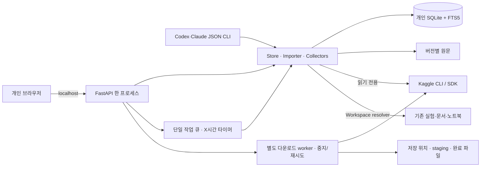

# 실제 구현 아키텍처

2026-10-01 기준. 초기 계획보다 [개인용 결정](../decisions/0002-personal-research.md)과 현재 코드를 우선한다.

React/TypeScript/Vite 정적 파일을 Python 앱이 제공한다. 별도 Node 서버를 계속 운영하지 않는다. `.venv`는 GPU 학습 Python과 분리한다. 기본 127.0.0.1 바인딩, Host/Origin 검사와 쓰기 토큰을 사용한다. 계정/팀/멀티테넌트 기능은 없다.

Windows의 `KneeOps.cmd`는 `desktop.py start`를 사용한다. 자식 서버는 `CREATE_NO_WINDOW`, 분리된 표준 입출력과 로그 파일로 실행해 시작 콘솔이 끝나도 유지한다. 실행별 ID와 state 디렉터리 OS 잠금을 사용하고, DB 초기화 전에 localhost 포트를 선점한다. 기존 서버를 재사용하며 다른 workspace의 배경 서버는 변경하지 않는다. `KneeOps-Stop.cmd`는 실행 ID별 stop 파일로 uvicorn의 정상 종료를 요청해 기존 download/service close를 수행한다. `serve/open` CLI와 Docker 실행 방식은 유지한다. 자동 시작/절전 방지는 하지 않는다.

SQLite WAL, schema3를 사용한다. 핵심은 sources, revisions, FTS index, runs, submissions, leaderboard, jobs, connectors, meta다. 초기 개발 중 생긴 hypotheses/imports 빈 테이블은 기존 DB에서 삭제하지 않았지만 제품/API에 노출하지 않는다. migration은 column 추가 방식이며 meta.schema_version에 기록한다.

source는 안정 ID·종류·대회·URL·authority·tags·current_revision·added_at·observed_at을 갖는다. revision은 본문·SHA256·Kaggle version·관측 시각·provenance를 보존한다. added_at은 최초 삽입 뒤 불변. 검색은 FTS literal phrase와 부분 문자열이다. 수집 HTML은 텍스트로 표시하며 실행하지 않는다.

수집은 단일 작업 큐에서 수행하고 진행·완료·부분 실패·실패를 DB에 남긴다. 중단된 작업은 다음 시작에 interrupted가 된다. 일정은 사용자가 켠 경우에만 앱 실행 중 적용하며 `last_sync_attempt`/`last_scheduled_enqueue` meta 기준으로 다음 시각을 계산한다(`/api/schedule` GET/PUT). 노트북·토론 전체 목록은 meta `notebook_catalog:<slug>`·`topic_catalog:<slug>`, 전체 LB 요약은 `leaderboard_summary:<slug>`에 둔다. 토론 본문은 별도 subprocess `topic_fetch.py`(SDK GetTopic+ListComments)로 받는다. CLI 수집을 UI 수집과 겹쳐 실행할 필요가 없다. `source_meta` 테이블은 추천·댓글·게시/실행 시각·제목 점수 표기·첨부 입력의 최신 관측값(가변)이며 revision은 불변으로 둔다. `/api/sources`는 sort/body/input, `/api/notebook-inputs`, `/api/source/compare`, `/api/predictions/files|compare`(`predictions.py`, 허용 폴더 목록의 파일만)를 제공한다. 서버는 `serving.py` 설정(Windows selector loop, graceful shutdown 10초)으로 실행한다.

Kaggle CLI 2.2.4의 pages parser 때문에 competition을 앞뒤로 전달한다. CLI pull metadata에는 version이 누락되어 별도 subprocess의 동일 SDK read-only GetKernel로 원문과 version을 받는다. 원본 hash와 셀 본문 hash를 구분한다. timeout이 있으며 과거 버전 거절은 그대로 기록한다. 자동 버전 갱신은 오래 관측한 항목부터 최대 20개다.

과거 대회는 competition 키로 분리한다. 과거 LB는 현재 대회 점수와 섞지 않고 별도 source로 저장한다. 솔루션 분류는 제목 패턴이므로 참가자 주장이고 오분류 가능하다. 전략 문구는 line number가 있는 정확한 원문 인용이다. 최종 입상자 인증이나 성능 재현을 주장하지 않는다.

실험은 기존 summary/result JSON을 읽는다. weak OOF·leaky pseudo OOF·진단 지표를 구분한다. 비교는 target·rows·folds·metric·label source와 study/label/split/mask/transform hash가 같고 점수가 존재해야 허용한다. 정보가 없으면 보류한다.

AI는 README → STATE → handoff → JSON CLI 순서로 접근한다. MCP·RAG·embedding·원격 LLM은 없다. 추가 비용 없이 파일과 구조화된 검색 결과를 사용한다.

한계: 모든 공개 노트북의 소스 수집(관련 노트북만), 노트북 숫자 점수(공식 API 미제공), 과거 버전 일괄 복원, 실제 상위팀 저자 자동 매칭, 의미 검색은 구현하지 않았다. 앱 종료·PC 절전 중 수집하지 않는다. 대회 성능을 확인하기 위한 GPU 학습과 제출을 실행하지 않았다.

## 데이터 관리

`data_manager.py`의 다운로드 worker는 자료 수집 queue와 독립적이다. `downloads` additive table에 불변 plan JSON(범위·경로·파일·크기·관측 시점)과 mutable progress/status를 기록한다. 설정은 meta의 data_destination/data_cache_manifest이며 공통 경로 설정을 덮어쓰지 않는다. 기존 schema3 테이블은 보존한다.

`data_remote.py`는 별도 Python subprocess에서 Kaggle SDK를 사용한다. tree metadata는 180초 제한, 최대 5 study·15,000파일 범위다. 슬라이스 선택 없이 각 study의 모든 시리즈를 나열한다. 전송은 shell 없이 Popen, 고정 디렉터리에 SDK stream/resume을 사용하며 URL/인증 출력은 노출하지 않는다. 중지는 subprocess를 종료하고 staging을 보존한다. 자동 수집은 다운로드를 예약하거나 실행하지 않는다.

개별 파일이 ZIP으로 응답되면 기대한 파일 하나·크기를 검증한 뒤 streaming으로 풀고, 전체 archive는 압축을 풀지 않는다. 완료된 staging 파일은 같은 볼륨 hard link로 기존 파일을 덮어쓰지 않고 배치한다. 실행 시 경로/공간/쓰기 권한과 동명 파일을 다시 검사하고 실행 중 1 GiB reserve를 확인한다. 에러·중지·재시작에서 부분 파일을 완료로 표시하지 않는다. 서버가 원격 파일을 같은 크기로 교체하는 경우까지 preview 버전을 고정하지는 못한다.

`data_cache.py`는 stdlib만으로 uint8 NPY header/size, shard 범위, UID 목록, mask를 확인한다. 영상 전체를 RAM으로 읽거나 실행하지 않는다. 큰 shard의 checksum은 검사하지 않았음을 JSON과 UI에 표시한다. cache descriptor는 입력 기록이며 학습 launcher가 아니다.

API: `GET /api/data`, `PUT /api/data/settings`, `GET /api/data/studies`, `POST /api/data/preview`, `GET /api/data/downloads`, `POST /api/data/downloads/{id}/start|cancel`, `GET /api/data/downloads/{id}/manifest`, `PUT /api/data/cache`, `GET /api/data/cache/descriptor`. 기존 localhost/Origin/쓰기 token 검사를 동일 적용한다. CLI `data status|cache-descriptor`는 읽기 전용이며 worker를 띄우지 않는다.

화면은 `monitoring/web/src/DataPage.tsx`와 `data.css`, 왼쪽 `#data` 메뉴다. 자세한 데이터 계약과 학습 판단은 [데이터 runbook](../runbooks/training-data.md)을 따른다. DB 백업에 계획·설정이 들어가지만 다운로드 영상과 staging은 들어가지 않으므로 저장 폴더는 별도로 관리한다.

## 공식 문서 번역과 탐색 구조

왼쪽은 대회 안내·자료 라이브러리·과거 대회·학습 데이터·실험·제출·내 작업 환경 6개 그룹이다. `main.tsx`의 navGroups가 기존 Page/hash를 그룹화한다. 데이터 종류는 기존 source.kind로 보존하고 내부 분류 탭에서 전환한다. 목록/카드·추가 날짜·NEW·버전 비교와 `#own`, `#solutions`, `#submissions` 직접 진입은 유지한다.

`translation.py`는 `translations/catalog.json`, `en/*.md`, `ko/*.md`를 읽는다. 현재 대회 공식 문서 10개의 본문 전체 번역을 제공하며 source competition·page·SHA256이 맞을 때만 `GET /api/source`에 `translation.status=available`과 본문을 붙인다. 원문 hash가 바뀌면 outdated, 번역 대상에 없으면 unavailable이며 본문을 반환하지 않는다. 저장된 영어 원문 hash도 loader에서 검증한다. DB 원문과 revisions를 수정하지 않고 외부 번역 API도 호출하지 않는다.

`OfficialPage.tsx`는 현재/과거 대회 문서 목록, 저장본 선택, 영어/한국어/나란히 보기를 제공한다. 현재 대회 외의 미번역 공식 문서는 영어로 표시한다. 언어 선택은 브라우저 localStorage에 저장한다. 같은 `OfficialDocument` reader를 라이브러리 공식 자료 상세창에도 사용한다. React Markdown/GFM/KaTeX로 읽기 전용 표시하며 raw HTML·외부 이미지·javascript URL은 실행하지 않는다. 해시 계산용 원문을 바꾸지 않고 표시 시 잘못된 heading 공백/일부 HTML 문법만 정규화한다. 수식·문서 라이브러리는 lazy chunk로 분리해 다른 페이지의 초기 로드를 늘리지 않는다.

번역 갱신은 새 원문을 확인하여 en snapshot·번역 ko 파일·catalog source_sha/관측일/번역일을 함께 관리하고 테스트한 뒤 앱을 재시작한다. 기존 번역을 새 원문의 번역이라고 임의로 연결하지 않는다. AI 참고 번역이고 영어가 해석 기준이라는 안내를 제공한다. 규칙 원문 자체의 CC-BY-NC/OSI 문장 불일치와 조항 번호·링크를 임의로 고치지 않았으며 별도 참고를 표시한다.

## 로컬 MRI 영상 분석

`viewer.py`의 Viewer는 검증된 cache catalog, 등록된 데이터 폴더 탐색, 직접 지정한 로컬 경로를 읽는다. `viewer_api.py`는 Pydantic 입력 검증을 적용한 `/api/viewer/*` 경계다. 직접 파일 열기는 POST와 기존 origin/CSRF 검사를 거친다. GET에는 서버가 발급한 source/root/session 식별자를 사용하고 탐색 relative path는 root 경계 안으로 제한한다. 영상·판독문 외부 전송이나 원본 변경은 하지 않는다.

Adjacent/Orthodiffusion manifest는 기존 헤더·파일 크기·UID·mask hash 검사 뒤 마스크 0/1 값도 검증한다. 캐시 index는 최근 8개만 보유하고 작은 UID/mask 메타데이터만 메모리에 둔다. NPY는 `allow_pickle=False`, `mmap_mode='r'`로 읽고 선택한 한 장을 float32로 복사한 뒤 mmap을 닫는다. 단독 NPY는 숫자형 2D/3D만 지원한다. 파일 크기·mtime·경로 서명 변경 시 기존 세션의 읽기를 거절한다. 이 서명은 파일 전체 SHA256 검증과 다르다.

DICOM은 한 study의 헤더만 먼저 모으고 IOP/IPP 위치 투영으로 정렬한다. 기하 정보가 불완전하면 InstanceNumber/파일명 순서와 경고를 반환한다. 단일 프레임 흑백만 허용하고 선택한 파일 하나를 decode해 rescale·MONOCHROME1을 반영한다. PixelSpacing이 시리즈 안에서 확인되고 일치할 때만 물리 측정 단위를 사용한다. 개인정보 DICOM header를 통째로 JSON으로 내보내지 않는다. NumPy·Pillow·pydicom·pylibjpeg/libjpeg/openjpeg는 CPU 의존성이고 GPU/PyTorch는 추가하지 않았다.

세션은 최근 24개, 영상은 4M 픽셀, DICOM 하나는 64 MiB, 폴더 열기는 300디렉터리·2,500 DICOM, 단독 NPY는 4,096장으로 제한한다. 프레임 API는 PNG data URI, 표시 범위, 원래 강도의 통계/히스토그램, 정규화 좌표 ROI 통계를 반환한다. 모아보기는 최대 12개의 균등 샘플이며 전체 영상 검사 결과가 아니다. 모든 프레임 통계는 표시 대비와 반전 적용 전 값을 사용한다. 결측 마스크 영상의 ROI는 반환하지 않는다.

`ViewerPage.tsx`는 학습 데이터 내 `#viewer` 탭으로 lazy load한다. UID·결측·라벨·양성 소견 필터, 캔버스 이동·확대·ROI·길이, 슬라이스·재생·마스크·모아보기, 공식 라벨과 접힌 Report, 메모를 제공한다. 비동기 요청의 순서/cleanup으로 이전 study 응답이 새 화면을 덮어쓰지 않게 한다. 메모에 포커스하면 재생을 중지한다. 캐시 slot 간 해부학적 위치를 동기화하거나 자동 재방향하지 않는다.

`viewer_reviews`는 additive 테이블이며 기존 schema3와 자료 테이블을 보존한다. source URI/UID/파일 버전/slot/slice가 검토 식별의 기준이고 같은 버전의 같은 슬라이스를 다시 저장하면 갱신한다. payload에는 메모·flags·ROI·표시 범위·manifest SHA·선택 픽셀 SHA·통계를 남긴다. Report나 영상 본문은 기록 JSON에 포함하지 않는다. 개인 DB online backup에 포함하며 새 원본 버전 기록은 기존 기록과 구분한다. UI/JSON은 현재 소스·study의 최신 100개를 반환한다.

자세한 지원 형식, 사용자 조작, API는 [영상 분석 runbook](../runbooks/image-viewer.md)에 있다. 실제 대회 테스트 DICOM 두 시리즈 표시까지 검증했다. 20~50 study의 내용 검토, 병변/예측 overlay, 3D/MPR, NPZ/NIfTI/Zarr는 완료된 기능으로 주장하지 않는다.

## 로컬 원본 인덱스

`data_library.py`는 원본/다운로드/등록 준비 폴더의 train_series·test_series를 읽고 기존 다운로드 계획과 series CSV로 파일 수·크기·시리즈 누락을 분류한다. 목록 요약은 meta에, 파일 명세와 캐시 입력은 `.local/kneeops/data-library/`의 새 JSON에 저장한다. `data_index` 작업과 `data index/library --json` CLI를 제공한다. `RawDataPanel.tsx`는 목록/상태/경로/JSON과 viewer 링크를 표시하고 viewer는 `raw` 식별자를 서버에서 폴더로 해석한다. 테스트와 불완전한 원본은 학습 입력으로 표시하지 않는다. 파일 데이터 이동·수정·학습 실행은 없다. 전체 ZIP 탐색과 선택 study 해제는 아래 후속 구현을 참고한다. 전체570GB 일괄 해제는 하지 않는다.

## 전체 ZIP 원본 탐색 (2026-10-02)

`data_archive.py`는 ZIP 중앙 목록을 별도 SQLite 파일에 인덱싱하고 signature·directory SHA256·관측일을 보존한다. 영상 본문을 인덱싱하지 않는다. API/JSON에는 study 요약 4,410개만 전달하고 UI는 20개, 시리즈 파일 API는 30개씩 보여준다. `GET /api/data/structure?raw=<id>&series=<uid>&offset=0`은 읽기 전용이다. 공식 CSV의 Anatomical_Plane/Fluid_Sensitive/Fat_Suppression을 설명으로 표시하며 DICOM SeriesDescription과 구분한다.

`POST /api/viewer/open`의 raw ID는 ZIP study도 허용한다. 인덱스에 저장된 ZipInfo/local header offset으로 한 study만 찾아 lossless 해제한다. 정상 ZIP의 819k 중앙 목록을 매번 RAM에 올리지 않는다. 파일명·크기·CRC·범위 검사는 zipfile이 수행한다. study당 OS 잠금, 상대경로/ADS/링크/중복명 차단, 1 GiB 여유, 임시 파일·CRC/SHA256·atomic receipt·동명 충돌 보존을 적용한다. 파일별 receipt 때문에 앱/PC 종료 후 같은 study 열기로 재개한다. 준비 위치는 다운로드 폴더/prepared/<archive-id>이며 ZIP을 삭제하지 않는다. 실제 학습 2건과 테스트 3건을 확인했으며 전체 영상 무결성 검사나 자동 전체 해제는 없다.

학습 JSON은 ZIP 보관/준비됨을 구분하고 export 때 준비 파일의 크기·mtime receipt를 확인한다. 이는 전체 픽셀 재해시와 다르다. JSON CLI는 `data structure --raw <id>`, `data prepare --raw <id>`, `data descriptor`를 지원한다. 수집이나 GPU 학습과 자동 연결하지 않는다.

`data_cleanup.py`는 명시적 유지보수용이다. 데이터 탐색이나 앱 시작 때 자동 삭제하지 않는다. 실제 SHA256을 비교한 duplicate cache 파일만 hardlink로 대체해 기존 학습 경로를 보존했다. 앱은 manifest hash와 UID/mask/shard의 실제 inode가 모두 일치하는 캐시만 통합한다. 캐시 내용은 불변 입력으로 취급하고 개별 경로에 덮어쓰지 않는다.

## 폴더 탐색·범위별 EDA·표시 버퍼 (2026-10-02)

`ViewerTree.tsx`는 기존 `/data/structure`, 원본 split/root 필터, 신규 `/viewer/tree/series`, `/viewer/browse`를 지연 호출한다. 트리의 DICOM 파일명은 서버가 반환한 물리 정렬 `filenames`로 슬라이스에 매핑한다. 같은 열린 study의 파일 선택은 세션을 재사용한다. 기존 목록·직접 경로 UI도 유지한다.

`viewer_eda.py`의 dataset_summary는 공식 CSV·원본 인덱스·작은 캐시 mask만 집계한다. train.csv에서 직접 라벨을 읽어 test UID 중복 시 학습 라벨이 덮이지 않게 한다. 소견별 known/unknown, 동시 양성의 알려진 라벨 분모, 프로토콜·방향·누락·UID 범위와 출처를 반환한다. series_audit는 최대64장만 decode해 품질 후보와 기하정보를 계산하며 전체 코호트 품질로 주장하지 않는다. preprocessing_preview는 한 장의 중앙 crop/정규화/종횡비 유지 resize+padding을 PNG와 변환 기록으로 반환한다. 이미지 쓰기·모델 실행은 없다.

`ViewerEda.tsx`는 전체현황·시리즈검사·전처리 비교, `ViewerCompare.tsx`는 UID 검증을 거친 별도 원본/캐시 세션을 제공한다. 비교 초기 방향 선택은 편의 기능이며 시리즈/위치 정합의 증명이 아니다. Report/개인 DICOM 헤더 전체를 EDA에 포함하지 않는다.

`viewer-frame-cache.ts`는 일시적인 브라우저 LRU 버퍼다. 표시 파라미터·세션별로 구분하고 15초 TTL·최대24장·추정32MiB로 제한한다. 인접6장 순차 prefetch와 요청 중복 제거, PNG 사전 decode, 오래된 요청 취소/결과 무시를 수행한다. canvas는 준비된 영상만 교체하며 대기 중 표시 #번호를 보존한다. 검토 저장은 서버에서 픽셀을 다시 읽고 기존 서명 검증을 유지한다. 캐시된 표시에는 원본 변경 감지가 최대15초 늦을 수 있다. 현재 버퍼는 탭을 닫으면 사라지고 GPU/디스크 학습 캐시와 무관하다.
