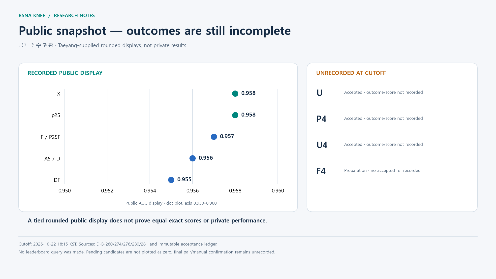
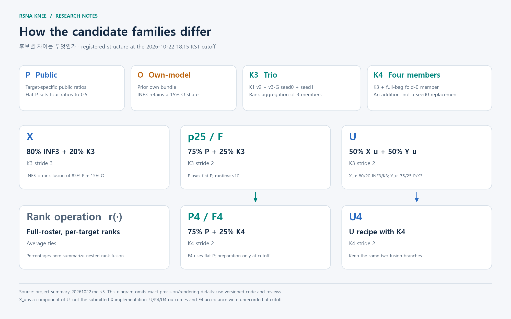
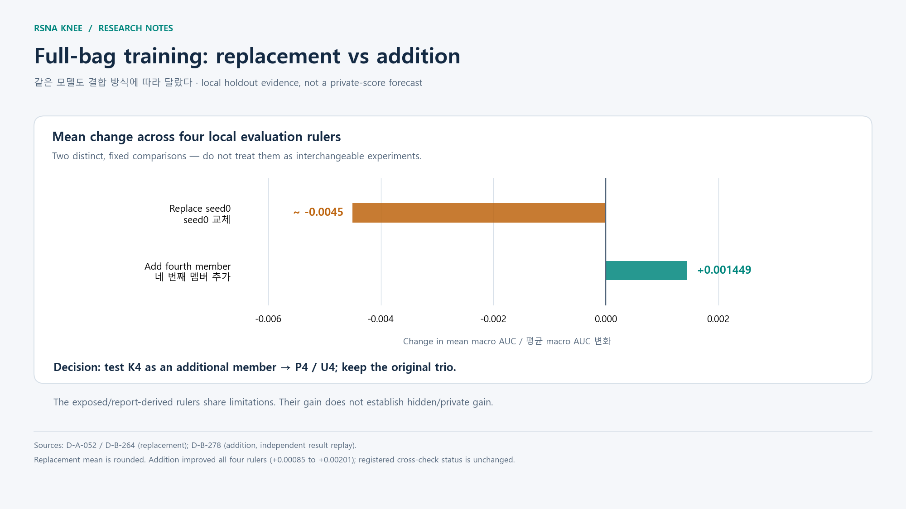

# RSNA 무릎 이상 탐지 — 결과 발표 전 연구 정리

[English main report](project-summary-20261022.md) · [한국어 안내](../../README.ko.md) · [전체 연구 목록](research-catalog-20261022.md)

**[결과·최종 선택 페이지](final-results.ko.md)**를 별도로 준비했습니다. 이 문서는 아래 기준
시점의 연구 기록을 보존하며 실시간 실행 상태를 표시하지 않습니다.

**연구 상태 기준: 2026-10-22 18:15 KST. 한국어판 v1.0.0. 사용자가 알려 준 결과 예정일: 2026-10-23.**

이 문서는 영어 메인 보고서의 한국어 해설판입니다. 기준 시점까지의 연구·구현·제출·판단을
정리했으며, 이후 결과를 추정하여 채우지 않았습니다. 공개 점수는 Taeyang이 전달한 기존 기록입니다.
비공개 점수·최종 순위·수동으로 확정한 최종 두 제출물은 기준 시점에 확인되지 않았습니다.
제출 접수, 비공개 데이터 추론 완료, 점수 확정은 서로 다른 상태입니다.

총 **390개 발견 기록**을 [전체 목록](research-catalog-20261022.md)에서 찾을 수 있습니다.
A 52개, B 281개, C 54개, D 3개입니다. 실험 근거와 검토 이력은
[discoveries.md](../../discoveries.md), 작업 이력은 [handoff.md](../../handoff.md),
최종 선택 규칙과 미완료 항목은 [plan.md](../../plan.md)가 기준입니다.

## 1. 무엇을 만들었는가

하나의 무릎 MRI 검사에 포함된 여러 시리즈와 슬라이스를 처리하여 **검사 ID마다 12개
이상 소견의 예측값**을 내는 시스템입니다. 평가는 12개 타깃의 AUC 평균인 macro AUC를
사용합니다. 여러 모델의 예측을 타깃별 순위로 바꿔 결합하며, 입력 영상 처리의 중복을
줄이는 구현과 제한 시간 안에 실제 모델이 실행되는지를 함께 검증했습니다.

*슬라이스 그림은 직접 도형으로 만든 아이콘이며 실제 환자 MRI가 아닙니다. 모든 후보가 모든
모델 분기를 실행하는 것은 아니며 각 후보의 등록된 구성을 따릅니다.*

| 항목 | 기준 시점의 기록 |
|---|---|
| 최고 공개 표시 점수 | **0.958** — 여러 후보가 동점 표시; 비공개 성능 예측 아님 |
| 마지막으로 전달된 자동 선택 | X `57415972` + p25 `57427331` |
| 사전 결정된 기본 최종 조합 | X + F `57475409`(0.957) |
| 마지막 날 제출 접수 완료 | U `57510427`, P4 `57512878`, U4 `57514281` |
| 준비 중 후보 | F4 — 기준 시점에는 제출 접수 번호 없음 |
| 최종 선택 판단 시각 | 10월 23일 **08:00 KST**까지 완료·점수 확인된 후보만 대상 |
| 프로젝트 규칙상 대회 마감 | 10월 23일 **08:59 KST** |
| 비공개 결과·최종 수동 선택 | 미확인 |

10월 19일의 오래된 인계 내용만 보고 H216·H210을 재시작하면 안 됩니다. 이후 OAI 비교와
seed1 복구가 완료되었습니다(D-B-244/245). 현재 F4 작업은 기존 담당 B에게 남아 있습니다.

## 2. 후보와 공개 결과

모든 커널의 소유자는 `taeyangg4`이며 아래 접수된 원격 버전은 모두 **version 1**입니다.
X의 slug에 있는 `-v2`는 이름의 일부로 원격 버전 2라는 뜻이 아닙니다. 정확한 slug와
접수 시각은 [영어 메인 표](project-summary-20261022.md#2-candidate-identities-and-outcomes)에 보존했습니다.

*결과 미기록 후보를 0점으로 표시하지 않았습니다. 축 범위는 0.950–0.960이며 작은 차이를
확대해 보는 점 도표입니다. 동점 표시만으로 실제 점수나 비공개 성능이 같다고 판단할 수 없습니다.*

| 후보 | 제출 번호 | 공개 결과 / 기준 시점 상태 | 주요 근거 |
|---|---|---|---|
| X | 57415972 | 0.958, 기본 최종 후보 A | D-B-249/260/276 |
| p25 | 57427331 | 0.958, 전달받은 자동 선택에 포함 | D-B-260/276 |
| F / P25F | 57475409 | 0.957, 기본 최종 후보 B | D-B-274 |
| D / A5 | 57484279 | 0.956, 등록된 규칙상 최종 조합 제외 | D-B-275/276 |
| DF | 57500332 | 0.955, 최종 조합 제외 | D-B-280/281 |
| U | 57510427 | 접수 완료; 비공개 추론 결과·점수 미기록 | 제출 원장·13:59 인계 |
| P4 | 57512878 | 접수 완료; 비공개 추론 결과·점수 미기록 | D-B-278·제출 원장 |
| U4 | 57514281 | 접수 완료; 비공개 추론 결과·점수 미기록 | 제출 원장·15:59 인계 |
| F4 | — | 준비·검토 단계; 접수 사실 미기록 | plan Update 10 |

## 3. 후보 구성과 수식

`r(·)`은 전체 추론 대상에 대해 수행하는 **타깃별 순위 변환**입니다. 동점에는 평균 순위를
사용합니다. 백분율은 중첩된 순위 결합의 요약이며 원시 예측 확률을 그대로 더한다는 뜻이 아닙니다.
정확한 정밀도·모델 해시·렌더링 동작은 버전별 코드와 검토 기록에 따릅니다.

| 기호 | 의미 |
|---|---|
| P | 공개 모델 분기: R384 / R224 / R6flip |
| O | 기존 자체 모델 묶음: EXP143v2 / EXP155 / Q |
| K3 | K1 v2 + v3-G seed0 + seed1의 순위 결합 |
| K4 | K3에 full-bag fold-0 모델을 네 번째 멤버로 추가 |
| Flat P | 공개 부모의 타깃별 비율 4개를 0.5로 통일: Lateral OA 0.2, PF OA 0.6, Synovitis 0.8, Baker's cyst 0.35를 변경 |

| 후보 | 등록된 구성 |
|---|---|
| INF3 | `r(0.85 r(P) + 0.15 r(O))` |
| 제출된 X | `r(0.80 r(INF3) + 0.20 r(K3))`, K3 stride 3 |
| p25 / F | `r(0.75 r(P) + 0.25 r(K3))`, K3 stride 2; F는 Flat P·runtime v10 |
| U | `X_u = r(0.80 r(INF3) + 0.20 r(K3))`, `Y_u = r(0.75 r(P) + 0.25 r(K3))`, `U = r(0.50 r(X_u) + 0.50 r(Y_u))`; K3 stride 2 |
| P4 / F4 | p25 / F에서 K3를 K4로 변경; F4는 실제 검증·제출이 전제 |
| U4 | U에서 K3를 K4로 변경 |
| A5 / DF | p25 내부 P를 `r(0.85 r(P) + 0.15 r(A5))`로 변경; DF는 Flat P도 적용 |

U 안의 `X_u`는 stride 2 구성요소이므로 이미 제출된 stride 3 후보 X와 구분해야 합니다.

## 4. 연구에서 배운 것

| 질문 | 확인된 내용과 해석 | 근거 |
|---|---|---|
| 자체 모델을 추가하면 항상 좋아지는가 | 초기 자체 모델 혼합은 공개 0.913으로 기준 모델 0.943보다 낮았습니다. 이후에도 구성요소 추가만으로 개선을 가정하지 않았습니다. | D-A-018/030/038/044 |
| 입력 처리 효율이 중요한가 | 디코딩·렌더링 공유로 중복 작업을 줄였습니다. K1과 R6의 입력 동등성을 검증한 뒤 실제 실행 가능한 K1 혼합을 만들었습니다. | D-B-018/048/110/242/243/249 |
| 학습 타깃은 어떻게 구성했는가 | Dread 75% / Aquila L2 25% 조합이 여러 백본의 5-fold JEV를 개선했습니다. 다만 평가용 타깃도 판독문 기반이라 오류가 서로 연관될 수 있습니다. | D-B-095/098/111 |
| 공개·외부 모델은 도움이 되었는가 | 일부 증강·분기 추가는 개선되었고 C85-R7은 0.957, 이후 H189는 0.958을 기록했습니다. 반면 mirror·A5 추가 등은 공개 점수가 하락했습니다. | D-B-080/137/179/213/217/276/281 |
| OAI가 도움이 되었는가 | H216의 실제 OAI/대조군 비교에서 네 평가 기준 평균 차이가 약 -0.00004였습니다. 등록된 결론은 OAI_NOT_USEFUL이며 기존 K1을 대체하지 않았습니다. | D-B-101/139/240/244 |
| K1 계열은 어떻게 발전했는가 | v1 실패 후 v2 학습에 성공했습니다. v3-G seed1을 원래 조건으로 복구했고 체크포인트·세 멤버 순위 평균이 네 로컬 평가 기준을 개선했습니다. | D-B-214/218/220/245 |
| 슬라이스를 더 촘촘히 쓰면 좋은가 | K1 stride 2는 stride 3보다 로컬 지표가 좋았지만 stride 1의 추가 변화는 작았습니다. R6 stride 변경의 실행 비용 감소와 점수 개선은 별개입니다. | D-B-247/250/262/268 |
| 공개 점수에 맞춘 비율은 믿을 수 있는가 | O 비중 증가나 타깃별 K1 비중 변경은 로컬에서 좋아 보여도 공개 점수가 낮아졌습니다. O를 제거한 p25는 0.958을 유지했습니다. | D-B-246/251/259/260 |
| fold·전체 데이터 모델을 더하면 좋은가 | 다섯 멤버 C는 0.957로 p25의 0.958보다 낮았습니다. 학습에 포함된 행을 같은 holdout으로 평가하면 독립적인 검증이 아닙니다. | D-B-263 |
| 마지막 외부 탐색에 확실한 개선책이 있었는가 | 0.959를 높은 확률로 달성할 근거는 발견하지 못했습니다. 11-label 결합도 기존 평가 기준과 강하게 연관되어 공개 순서의 오류를 해결하지 못했습니다. | D-B-256/259/265/277 |

### Full-bag의 핵심: 교체와 추가는 다른 비교다

Full-bag 모델은 seed0을 **대체**했을 때 네 기준 모두 하락했고 평균 차이는 약 **-0.0045**였습니다.
기존 세 멤버에 **네 번째로 추가**했을 때는 네 기준 모두 상승했으며 평균 **+0.001449**,
기준별 **+0.00085~+0.00201**이었습니다. 추가 비교는 동일한 977개 fold-0 holdout과 stride 3에서
K4 대 K3를 평가한 결과입니다. 독립 재계산을 거쳤으며 P4/U4를 시험할 근거가 되었습니다.
이는 K1 분기 자체의 로컬 변화입니다. 최종 혼합 개선량이나 비공개 점수로 그대로 환산할 수 없습니다.

다른 마지막 실험도 결과를 남겼습니다: 타깃 유형별 pooling 평균 macro -0.0030(D-B-269),
Lateral OA 전문가의 해당 타깃 +0.00222(기준 +0.006 미달, D-B-271), 실패 가중 재학습
평균 -0.00179(D-B-272), effusion으로 구분한 Synovitis 재학습 평균 -0.01069(D-B-273),
crop-shift TTA 평균 macro -0.000085(D-B-279)입니다. 기준 미달을 성공으로 바꾸지 않았으며
작은 crop 전문가 신호는 향후 연구 가능성으로 남겼습니다.

## 5. 검증·장애·불확실성

[U 검토](pre-result-review-evidence-20261022/U-final-check.md),
[P4 검토](pre-result-review-evidence-20261022/P4-final-check.md),
[U4 검토](pre-result-review-evidence-20261022/U4-final-check.md)에 실제 실행과 독립 검토가
보존되어 있습니다. visible 및 32개 검사 실행, K1 멤버 실행, 유한한 출력, 내장 모듈과 설정,
수식 재계산을 확인한 기록입니다. 이 PASS가 비공개 추론 성공이나 점수 상승까지 인증하는 것은 아닙니다.

1. **K2 실패:** 최초 두 비공개 예외의 근본 원인은 확정하지 못했습니다. 수정 후 4,407개 헤더와
   32개 실제 검사 등 실패 조건 중심의 검증을 수행했고 v5는 이후 공개 0.944였습니다(D-B-219).
2. **모델 로딩·fallback:** 기존 120초 제한을 넘는 로딩 때문에 K1이 비활성화될 수 있었습니다.
   이후 로딩·분류 제한을 나누고 검사별 fallback과 명확한 실패 처리를 추가했습니다.
   실행 비율 조건도 실제 측정 근거와 함께 적용했습니다(D-B-245/253/261).
3. **v9 원인 단정 금지:** 내부 예외 보존과 타이밍 근거가 부족해 capture-timeout 가설은 이의를
   받았습니다. v10의 제한 확대는 완화책이지 원인 증명은 아닙니다(D-B-261).
4. **실제 내장 코드 검증:** DF의 로컬 스키마와 노트북 내장 스키마 불일치로 `p_weight_mode`
   오류가 발생했습니다. 이후 실제 내장 payload를 새 프로세스로 불러오는 검증을 추가했습니다.
5. **작은 표본의 한계:** 32개 검사 일치가 전체 캐시 일치를 보장하지 않았습니다. 전체 비교에서
   4,167개 중 3개의 픽셀이 달랐고 나머지 메타데이터 차이는 META_EPS로 분류했습니다(D-B-254/270).
6. **실행 시간 변동:** A5와 DF의 비공개 경과시간 상한은 6.77시간·8.29시간으로 1.52시간 차이가
   났습니다. 대기가 포함된 값이며 U/U4 시간 예측을 약화하는 근거입니다. 8.8시간 guard와 9시간
   제한은 실제 위험으로 남아 있습니다(D-B-280).

Gold58은 이미 노출되었고 판독문 기반 평가 기준들은 오류를 공유하며 같은 holdout을 반복 사용했습니다.
일반 OOF만으로 학습된 중첩 stacker를 검증할 수 없고 추가 fold 모델이 평가 행을 학습했을 수도 있습니다.
발견 기록의 PENDING·HOLD·CHALLENGED 상태를 여기서 승격하지 않습니다. D-B-278의 독립 결과 재계산과
다른 플랫폼의 발견 cross-check 완료는 별개입니다. 외부 체크포인트 관련 대회 주최 측 판단도 새로 단정하지 않습니다(D-B-265).

## 6. 최종 두 제출물 선택과 다음 결과 기록

아래는 [plan.md의 Updates 7–10](../../plan.md)에 이미 등록된 정책의 요약입니다. 그림과 번역으로
선택 규칙을 바꾸지 않습니다.

- 기본 조합은 **X + F**입니다. 10월 23일 08:00 KST까지 COMPLETE와 표시 점수가 확인된 후보만
  새 조합에 들어갈 수 있습니다. 미완료·오류 후보는 대체하지 않습니다.
- U/P4/U4가 A를 대체하는 조건은 기존 분기를 따릅니다. 명시된 **0.959 이상 동점**에서는
  **P4 > U4 > U** 순서입니다. 0.958 자동 선택 분기는 사용자 판단을 위한 권고이며 최종 확정이 아닙니다.
- Update 10은 표시 차이가 **0.002 미만**인 경우를 동점으로 취급합니다. 경계 사례는 이전의
  일반 규칙으로 임의 처리하지 않고 최신 원문 조건을 따릅니다.
- A가 P4 또는 U4이고 F4 점수가 0.957 이상이면 B는 F4가 됩니다. 그 외에는 F를 유지합니다.
  A가 X일 때는 F4로 바꾸지 않습니다. A5·DF는 제외입니다.
- 실제 최종 두 제출물은 수동 선택 후 정확한 ref/version을 기록해야 합니다. 기준 시점에는 이 확인이 없습니다.

결과가 오면 **제출 ref·버전·완료/오류·점수·관측 시각·최종 선택 여부**를 기록합니다.
공개 점수와 비공개 점수·순위를 구분하고 결과를 본 뒤 기존 비율이나 당시 근거를 다시 쓰지 않습니다.
결과 예정일만으로 새로운 점수 감시나 자동 작업이 설정되지는 않았습니다.

## 7. 문서·보존·정리 현황

미완료 큐에는 오래된 설명과 이후 결과가 함께 남아 있습니다. H219/H225는 D-B-249/260,
H224/H231은 D-B-263, H227은 D-B-251, H228/H230은 D-B-250/253/261/262를 함께 봐야 합니다.
H223/H226의 추가 seed·백본은 예약이며 새 실행 지시가 아닙니다. H35/H107의 최종 선택과 실행 근거는
계속 필요합니다. 이번 문서 작업에서 담당·예약·실험 큐는 바꾸지 않았습니다.

문서 정리 시작 시 일관성 검사에 기존 지적 800개가 있었습니다. 과거 메타데이터·큐 형식 등의 부채이며
프로젝트 전체가 깨끗한 PASS라고 주장하지 않습니다. 원래 검토 상태를 유지하고 링크와 표현을 정리했습니다.

GitHub에는 문서·도구 소스·집계 원장이 들어갑니다. 데이터·라벨·판독문·모델 가중치·캐시·인증정보는
들어가지 않습니다. 따라서 바이너리 백업이나 그대로 재현 가능한 데이터 배포본이 아닙니다.
현재 작업 폴더의 Git 동기화는 계속 꺼져 있으며 별도의 비공개 문서 snapshot만 갱신합니다.

**18:55 KST 후속 정리:** 승인된 외부 대상 150건, 파일 13,917개, **863.81 GiB**를 삭제했습니다.
실제 C:/G: 여유 공간은 **863.53 GiB** 증가했습니다. 기록 4,913개를 별도 보관했고 현재 H: 작업·최종
모델·F: 캐시·OAI는 보존했습니다. 원본 확인이 남은 세 묶음 14.27 GiB도 남겼습니다.
[상세 삭제·보존 기록](external-cleanup-result-20261022.md)을 참조하십시오.

## 용어 빠른 설명

| 용어 | 설명 |
|---|---|
| study | 한 번의 검사 단위; 여러 영상 시리즈·슬라이스를 포함 |
| stride | 슬라이스/윈도우를 선택하는 간격; 실제 의미는 해당 코드 계약에 따름 |
| seed | 학습의 난수 초기값; 다른 seed 모델로 다양성을 확보할 수 있음 |
| full-bag | 등록된 조건에서 검사 전체 윈도우 묶음을 이용하는 학습 목표 |
| holdout | 학습과 분리해 평가하는 데이터; 반복 선택에 쓰면 낙관 편향이 생길 수 있음 |
| ruler | 비교에 사용한 평가 타깃/기준 묶음; 서로 독립인 정답이라는 뜻은 아님 |
| rank fusion | 예측값의 순위를 변환해 고정 가중치로 결합하는 방식 |
| fallback | 경로 실패·지연 시 등록된 대체 경로를 사용하는 처리 |
| public / private | 공개 평가와 최종 비공개 평가; 두 결과는 다를 수 있음 |

시각 자료 제작 방식·수치 출처·재생성 코드는 [그림 안내](visuals-20261022/README.md)에 있습니다.
