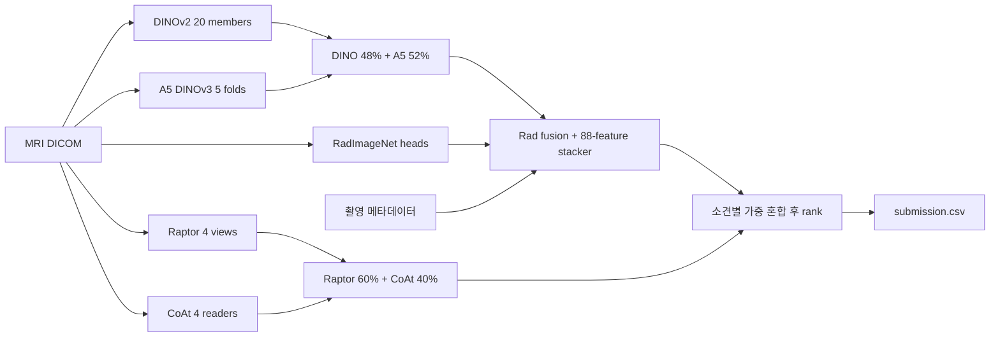

# 0.943 기준 노트북 학습·개선점 분석 — 2026-10-03

대상은 [Jiweiliu Fast 2×T4 v11](https://www.kaggle.com/code/jiweiliu/rsna-knee-fast-2xt4-inference)과 우리 `taeyangg4/knee-anchor-0943-stack` v1이다. 현재 로컬 제출본과 10/03 11:18 KST 수집한 공개본의 **코드23셀은 동일**하다. 이번에 최신 공개 소스를 다시 수집한 것은 아니다. [원문/hash/셀 대응표](../handoffs/evidence/2026-10/2026-10-03-anchor-study/source-manifest.json), [읽기용 소스](../handoffs/evidence/2026-10/2026-10-03-anchor-study/anchor_source.py). 아래 행 번호는 읽기용 소스 기준이다.

**결론: 이 기준본은 정교한 추론·앙상블 시스템이며, 재현한0.943를 비교점으로 보존할 가치가 있다. 그러나 모든 구성 요소가 독립 검증된 것은 아니다. 먼저 실제 기여와 실패 상태를 정확히 계측하고, series 선택·series 내부 창 구성·촬영 프로토콜 의존성을 작게 대조하는 것이 유망하다.** 기존 가중치에 새 전처리를 일괄 적용하거나 공개 LB로 비율을 다시 찾는 것은 이 분석의 권고가 아니다.

범위는 노트북의 실제 호출 경로, 일부 외부 모델 명세·소스, 기존 Kaggle 샘플 실행 로그, CPU 합성 검사와 학습 메타데이터다. 노트북 전체/GPU 모델을 실행하지 않았고 원본·가중치·제출 패키지를 수정하지 않았다. 모든 외부 학습 코드와 hidden 실행을 전수 검증한 것도 아니다.

## 1. 실제로 무엇을 계산하는가

각 study의 여러 MRI series를 plane/contrast별 슬롯으로 나누고 모델마다 다른 crop·장수·강도 정규화를 적용한다. Report는 추론 입력에 없다. 12개 소견별 점수는 여러 번 확률 평균과 순위 변환을 거친다. 최종 CSV 값은 질병 확률로 해석할 수 없다.

| 계열 | 읽어서 확인한 구조·입력 | 실제 결합 방식 |
|---|---|---|
| DINOv2 | 20 member. checkpoint가 정한 슬롯·crop·해상도·slice 규칙 복원. CLS/patch 특징과 소견별 slot attention | **member별 rank→20개 평균→rank**. fold 안에서 확률평균하는 함수는 정의만 있고 최종 경로에 호출되지 않음 |
| A5 | 기존 실행의 config는 **DINOv3 ViT-S/16**,336px·16슬라이스를 입력 채널로 사용, slot token, `xcodex` residual attention,5fold. 일반 RGB 3채널 모델로 보면 안 됨 | fold별 순위 평균을 다시 rank. 입력이 있는 study에서 DINO48%+A5 **52%**. 소개의45%와 불일치 |
| RadImageNet | ResNet50 특징 +5개 E10 head/5개 E13 head. E10·E13·E11 배치를 이용하며 E13 head를 E11 입력에 적용하는 두 번째 경로 존재 | E10/E13 결합, DINO/A5와 혼합, 두 번째 Rad20% 혼합, 일부 소견에 학습된 stacker40% 반영. 단순 확률보정이 아님 |
| Raptor | CoAtNet 특징을 소견별 attention으로 모으는 MIL. MaxSpan 정방향/역방향, Native384Dense, Native384 | 확률 **0.60/0.10/0.10/0.20** 평균→rank. MaxSpan 두 뷰는 가중치를 공유하므로 독립 학습모델4개가 아님 |
| 추가 CoAt | residual-gated top3, D4 SWA3, Global96 top3, Repair-v1 top3 | 정상 경로는 각 reader의 확률을25%씩 평균→rank. Raptor60%+추가 CoAt40%, 이 단계에는 재rank 없음 |

A5 실제 구조는 새로 가져온 기존 실행의 `diagnostics/a5_loads.json`으로 확인했다. 소스에 정의된 여러 pooling/stem 후보가 모두 실행되는 것은 아니다. Rad의 E13/E11 교차 입력은 기존 stacker와 맞춘 의도된 계약이다(3487–3490). head 이름만 보고 단독 수정하면 stacker 입력 분포까지 바뀐다.

`T`를 DINO/A5/Rad/stacker 결과, `R`을 Raptor 순위, `C`를 추가 CoAt 순위라 하면 정상 경로는 다음과 같다.

`final_j = rank((1-w_j)·T_j + 0.6·w_j·R_j + 0.4·w_j·C_j)`

| 소견 | T | R | C |
|---|---:|---:|---:|
| ACL·Lateral OA·Fracture | 25% | 45% | 30% |
| Medial Meniscus | 20% | 48% | 32% |
| Lateral Meniscus | 0% | 60% | 40% |
| 나머지7개 | 40% | 36% | 24% |

이 비율은 최종 rank 직전 **계열 점수의 계수**다. C 내부에 비선형 rank가 있으므로 ‘각 CoAt reader의 최종 기여6%’처럼 더 분해할 수 없다. Lateral Meniscus의 T 계수가0이어도 그 upstream 예측을 삭제하면 안 된다. stacker가 다른 소견을 계산할 때 Lateral Meniscus를 입력으로 사용한다. 기존 R2 역시 CoAt 계열이므로 추가한다고 독립적인 정보가 늘어난다는 보장은 없다.

## 2. 가장 중요한 검증 발견

### Gold58 선택 노출은 추측이 아니라 자산 명세에 있다

residual-gated CoAt의 manifest SHA256은 노트북이 요구하는 `98511a8f…f284e`와 일치한다. 여기에 `criterion: top three official Gold58 macro-AUC by epoch 10`, 선택 epoch `[4,6,8]`, 각 checkpoint의 `selection_metric: official_gold58_macro_auc`가 명시돼 있다. 기존 샘플 실행 receipt의 epoch도 같다.

따라서 **Gold58로 이 기준본·그 혼합비율·대체 모델의 우열을 독립 검증할 수 없다.** 이는 공개 모델의 선택 이력이며 테스트 데이터 누출이 확인됐다는 뜻은 아니다. 전체 기준본의0.943는 실제 public 성과지만 private 안정성의 증거와는 구분한다. [명세/hash 근거](../handoffs/evidence/2026-10/2026-10-03-anchor-study/resgated-provenance.json).

### ‘calibrator’는 촬영 프로토콜도 이용하는 학습 모델이다

base64/zlib payload를 실행하지 않고 JSON으로 풀었다.12×88 계수이며 입력은 세 계열의 예측·차이·평균72개, 소견군 평균4개, 시리즈 수/plane/지방억제/수분민감 계수12개다. 적용 gate는 ACL·Medial OA·Lateral OA·PF OA·Effusion·Baker’s·Contusion이다(3546–3570).

모든 gate에 protocol 비영계수가 있다. 영상 모델 예측이 같아도 촬영 구성으로 점수가 달라질 수 있다. 촬영 구성이 질환 정보를 줄 수도 있지만 기관·장비의 우연한 상관을 사용할 수도 있다. **payload에는 학습 UID·라벨·fold·OOF·선택 과정이 없어 독립성을 확인하지 못했다.** Gold58로 fit했다고 단정할 근거도 없다. protocol 제거/축소는 subgroup 안정성 대조 후보이며, 공개 LB에 맞춘 새 stacker 학습부터 시작하지 않는다.

## 3. 확정된 구현·기록 문제

| 발견 | 근거와 영향 | 개선 방향 |
|---|---|---|
| 실패와 입력 부재를 같은 상태로 전달 | A5 build 예외→이미지/mask0→`eligible=False`(3030–3035). 읽을 파일이 없어도 같은 경로. FP32 재시도 후 nonfinite도0.5로 치환(2908–2911), 그런데 receipt에는 `model_failure_fallback_allowed=False` | `absent/decode_failed/numeric_failed/valid` 구분. 예측을 먼저 바꾸기보다 actual coverage와 실패율을 기록 |
| fallback이 다른 앙상블을 만듦 | CoAt reader 하나 실패 시 나머지가 여전히40% 전체를 나눔. 확률파일 하나 누락돼도 전체 reduction이 probability-mean→rank-mix로 바뀜(4598–4615). CPU 예제에서 두 study의 순서 역전 확인 | COMPLETE와 원래 구성의 정상 완료를 구분. degraded 사유·study/reader 수·대체 방식 기록. 런타임 부족으로 reader가 탈락했는지도 검사 |
| cell27 부분 재실행 시 재귀 | global 원함수 변수를 가리키는 JSON wrapper를 다시 감싸면 자기참조(3595–3601). 실제 추출 함수 CPU 검사에서 `RecursionError` | 원함수 capture/중복 wrapping 방지. **새 kernel 전체1회 실행의 결함은 아님** |
| 동일 working dir 재실행에서 이전 receipt 잔존 | 초기 정리목록에 CoAt receipt 없음(796). 모든 reader 실패 시 새 receipt 없이 return(4558–4561), final은 이전 receipt 읽음(4686) | run ID 또는 실행별 경로, zero-reader receipt도 새로 작성. 이번 clean 실행에서 발생했다는 증거는 없음 |
| 일부 자산은 hash 기록만 하고 expected hash 비교는 안 함 | Raptor/A5는 구조 검사 후 읽은 hash 기록. D4/Rad 등의 고정hash 검사와 다름 | 이번 정상 실행의 **모든** 가중치 hash·실제 dataset 버전을 기준 manifest에 고정 |
| 설명·미사용 계산 잔재 | A545%→실제52%; Rad 두 번째15%→실제20%. DINO soft-pool 계산/복사 결과는 최종 `_combine`에 미사용 | 설명 정정. unused branch는 출력 동등성 검사 뒤 정리 가능하나 큰 속도향상 근거는 아님 |

fallback 자체는 제출을 살리는 의도된 설계다. 관측/채택 단계에서 이를 완전한 기준본 실행과 혼동하는 것이 문제다. 모든 실패를 즉시 fatal로 바꾸는 것이 최선이라고 단정하지 않는다. 최종 정상/저하 상태와 허용범위를 먼저 구분한다.

## 4. 성능 개선 가능성이 있는 입력 문제

**A. 여러 series 중 첫 항목 선택 — 우선 실험 후보.** A5는 같은 plane/FS 중 `sub.iloc[0]`(2413), Raptor는 preferred/candidate 첫 항목(3848–3851)을 사용한다. 학습 메타24,371 series/4,407 study를 집계하면 동일 `(study, plane, Fat_Suppression)` 후보가 여러 개인 study가 **1,936개(43.93%)**, 그룹2,898개, 최대6개다. 첫 항목이 잘못됐다는 증거는 아니지만 적용 범위가 크다. 유효 slice 수·물리 coverage·spacing·decode 품질 기준 선택, 또는 후보2개 pooling을 대조할 가치가 있다. 모델 예측/LB로 series를 선택하지 않는다.

**B. 서로 다른 series를 한 RGB triplet에 넣음.** Raptor는 슬롯 volume을 이어붙이고 전역 연속3장을 입력으로 만든다(3970–4005).5개 series가 충분히 길면 quota `[27,21,18,12,18]`,94창 중 **8창(8.51%)**이 series 경계를 넘는다. 실제 함수의 allocation/center를 이용한 CPU 합성 검사다. 결측·짧은 series에서는 비율이 다르며 전체 실제데이터 비율을 측정한 것은 아니다. series 내부 triplet·물리 간격/mask를 사용하는 자체 모델 대조가 타당하다. 기존 공개 가중치가 경계 포함 입력에 맞춰졌을 수 있어 즉시 수정하면 성능이 오히려 떨어질 수 있다.

**C. 좌우 정규화의 기하 반례.** A5는 coronal/axial 첫 DICOM의 IPP X가 음수면 뒤집는다(2369–2373,2417). 영상 모서리 좌표는 무릎 중심 좌표가 아니다. 합성 좌측 study에서 IPP X=-90mm,512px,spacing0.5mm이면 중심 X=+38mm인데 A5는 뒤집고 native center법은 L로 판정한다. 실제 빈도·효과는 미측정이다. Laterality/IOP/중심 판정 불일치를 먼저 기록하고, 해당 study strata에서 학습·추론 계약을 함께 비교한다.

**D. 일부 decode 실패의 영향이 큼.** Raptor는 normalization용 샘플과 dense 선택의 합집합을 읽다가 한 파일이 실패해도 해당 study/arm 전체가 실패 경로로 간다(3980–3983,4133,4170). 끝에서는 cohort 평균 또는0.5로 대체한다(4194–4199). 일부 정상 영상이 충분할 때도 버릴 수 있다. 재시도·다른 series·유효 slice 정책은 후보지만 실패를 임의로 숨기지 않고 영향과 계약을 기록해야 한다.

낮은 우선순위로 DINO/Rad/A5/Raptor의 modality LUT·MONOCHROME1 처리가 서로 다른 점도 있다. 실제 해당 입력의 존재와 빈도를 확인하지 않았으므로 일괄 통일 사유로 쓰지 않는다.

## 5. 순위 앙상블에서 꼭 이해해야 할 점

한 모델의 최종 score에 엄격히 증가하는 변환을 적용하면 AUC는 유지된다. 반올림처럼 새 동점을 만드는 변환은 예외다. **여러 모델을 섞기 전 rank하는 단계**를 바꾸면 결과가 달라진다. 그래서 rank-of-mean-probabilities와 mean-of-ranks는 같은 계산이 아니다.

중간 rank는 함께 들어온 study 집합에도 의존한다. 실제 `_a5_blend_available` 함수에 A/B 두 study를 넣으면0.74/0.76인데, A/B의 원 예측을 고정한 채 세 번째 study만 추가하면0.6533/0.5067로 순서가 뒤집히는 합성 예제를 확인했다. 이는 순위 앙상블의 성질이며 곧바로 버그/누출은 아니다. **샘플3건으로 순위 혼합의 hidden 성능을 평가하거나, chunk마다 rank한 뒤 합치는 것은 부적절하다.** 현재 GPU 결과를 합친 뒤 전체 cohort에서 rank하는 구현은 유지해야 한다.

소견별 가중치·여러 pooling 규칙·stacker gate는 변경 가능한 선택지가 많다. 이 추론 노트북만으로 각 설정의 독립 검증 근거는 확인할 수 없다. 현재 과적합이 발생했다고 단정하지 않되, public LB로 이 숫자들을 다시 최적화하는 실험은 피한다.

## 6. 유지할 좋은 설계와 실제 실행 근거

- DINO shared-prefix는113개 tensor hash·member fingerprint·전체/분리 forward parity로 보호한다. 동일한 frozen6block 계산을 재사용하는 방향은 합리적이다.
- A5는8-study microbatch 경계를 보존하고, GPU별 rank 대신 원 UID 순서로 합친다.5fold checkpoint 구조/label/slot 조건도 확인한다.
- Raptor는 bounded pixel cache·prefetch·microbatch, DINO의 검증된 slice-order 재사용, 입력 source hash를 갖췄다. 추가4뷰는3종 준비/가중치로 공유한다.
- CoAt는 큰 cohort에서 순차 실행해 RAM/GPU peak를 제한한다. child timeout 시 종료하며 최종 UID/schema/finite 검사 후 CSV를 atomic하게 게시한다.
- 초기에 JSON 동시쓰기 race를 의심했으나, 뒤에서 lock wrapper를 적용하는 최종 경로를 확인해 **그 finding은 폐기**했다. 정상 최종 binding의 CPU64회 동시 쓰기는 통과했다.

이번에 `kaggle kernels output taeyangg4/knee-anchor-0943-stack/1`에서 **작은 JSON/로그만** 가져왔다. 새로운 실행이 아니다. 공개 sample3건에서 DINO20·A5 5fold·Raptor4view·CoAt4reader, CoAt probability mean, A5 applicable3/3,9개 Raptor 준비, fallback 이벤트 없음이 확인됐다. 내부 timer224.78초는 startup 전체시간이나 hidden runtime이 아니다.

48건 이하는 CoAt 병렬2쌍,49건 이상은4reader 순차로 다른 경로를 사용한다. 샘플 성공과 실제0.943 채점 완료는 유효한 성과지만 hidden에서 모든 reader가 살아 있었는지·9h 여유가 얼마인지까지 입증하지 않는다. 다음 runtime 확인은49건 이상·대표100~200건과 큰 study 꼬리를 포함해야 한다. 점수 검증과 runtime용 train 추론을 구분한다. 원본 노트북은 정확히2GPU를 요구하므로 로컬1GPU에 그대로 실행할 수 없다.

## 7. 이 공부 이후의 실행 우선순위

1. **작은 계측 보완부터:** 원 기준본 복사본에 run ID·expected hash·실패분류·actual reader coverage를 추가하고 부분 재실행/실패 주입 검사를 한다. 정상 입력의 예측은 동일해야 한다. 범용 앱 개편으로 확대하지 않는다.
2. **계약과 운영 검증:** 원본/계측본의 동일 입력·예측 parity,49+건 경로와 대표 표본 runtime 확인. 실제 데이터에서 다중 series·laterality 불일치·decode failure 분포를 집계한다. 전체 DICOM 전수 감사가 선행조건은 아니다.
3. **성능 가설은 하나씩:** 우선 series 선택 또는 series 내부 triplet 중 하나를 자체 모델의 고정라벨·동일분할·동일예산 대조로 검증한다. 기존 R2 누출/평가라벨 문제는 별도로 해결한다. Gold58로 선택하거나 공개 pretrained의 train 예측을 독립 OOF로 쓰지 않는다.
4. **stacker/route는 검증 가능한 경우에만:** 학습·선택 provenance를 확보하거나 clean 평가를 새로 구성할 수 있을 때 protocol 의존성과 단순 혼합을 비교한다. 못하면 현재 기준을 보존하고 불확실성을 기록한다. 이미 계획한 R2 10%도 보완성 입증 전에는 탐색 후보다.

이번에 **성능이 오른다고 검증한 수정은 없다.** 확정된 것은 구조·상태/재실행 문제·선택 이력과 몇 가지 재현 가능한 입력 반례다. 우승에 도움이 될 후보는 ‘더 많은 비율 탐색’보다 **더 나은 series/영상 정보와 검증 가능한 다른 오류의 모델**에서 찾는 편이 타당하다.

근거: [입력 합성 검사·메타·기존 실행](../handoffs/evidence/2026-10/2026-10-03-anchor-study/input-analysis.json), [앙상블·stacker 분석](../handoffs/evidence/2026-10/2026-10-03-anchor-study/ensemble-analysis.json), [재실행 CPU 검사](../handoffs/evidence/2026-10/2026-10-03-anchor-study/runtime_probe.json), [선택 이력](../handoffs/evidence/2026-10/2026-10-03-anchor-study/resgated-provenance.json). 같은 폴더의 `*_probe.py`에 검사 방법을 보존했다.
